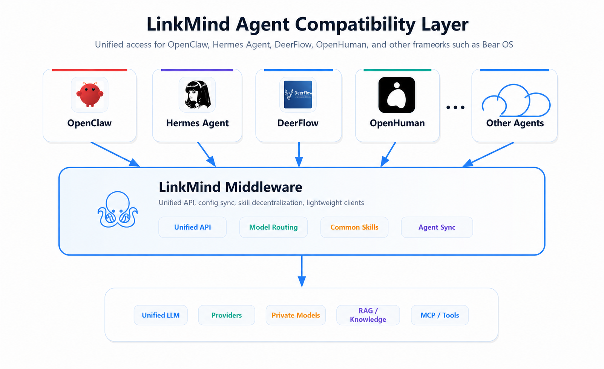
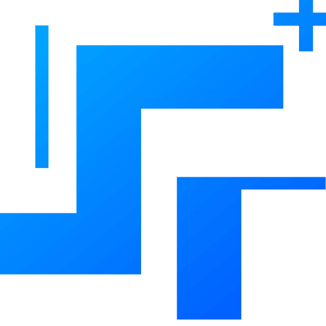
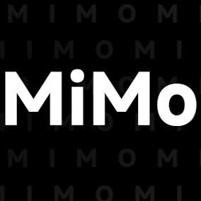
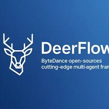
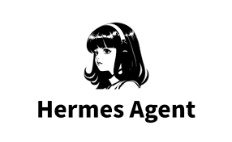
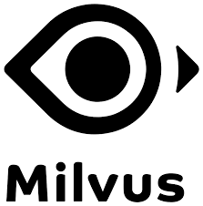
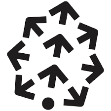
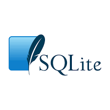

[简体中文](README_zh.md) | English

#  LinkMind

LinkMind is enterprise-grade multimodal AI middleware for teams that need one stable layer between business systems, private knowledge, model providers, and agent runtimes. It focuses on fast onboarding, low-friction integration, routing and failover, RAG, multimodal APIs, and production governance.

## Introduction

The current codebase exposes a single middleware layer for chat, RAG, OCR, ASR/TTS, image and video workflows, text-to-SQL, embeddings, rerank, MCP access, skills, worker orchestration, and APIs compatible with OpenAI Chat Completions / Responses and Anthropic Messages. It also includes runtime sync hooks for OpenClaw, Hermes Agent, DeerFlow, and OpenHuman.


## Why LinkMind

- One middleware layer covers chat, OCR, ASR/TTS, image generation, image and video understanding, text-to-SQL, embeddings, rerank, and document pipelines.
- Multi-model routing, failover, and orchestration are configured centrally in `lagi.yml`, so business systems do not need provider-specific rewrites.
- RAG can connect directly to Chroma, Elasticsearch, Milvus, MySQL, Pinecone, SQLite, and graph-style augmentation paths.
- Medusa cache acceleration, token statistics, filters, and runtime governance are built for real production stability and cost control.
- OpenClaw, Hermes Agent, DeerFlow, and OpenHuman integration hooks make it easier to join existing agent workflows instead of rebuilding them.

  <a href="docs/images/img_25.png">
    
  </a>

## Get Started In Minutes

The following four methods are parallel options. Choose any one of them.

### Option 1. Official Installer

Prerequisite: install **JDK 8 or later** first. If you still need Java setup steps, jump to the [Installation Guide](docs/install_en.md#appendix-install-jdk-8).

- Windows PowerShell

  ```powershell
  iwr -useb https://cdn.linkmind.top/install.ps1 | iex
  ```

- macOS / Linux

  ```bash
  curl -fsSL https://cdn.linkmind.top/install.sh | bash
  ```

LinkMind uses one unified runtime: deploy it as a team AI hub on an appliance, server, personal computer, or Docker. When OpenClaw, Hermes Agent, DeerFlow, OpenHuman, or another supported frontend already exists locally, connect it as an optional integration while retaining configuration synchronization.

### Option 2. Download Packaged Jar

Packaged downloads:

- Application package: `LinkMind.jar` ([Download](https://cdn.linkmind.top/installer/LinkMind.jar))
- Core library: `lagi-core-1.2.0-jar-with-dependencies.jar` ([Download](https://ai.linkmind.top/lagi/lib/lagi-core-1.2.0-jar-with-dependencies.jar))

```powershell
java -jar LinkMind.jar
```

On first run, LinkMind creates `config/`, `data/`, and the default `lagi.yml`. Then open `http://localhost:8080`.

### Option 3. With Docker Image

Prebuilt image: `landingbj/linkmind`

```bash
docker pull landingbj/linkmind
docker run -d -p 8080:8080 landingbj/linkmind
```

Then open `http://localhost:8080`.

### Option 4. Build from Source

```bash
mvn clean package -pl lagi-web -am -DskipTests -U
```

Current packaging generates:

- `lagi-web/target/LinkMind.jar`
- `lagi-web/target/ROOT.war`

More setup details are in the [Installation Guide](docs/install_en.md). For a guided first-run walkthrough, use the [Tutorial](docs/tutor_en.md).

After LinkMind is running, use the [Configuration Guide](docs/config_en.md) to enable providers, routes, filters, RAG, and other runtime settings in `lagi.yml`.

To choose a LinkMind deployment shape by business scenario, see the [Business Scenarios Guide](docs/scenarios_en.md).

## API Surface

LinkMind exposes native routes and protocol-compatible routes:

- Native LinkMind routes without extra version prefixes where the server already supports them, such as `/chat/completions`, `/audio/speech2text`, `/audio/text2speech`, `/image/text2image`, `/sql/text2sql`, `/instruction/generate`, `/doc/doc2ext`, and `/ocr/doc2ocr`
- OpenAI-compatible routes, including Chat Completions at `/v1/chat/completions`, Responses at `/v1/responses`, plus `/v1/models`, `/v1/embeddings`, `/v1/images/generations`, and `/v1/rerank`
- Anthropic Messages-compatible route: `/v1/messages`

One current exception is the vector administration namespace, which is still mapped in code as `/v1/vector/*`. Full endpoint documentation is in the [API Reference](docs/API_en.md).

## Customization API

LinkMind keeps secondary-development entry points behind object-oriented boundaries so teams can extend behavior without rewriting the main request flow.

- `Communication and out-of-band data`: OpenAI-compatible chat requests accept `extra_body`, and runtime helpers handle encoding, decoding, and current-user injection without pushing business parsing into the adapter itself. Existing completion, streaming, and cascade flows remain unchanged.
- `Skill-level social data`: social interaction data is encapsulated in skills and service classes, then exposed through `/socialChannel/*`. If you do not enable social skills, the original chat and token flow stays intact.
- `Authentication, API-key, and billing`: `/user/*`, `/apiKey/*`, and `/credit/*` form the stable HTTP surface for account binding, key-pool management, and charging workflows. You can replace the backing service logic while preserving the external contract.

This split gives two practical benefits for secondary development: zero-invasive integration with the current codebase, and opt-in adoption so you only enable the interfaces your deployment actually needs.

## Agent Runtime Integration

- **OpenClaw**: LinkMind can inject itself as an OpenAI-compatible provider and can also load model selections back from OpenClaw into `lagi.yml`.
- **Hermes Agent**: LinkMind can import and export model settings through `~/.hermes/config.yaml` and `.env`.
- **DeerFlow**: LinkMind can import and export model settings through DeerFlow `config.yaml` and `.env`.
- **OpenHuman**: LinkMind can add a local Bearer-auth `linkmind` provider to OpenHuman `config.toml`, bind the `provider:linkmind` auth profile, store the token in OpenHuman's desktop keychain file when available, and import supported OpenAI-compatible providers back into `lagi.yml`.

For the shortest evaluation path, start LinkMind directly and verify the web console and API. Connect an existing Agent frontend when needed; no product-version switch is required.

## Core Features

### 1. RAG + Embedding

Turn private files, QA pairs, and structured knowledge into retrievable context through vector stores, embeddings, OCR, and document ingestion pipelines.

### 2. Medusa

Use built-in cache acceleration to shorten repeat response latency and improve runtime efficiency in real production traffic.

### 3. Airank

Route, rank, fail over, and orchestrate multiple models centrally through routers such as `best(...)` and `pass(...)` instead of hard-coding provider logic in each app.

### 4. Security & Safety

Centralize guardrails, policy checks, data handling, access control, provider governance, and deployment responsibilities through the [Security & Safety document](docs/security_en.md).

### 5. Graph

Augment retrieval and intent understanding with graph-style context so the middleware can make more stable decisions for complex enterprise knowledge scenarios.

### 6. Token Grid (Cascade Network)

Token Grid connects many LinkMind nodes into a national-power-grid-like intelligence network. In this topology, LinkMind nodes in a multi-level architecture are not passive relay stations. Like cascade hydropower stations, every layer can mount its own "machine-model" capacity, including local models, provider routes, tools, skills, private knowledge, and policy controls. Every node in the grid is both a consumer of upstream capabilities and a provider of compute and domain capability to downstream nodes, while cascade links preserve physical and logical isolation for data and permissions.

<a href="docs/images/token_grid_en.png">
  
</a>

### 7. Agent Framework Support

Use LinkMind as the shared model, context, and governance layer for agent frameworks rather than configuring each model separately in every agent application. The runtime exposes OpenAI Chat Completions / Responses and Anthropic Messages-compatible APIs, so frameworks that use these protocols can connect through a common provider endpoint.

- **Built-in configuration synchronization**: OpenClaw, Hermes Agent, DeerFlow, and OpenHuman can import or export supported model and provider settings.
- **Framework-neutral integration**: Other agent frameworks can use the compatible APIs, `lagi.yml` model routing, MCP, Skills, RAG, and policy controls without requiring a framework-specific plugin.
- **Unified execution**: Workers register and route local business agents and integrated external agent capabilities through one invocation surface.

To integrate these capabilities into your application via `lagi-core` or REST APIs, see the [Integration Guide](docs/guide_en.md).

### 8. Worker Orchestration

Workers provide a unified way to invoke registered agents, supporting explicit agent selection or routing policies that choose a suitable executor. Reuse local business agents and integrated cloud agent platform capabilities for specialized assistants, domain question answering, and task dispatch.

Configure worker implementations and routes under `skills.workers` in `lagi.yml`, then invoke them through `POST /chat/go`. See the [Worker Configuration Guide](https://github.com/landingbj/LinkMind/blob/main/docs/config_en.md#workers) for setup and the [Extension Guide](https://github.com/landingbj/LinkMind/blob/main/docs/extend_en.md) for custom implementations.


## Model And Runtime Ecosystem

**Models & Providers**

<table>
  <tr>
    <td> Azure OpenAI</td>
    <td> Baichuan</td>
    <td> ChatGLM</td>
    <td> Claude</td>
  </tr>
  <tr>
    <td> DeepSeek</td>
    <td> Doubao</td>
    <td> ERNIE</td>
    <td> FastChat / Vicuna</td>
  </tr>
  <tr>
    <td> Gemini</td>
    <td> Grok</td>
    <td> Hunyuan</td>
    <td> iFLYTEK Spark</td>
  </tr>
  <tr>
    <td> MiniMax</td>
    <td> Moonshot / Kimi</td>
    <td> OpenAI</td>
    <td> OpenRouter</td>
  </tr>
  <tr>
    <td> Qwen</td>
    <td> SenseChat</td>
    <td> StepFun</td>
    <td> Xiaomi</td>
  </tr>
</table>

**Local Agent Frameworks**

<table>
  <tr>
    <td> DeerFlow</td>
    <td> Hermes Agent</td>
    <td>OpenHuman</td>
    <td> OpenClaw</td>
  </tr>
</table>

**Cloud Agent Platforms**

<table>
  <tr>
    <td> Coze</td>
    <td> Hunyuan Agents</td>
    <td> Wenxin Agents</td>
    <td> Zhipu Agents</td>
  </tr>
</table>

**Data & Retrieval**

<table>
  <tr>
    <td> Chroma</td>
    <td> Elasticsearch</td>
    <td> Milvus</td>
  </tr>
  <tr>
    <td> MySQL</td>
    <td> Pinecone</td>
    <td> SQLite</td>
  </tr>
</table>

Entries are grouped by type and listed alphabetically. These ecosystems are extensible; the [Extension Guide](docs/extend_en.md) covers writing new model, vector-store, adapter, and secondary-development integrations. For Chroma setup specifics, see the [Annex](docs/annex_en.md).


## Agentic Social

Agentic Social gives agents a structured way to exchange context, user intent, collaboration signals, and social interaction data without forcing that logic into the main chat pipeline. Social data is encapsulated in skills and service classes, then exposed through `/socialChannel/*`, so teams can add agent-to-agent and user-to-agent collaboration features only when their deployment needs them.

<table width="100%">
  <tr>
    <td valign="top" width="50%">
      <h2>License</h2>
      <p>This project is distributed under the <a href="LICENSE">LICENSE</a>.</p>
    </td>
    <td valign="top" width="50%">
      <h2>Online Demo</h2>
        Public&nbsp;demo:&nbsp;<a href="https://linkmind.landingbj.com/">https://linkmind.landingbj.com/</a>
    </td>
  </tr>
</table>

## Documentation

Start with the Installation Guide, then follow the Web UI guide to complete your first conversation. Use the references below for application integration and runtime configuration.

### Getting Started, Configuration, and Development

| Document | Contents |
| --- | --- |
| [Installation Guide](docs/install_en.md) | Installation, startup, deployment options, and first use |
| [Business Scenarios Guide](docs/scenarios_en.md) | Typical use cases and deployment choices |
| [Tutorial](docs/tutor_en.md) | First calls, RAG, model routing, and external agent client integration checks |
| [Configuration Guide](docs/config_en.md) | Models, storage, RAG, agents, MCP, skills, workers, routes, and filters |
| [API Reference](docs/API_en.md) | HTTP endpoints, request parameters, and response examples |
| [Integration Guide](docs/guide_en.md) | Connect applications through the Java SDK or REST APIs |
| [Extension Guide](docs/extend_en.md) | Extend model adapters, storage, agents, skills, workers, and MCP |
| [Security & Safety](docs/security_en.md) | Access control, data handling, tool permissions, and deployment responsibilities |
| [Annex](docs/annex_en.md) | Additional setup for Chroma, vector retrieval, and knowledge ingestion |

### Web UI Reference

| Topic | Contents |
| --- | --- |
| [Web UI Overview](docs/webui/index_en.md) | First-run verification, feature entry points, and the boundary between console use and runtime configuration |
| [Web UI Troubleshooting](docs/webui/troubleshooting_en.md) | Diagnose login, model calls, uploads, knowledge retrieval, and statistics issues |

### Best Practices for AI Agent Projects (English PDFs)

| Document | Topic |
| --- | --- |
| [Part 01](docs/BestPractice/Best-Practice-for-AI-Agents-Project_Part-01_From-Model-Call-to-Reliable-Single-Agent.pdf) | From Model Call to Reliable Single Agent |
| [Part 02](docs/BestPractice/Best-Practice-for-AI-Agents-Project_Part-02_Injecting-Private-Knowledge-without-Retraining.pdf) | Injecting Private Knowledge without Retraining |
| [Part 03](docs/BestPractice/Best-Practice-for-AI-Agents-Project_Part-03_Injecting-Private-Capabilities-with-Skills-Tools-and-MCP.pdf) | Injecting Private Capabilities with Skills, Tools, and MCP |
| [Part 04](docs/BestPractice/Best-Practice-for-AI-Agents-Project_Part-04_Safety-by-Design-Guardrails-Permissions-and-Audit.pdf) | Safety by Design: Guardrails, Permissions, and Audit |
| [Part 05](docs/BestPractice/Best-Practice-for-AI-Agents-Project_Part-05_Routing-Orchestration-and-Multi-Agent-Teamwork.pdf) | Routing, Orchestration, and Multi-Agent Teamwork |
| [Part 06](docs/BestPractice/Best-Practice-for-AI-Agents-Project_Part-06_Agentic-Social-Agents-in-Shared-Human-Contexts.pdf) | Agentic Social: Agents in Shared Human Contexts |
