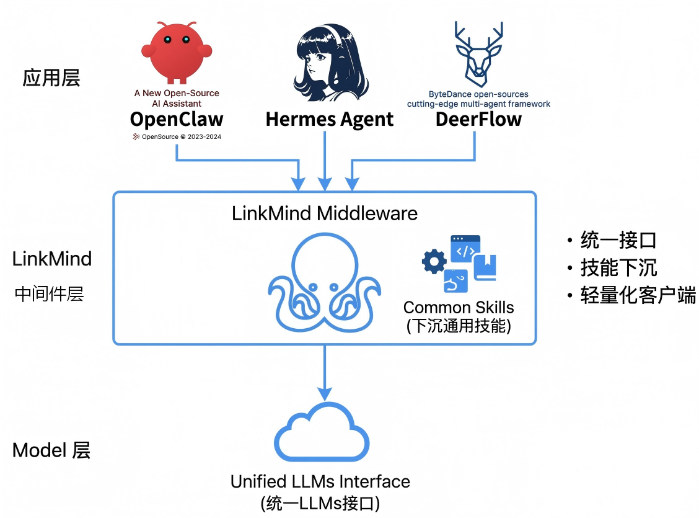
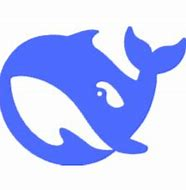
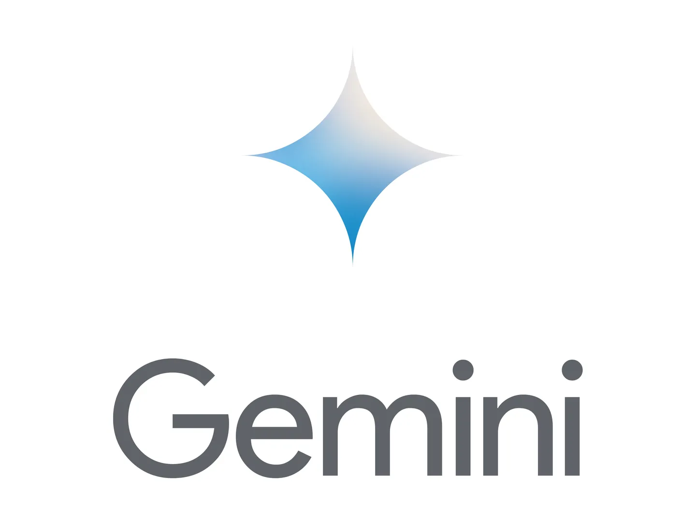
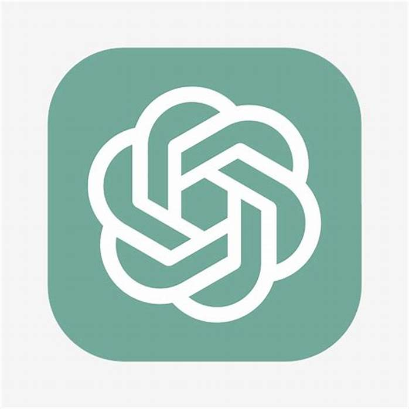
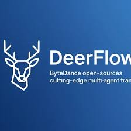

简体中文 | [English](README.md)

#  LinkMind

LinkMind 是面向企业场景的多模态 AI 中间件，用来把业务系统、私有知识、模型厂商和 Agent 运行时统一接到一层可治理、可扩展、可上线的能力层里。它优先解决的是企业真正落地时最常见的几个问题：上手慢、接入碎、成本高、稳定性差。

## 项目简介

当前代码已经覆盖统一聊天入口、RAG、OCR、ASR/TTS、图片与视频能力、文档处理、Text-to-SQL、Embedding、Rerank、MCP、Skills、Worker 编排，以及兼容 OpenAI Chat Completions / Responses 和 Anthropic Messages 的接口。同时，项目还内置了 OpenClaw、Hermes Agent、DeerFlow、OpenHuman 的配置同步能力，便于接入现有 Agent 工作流。


## 为什么选 LinkMind

- 一层中间件同时覆盖聊天、OCR、ASR/TTS、图片生成、图像与视频理解、Text-to-SQL、Embedding、Rerank、文档处理等能力。
- 多模型路由、故障切换和编排统一配置在 `lagi.yml` 中，业务系统不用为不同厂商重复改接口。
- RAG 可以直接接到 Chroma、Elasticsearch、Milvus、MySQL、Pinecone、SQLite 等检索组件，也能继续扩展图谱类增强能力。
- Medusa 缓存加速、Token 统计、过滤器和运行时治理，都是面向真实生产场景的稳定性与成本问题设计的。
- OpenClaw、Hermes Agent、DeerFlow、OpenHuman 的接入钩子已经内置，适合在现有 Agent 工作流里逐步落地。

  <a href="docs/images/img_24.png">
    
  </a>

## 几分钟上手

下面 4 种方式是并列选项，任选其一即可。

### 选项1：官方安装脚本快速安装

前置要求：先安装 **JDK 8 或以上版本**。如果还没装 Java，可直接跳到[安装指南](docs/install_zh.md#附录安装-jdk-8)中的附录。

- Windows PowerShell

  ```powershell
  iwr -useb https://cdn.linkmind.top/install.ps1 | iex
  ```

- macOS / Linux

  ```bash
  curl -fsSL https://cdn.linkmind.top/install.sh | bash
  ```

LinkMind 采用统一运行形态：可作为团队 AI 枢纽部署在硬件盒子、服务器、个人电脑或 Docker 中；若本机已有 OpenClaw、Hermes Agent、DeerFlow、OpenHuman 等前端，可按需接入并保留配置同步能力。

### 选项2：下载并运行 JAR 包

预打包资源：

- 应用文件：`LinkMind.jar`，[点击这里下载](https://cdn.linkmind.top/installer/LinkMind.jar)
- 核心库文件：`lagi-core-1.2.0-jar-with-dependencies.jar`，[点击这里下载](https://ai.linkmind.top/lagi/lib/lagi-core-1.2.0-jar-with-dependencies.jar)

```powershell
java -jar LinkMind.jar
```

首次启动会自动生成 `config/`、`data/` 和默认的 `lagi.yml`，随后访问 `http://localhost:8080` 即可。

### 选项3：使用 Docker 镜像

镜像名称：`landingbj/linkmind`

```bash
docker pull landingbj/linkmind
docker run -d -p 8080:8080 landingbj/linkmind
```

启动后访问 `http://localhost:8080`。

### 选项4：从源码编译

```bash
mvn clean package -pl lagi-web -am -DskipTests -U
```

当前打包结果为：

- `lagi-web/target/LinkMind.jar`
- `lagi-web/target/ROOT.war`

更完整的安装说明见 [安装指南](docs/install_zh.md)。如需跟着示例一步步跑通，请参考[教学演示](docs/tutor_zh.md)。

启动 LinkMind 后，可继续查看 [配置指南](docs/config_zh.md)，启用 `lagi.yml` 中的模型、路由、过滤器、RAG 等运行配置。

如果需要按业务场景选择 LinkMind 形态，请查看 [业务场景指南](docs/scenarios_zh.md)。

## 接口风格

LinkMind 提供原生路由和协议兼容路由：

- LinkMind 原生路由，例如 `/chat/completions`、`/audio/speech2text`、`/audio/text2speech`、`/image/text2image`、`/sql/text2sql`、`/instruction/generate`、`/doc/doc2ext`、`/ocr/doc2ocr`
- OpenAI 兼容路由，包括 Chat Completions `/v1/chat/completions`、Responses `/v1/responses`，以及 `/v1/models`、`/v1/embeddings`、`/v1/images/generations`、`/v1/rerank`
- Anthropic Messages 兼容路由：`/v1/messages`

当前有一个仍按代码映射保留在 `/v1` 命名空间下的例外：向量管理接口 `/v1/vector/*`。完整的接口文档见 [API 参考](docs/API_zh.md)。

## 二次开发接口

LinkMind 将二次开发能力放在清晰的面向对象边界之后，便于在不改动主流程的前提下扩展业务能力。

- `通讯层与带外数据`：OpenAI 兼容请求支持 `extra_body`，运行时通过专门的工具类完成编码、解码和当前用户注入，不把业务解析逻辑塞进 Adapter 主链路，因此不会影响既有补全、流式输出和级联调用。
- `Skill 层社交数据`：社交交互数据封装在 Skill 与 Service 内部，并通过 `/socialChannel/*` 对外暴露。如果不启用社交 Skill，原有聊天流程和 Token 路径保持不变。
- `认证、API Key 与计费`：`/user/*`、`/apiKey/*`、`/credit/*` 构成稳定的对外接口层，用于账号绑定、Key 池管理和计费流程接入，业务方可以替换后端实现而不改变接口协议。

这种分层方式让二开具备两个直接优势：对现有代码零侵入，以及按需启用。你可以只接入自己需要的接口，而不必重写整套运行时。

## Agent 运行时集成

- **OpenClaw**：可以把 LinkMind 注入为 OpenAI 兼容 Provider，也可以把 OpenClaw 的模型选择反向同步回 `lagi.yml`
- **Hermes Agent**：可以通过 `~/.hermes/config.yaml` 和 `.env` 导入导出模型配置
- **DeerFlow**：可以通过 DeerFlow 的 `config.yaml` 和 `.env` 导入导出模型配置
- **OpenHuman**：可以把带 Bearer 鉴权的 LinkMind 写入 OpenHuman `config.toml` 的 `linkmind` provider，绑定 `provider:linkmind` 鉴权 profile，并在 OpenHuman 桌面端 keychain 文件可用时写入 LinkMind token；也可以把支持的 OpenAI 兼容 provider 反向导入 `lagi.yml`

首次评估可直接启动 LinkMind 跑通控制台与 API；需要时再接入现有 Agent 前端，不需要切换产品版本。

## 核心功能

### 1. RAG + Embedding

把私有文档、问答对和结构化知识转成可检索上下文，通过向量库、Embedding、OCR 与文档处理流水线支撑真实知识库问答。

### 2. Medusa

通过内置缓存加速层缩短重复请求的响应时间，让模型运行在真实业务流量下更稳、更快。

### 3. Airank（路由与编排）

利用 `best(...)`、`pass(...)` 等路由规则统一完成多模型选择、排序、故障切换与编排，而不是把厂商逻辑散落在各个业务系统里。

### 4. 安全与合规

通过[安全与合规文档](docs/security_zh.md)集中说明安全围栏、策略检查、数据处理、访问控制、模型提供方治理与部署责任边界。

### 5. Graph

在向量检索之外补充图谱类上下文增强和意图理解能力，适合更复杂的企业知识与推理场景。

### 6. Token Grid（级联网络）

Token Grid 把多个 LinkMind 节点连接成类似“国家电网”的智能网络。在这套网络里，多级架构中的各级 LinkMind 节点并非仅仅是中转站。它更像梯级水电站，每一层都可以挂载自己的“机模”，包括本地模型、厂商路由、工具、技能、私有知识库和策略控制。全网所有节点既是上游能力的消费者，也是向下游输出算力与领域能力的提供者，同时通过级联链路保障数据和权限的物理与逻辑隔离。

<a href="docs/images/token_grid_zh.png">
  
</a>

### 7. OpenClaw 插件

把 LinkMind 作为 OpenClaw 生态里可插拔、兼容 OpenAI 的上下文层与 Provider 层来接入，而不是逐个模型分散配置。

如需将这些能力通过 `lagi-core` 或 REST API 接入到业务系统，请继续阅读[开发集成指南](docs/guide_zh.md)。

### 8. Worker 编排

通过 Worker 统一组织已注册 Agent 的调用，支持指定目标 Agent，或结合路由策略选择合适的执行者。可复用本地业务 Agent 和已接入的云端 Agent 平台能力，适用于多业务助手统一接入、领域问答和任务分发等场景。

在 `lagi.yml` 的 `skills.workers` 中配置 Worker 实现与路由，业务系统通过 `POST /chat/go` 发起调用。配置方式见 [Worker 配置指南](https://github.com/landingbj/LinkMind/blob/main/docs/config_zh.md#workers)，自定义扩展见[扩展开发文档](https://github.com/landingbj/LinkMind/blob/main/docs/extend_zh.md)。

## 模型与运行时生态

**模型与提供方**

<table>
  <tr>
    <td> Azure OpenAI</td>
    <td> Baichuan</td>
    <td> ChatGLM</td>
    <td> Claude</td>
  </tr>
  <tr>
    <td> DeepSeek</td>
    <td> Doubao</td>
    <td> ERNIE</td>
    <td> FastChat / Vicuna</td>
  </tr>
  <tr>
    <td> Gemini</td>
    <td> Grok</td>
    <td> Hunyuan</td>
    <td> iFLYTEK Spark</td>
  </tr>
  <tr>
    <td> MiniMax</td>
    <td> Moonshot / Kimi</td>
    <td> OpenAI</td>
    <td> OpenRouter</td>
  </tr>
  <tr>
    <td> Qwen</td>
    <td> SenseChat</td>
    <td> StepFun</td>
    <td> Xiaomi</td>
  </tr>
</table>

**本地 Agent 框架**

<table>
  <tr>
    <td> DeerFlow</td>
    <td> Hermes Agent</td>
    <td>OpenHuman</td>
    <td> OpenClaw</td>
  </tr>
</table>

**云端 Agent 平台**

<table>
  <tr>
    <td> Coze</td>
    <td> Hunyuan Agents（混元智能体）</td>
    <td> Wenxin Agents（文心智能体）</td>
    <td> Zhipu Agents（智谱智能体）</td>
  </tr>
</table>

**Data & Retrieval（数据与检索）**

<table>
  <tr>
    <td> Chroma</td>
    <td> Elasticsearch</td>
    <td> Milvus</td>
  </tr>
  <tr>
    <td> MySQL</td>
    <td> Pinecone</td>
    <td> SQLite</td>
  </tr>
</table>

以上条目按类型分组，并按英文名称字母顺序排列。新增模型、向量库、适配器或二次开发接口的方式见[扩展开发文档](docs/extend_zh.md)。Chroma 的具体安装与补充说明见[附件](docs/annex_zh.md)。

## Agentic Social（智能体社交）

Agentic Social 为智能体提供结构化的上下文交换、用户意图传递、协作信号和社交交互数据通道，而不是把这些逻辑硬塞进主聊天链路。社交数据封装在 Skill 与 Service 内部，并通过 `/socialChannel/*` 对外暴露，团队可以按需启用智能体之间、用户与智能体之间的协作能力。

<table width="100%">
  <tr>
    <td valign="top" width="50%">
      <h2>License</h2>
      <p>本项目遵循 <a href="LICENSE">LICENSE</a>。</p>
    </td>
    <td valign="top" width="50%">
      <h2>演示参看</h2>
      <p>演示地址：<a href="https://linkmind.landingbj.com/">https://linkmind.landingbj.com/</a></p>
    </td>
  </tr>
</table>

## 详细文档导航

首次使用建议先阅读安装指南，再按 Web UI 指南完成第一次对话；开发接入和运行配置可按下表查阅。

### 入门、配置与开发

| 文档 | 内容 |
| --- | --- |
| [安装指南](docs/install_zh.md) | 安装、启动、部署方式与首次使用 |
| [业务场景指南](docs/scenarios_zh.md) | 典型业务场景与部署选择 |
| [教学演示](docs/tutor_zh.md) | 从首次调用到 RAG、模型路由及外部 Agent 客户端接入验证 |
| [配置指南](docs/config_zh.md) | 模型、存储、RAG、Agent、MCP、Skills、Workers、路由与过滤器 |
| [API 参考](docs/API_zh.md) | HTTP 接口、请求参数与响应示例 |
| [开发集成指南](docs/guide_zh.md) | 通过 Java SDK 或 REST API 接入业务系统 |
| [扩展开发文档](docs/extend_zh.md) | 扩展模型适配器、存储、Agent、Skills、Workers 与 MCP |
| [安全与合规](docs/security_zh.md) | 访问控制、数据处理、工具权限与部署责任边界 |
| [附件与补充说明](docs/annex_zh.md) | Chroma、向量检索与知识入库的补充配置 |

### Web UI 使用指南

| 专题 | 内容 |
| --- | --- |
| [使用 Web UI](docs/webui/index_zh.md) | 首次对话、菜单导航与适用版本 |
| [模型与 API 密钥](docs/webui/models_zh.md) | 添加和管理密钥、选择模型与确认配置生效 |
| [聊天与多模态](docs/webui/chat_zh.md) | 文本、语音、图片、视频及附件格式和大小限制 |
| [智能体](docs/webui/agents_zh.md) | 选择智能体、导入历史对话与继续任务 |
| [知识与文档](docs/webui/knowledge_zh.md) | 上传学习文件、生成指令集与核对回答来源 |
| [用量与日志](docs/webui/monitoring_zh.md) | Token 用量、调用日志、过滤记录与费用估算 |
| [互动与级联](docs/webui/interaction_zh.md) | 频道订阅、消息监控、频道管理与级联设置 |
| [设置与额度](docs/webui/settings_zh.md) | 安全规则、余额充值、登录退出与界面语言 |
| [常见问题](docs/webui/troubleshooting_zh.md) | 登录、模型调用、上传、知识检索与统计问题排查 |

### Agent 项目最佳实践（英文 PDF）

| 文档 | 主题 |
| --- | --- |
| [Part 01](docs/BestPractice/Best-Practice-for-AI-Agents-Project_Part-01_From-Model-Call-to-Reliable-Single-Agent.pdf) | 从模型调用到可靠的单 Agent |
| [Part 02](docs/BestPractice/Best-Practice-for-AI-Agents-Project_Part-02_Injecting-Private-Knowledge-without-Retraining.pdf) | 无需重新训练的私有知识接入 |
| [Part 03](docs/BestPractice/Best-Practice-for-AI-Agents-Project_Part-03_Injecting-Private-Capabilities-with-Skills-Tools-and-MCP.pdf) | 通过 Skills、Tools 与 MCP 接入私有能力 |
| [Part 04](docs/BestPractice/Best-Practice-for-AI-Agents-Project_Part-04_Safety-by-Design-Guardrails-Permissions-and-Audit.pdf) | 安全围栏、权限与审计 |
| [Part 05](docs/BestPractice/Best-Practice-for-AI-Agents-Project_Part-05_Routing-Orchestration-and-Multi-Agent-Teamwork.pdf) | 路由、编排与多 Agent 协作 |
| [Part 06](docs/BestPractice/Best-Practice-for-AI-Agents-Project_Part-06_Agentic-Social-Agents-in-Shared-Human-Contexts.pdf) | 共享人类上下文中的智能体社交 |
