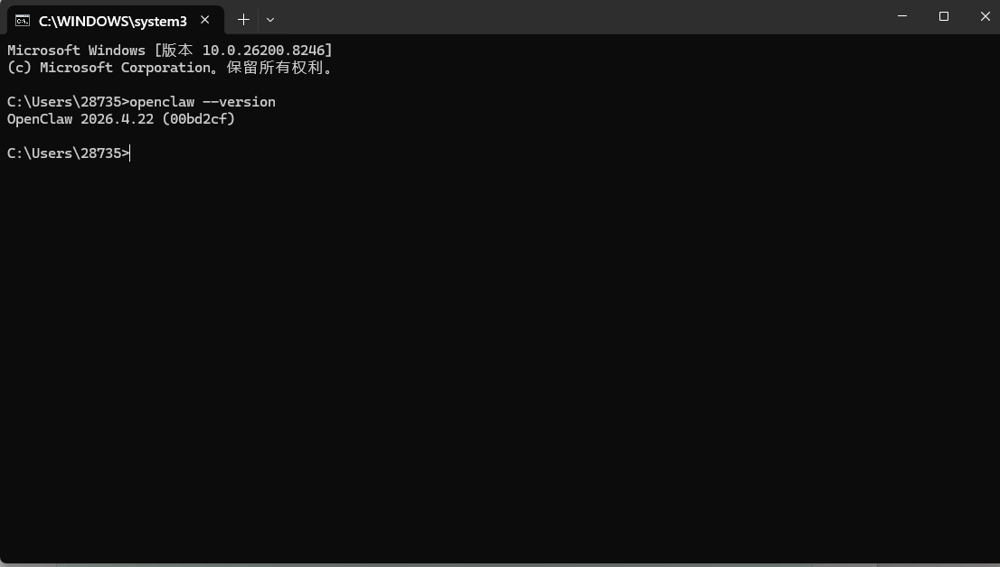
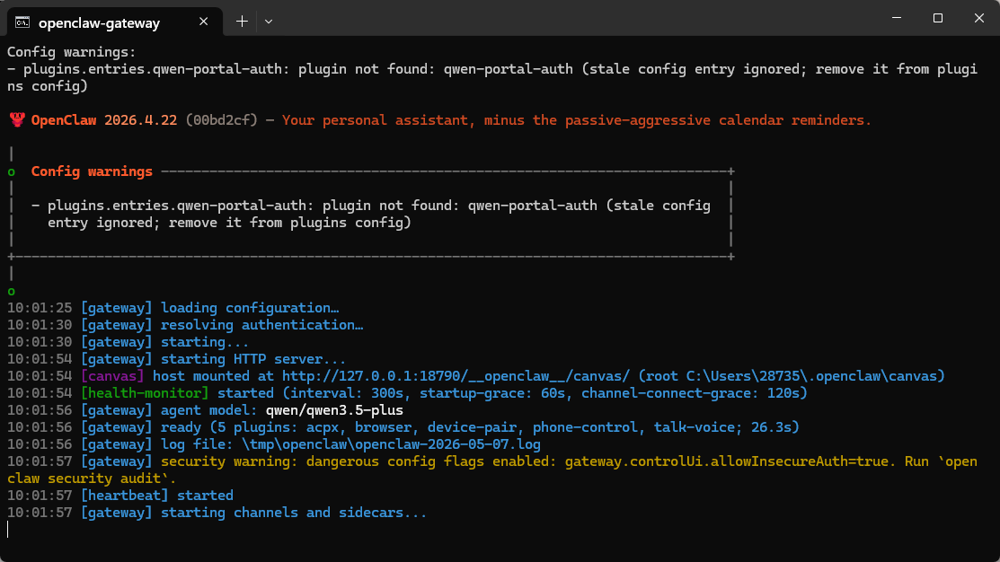

# Agent Runtime Integration Cookbook

This cookbook contains operational setup and verification steps for connecting LinkMind to Agent clients. Keep the product overview in the [Tutorial](../tutor_en.md); use this document when you need to install, configure, or troubleshoot a specific client.

## Shared Prerequisites

1. Start LinkMind and verify `http://localhost:8080`.
2. Enable at least one chat route and create a LinkMind API key.
3. Use `http://localhost:8080/v1` as the OpenAI-compatible base URL when the client runs on the same machine.
4. If the client runs in WSL or another host, use a reachable LinkMind host address instead of `localhost`, and expose only the required trusted-network port.

## OpenClaw

### Install or verify

Open PowerShell and verify the prerequisites:

```powershell
node -v
git -v
Set-ExecutionPolicy -ExecutionPolicy RemoteSigned -Scope CurrentUser
```

Install OpenClaw when it is not already present, then start its gateway:

```powershell
iwr -useb https://openclaw.ai/install.ps1 | iex
openclaw --version
openclaw gateway start
```

Open `http://127.0.0.1:18789`. In the OpenClaw console, select LinkMind as the middleware, switch to `linkmind-Pro` or the model synchronized by the installer, and send a test message. Confirm that the response appears in OpenClaw and that LinkMind records the call.





## Hermes Agent

Verify that the command is available:

```powershell
where.exe hermes
hermes --version
hermes status
```

Configure Hermes with a custom provider in `config.yaml`:

```yaml
model:
  default: Alibaba/qwen-plus
  provider: custom
  base_url: http://localhost:8080/v1
  api_key: <your-linkmind-api-key>
  api_mode: chat_completions
  context_length: 64000
```

Restart the Hermes session and send a message. For WSL, replace `localhost` with the reachable Windows-host address.

## DeerFlow

DeerFlow requires Python 3.12+, Node.js 22+, `uv`, `pnpm`, and its project dependencies. Use an absolute path without spaces where possible.

```bash
git clone https://github.com/bytedance/deer-flow.git
cd deer-flow
pip install uv
make config
make check
make install
make dev
```

Configure a LinkMind model in DeerFlow `config.yaml`:

```yaml
models:
  - name: "linkmind-qwen-plus"
    display_name: "LinkMind Qwen Plus"
    use: "deerflow.models.linkmind_provider:LinkMindChatModel"
    model: "Alibaba/qwen-plus"
    api_key: "$LINKMIND_API_KEY"
    base_url: "http://localhost:8080/v1"
    request_timeout: 600.0
    max_retries: 2
    max_tokens: 4096
    disable_streaming: true
```

Put the API key in `.env`, start the Gateway and frontend, then open `http://localhost:3000/workspace/chats/new`. Select the LinkMind model and verify a response.

## OpenHuman

Install the official OpenHuman desktop release and launch it once. During LinkMind setup, choose the OpenHuman integration or supply its `config.toml` path. LinkMind can discover the active configuration through `OPENHUMAN_WORKSPACE`, `~/.openhuman/active_user.toml`, or the local-user configuration.

The configured provider should use the LinkMind endpoint and Bearer authentication:

```toml
[[cloud_providers]]
id = "p_linkmind_linkmind"
slug = "linkmind"
label = "LinkMind"
endpoint = "http://127.0.0.1:8080/v1"
auth_style = "bearer"
default_model = "Alibaba/qwen3.6-plus"
```

Restart OpenHuman after the configuration changes, send a message, and confirm a `/v1/chat/completions` request appears in LinkMind.

## Common Verification

The integration is complete only when all of the following hold:

- The client returns a model response.
- LinkMind has a corresponding call log or token record.
- The selected LinkMind route and API key are active.
- Credit or usage information changes when billing is enabled.

For supported configuration keys and protocol-specific settings, see the [Configuration Reference](../config_en.md).
