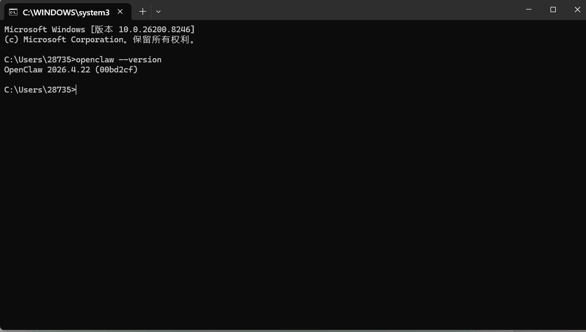
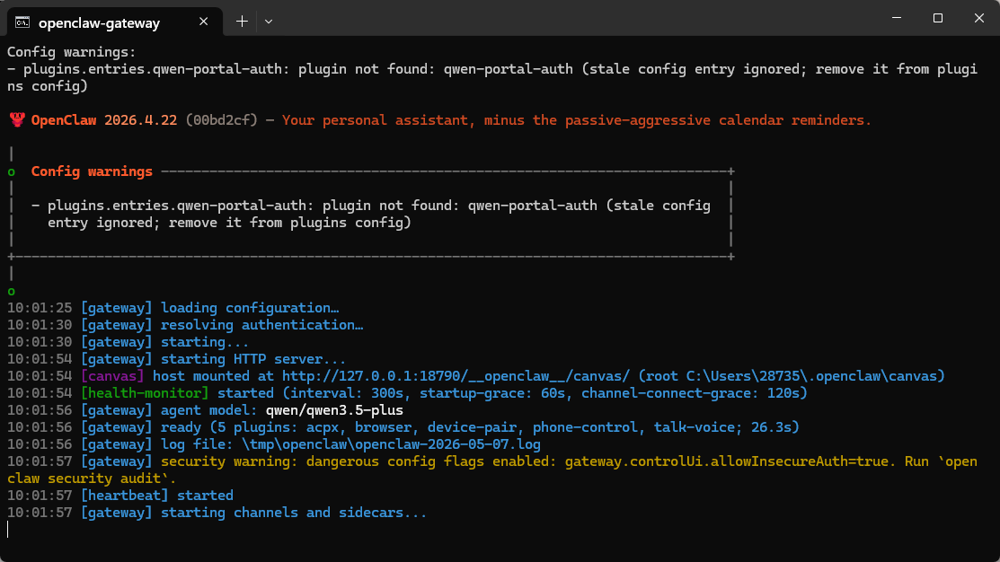

# Agent 客户端接入实操

本文放置 OpenClaw、Hermes Agent、DeerFlow、OpenHuman 的安装、配置和验证步骤。产品能力概览请看[教学演示](../tutor_zh.md)；需要实际安装或排查某个客户端时，以本文为准。

## 通用前提

1. 启动 LinkMind，并确认可访问 `http://localhost:8080`。
2. 至少启用一条聊天路由，并创建可供客户端使用的 LinkMind API Key。
3. 客户端与 LinkMind 在同一台机器时，使用 OpenAI 兼容地址 `http://localhost:8080/v1`。
4. 客户端位于 WSL 或另一台主机时，改用可达的 LinkMind 主机地址；只在可信网络中开放必要端口。

## OpenClaw

### 安装或核验

在 PowerShell 中确认前置环境：

```powershell
node -v
git -v
Set-ExecutionPolicy -ExecutionPolicy RemoteSigned -Scope CurrentUser
```

未安装 OpenClaw 时，执行官方安装脚本；随后核验版本并启动 Gateway：

```powershell
iwr -useb https://openclaw.ai/install.ps1 | iex
openclaw --version
openclaw gateway start
```

打开 `http://127.0.0.1:18789`。在 OpenClaw 控制台选择 LinkMind 中间件，切换到 `linkmind-Pro` 或安装器同步出的模型，发送测试消息。确认 OpenClaw 正常返回，并在 LinkMind 中看到对应调用记录。





## Hermes Agent

先确认命令可用：

```powershell
where.exe hermes
hermes --version
hermes status
```

在 `config.yaml` 中配置 custom provider：

```yaml
model:
  default: Alibaba/qwen-plus
  provider: custom
  base_url: http://localhost:8080/v1
  api_key: <你的-linkmind-api-key>
  api_mode: chat_completions
  context_length: 64000
```

重启 Hermes 会话后发送一条测试消息。若 Hermes 位于 WSL，请将 `localhost` 改为 WSL 可访问的 Windows 主机地址。

## DeerFlow

DeerFlow 需要 Python 3.12+、Node.js 22+、`uv`、`pnpm` 及项目依赖。建议使用不含空格的绝对路径。

```bash
git clone https://github.com/bytedance/deer-flow.git
cd deer-flow
pip install uv
make config
make check
make install
make dev
```

在 DeerFlow `config.yaml` 中加入 LinkMind 模型：

```yaml
models:
  - name: "linkmind-qwen-plus"
    display_name: "LinkMind Qwen Plus"
    use: "deerflow.models.linkmind_provider:LinkMindChatModel"
    model: "Alibaba/qwen-plus"
    api_key: "$LINKMIND_API_KEY"
    base_url: "http://localhost:8080/v1"
    request_timeout: 600.0
    max_retries: 2
    max_tokens: 4096
    disable_streaming: true
```

把 API Key 放入 `.env`，启动 Gateway 和前端后访问 `http://localhost:3000/workspace/chats/new`，选择 LinkMind 模型并验证返回内容。

## OpenHuman

安装 OpenHuman 官方桌面版并至少启动一次。配置 LinkMind 时选择 OpenHuman 集成，或提供其 `config.toml` 路径。LinkMind 可通过 `OPENHUMAN_WORKSPACE`、`~/.openhuman/active_user.toml` 或本地用户配置定位活动配置。

Provider 应使用 LinkMind 地址与 Bearer 鉴权：

```toml
[[cloud_providers]]
id = "p_linkmind_linkmind"
slug = "linkmind"
label = "LinkMind"
endpoint = "http://127.0.0.1:8080/v1"
auth_style = "bearer"
default_model = "Alibaba/qwen3.6-plus"
```

修改配置后重启 OpenHuman，发送消息，并在 LinkMind 中确认出现 `/v1/chat/completions` 请求。

## 统一验证口径

完成接入需同时满足：

- 客户端正常返回模型回复。
- LinkMind 出现对应调用日志或 Token 记录。
- 选定的 LinkMind 路由和 API Key 均已启用。
- 开启计费时，额度或用量数据随请求更新。

协议与配置项详见[配置参考](../config_zh.md)。
