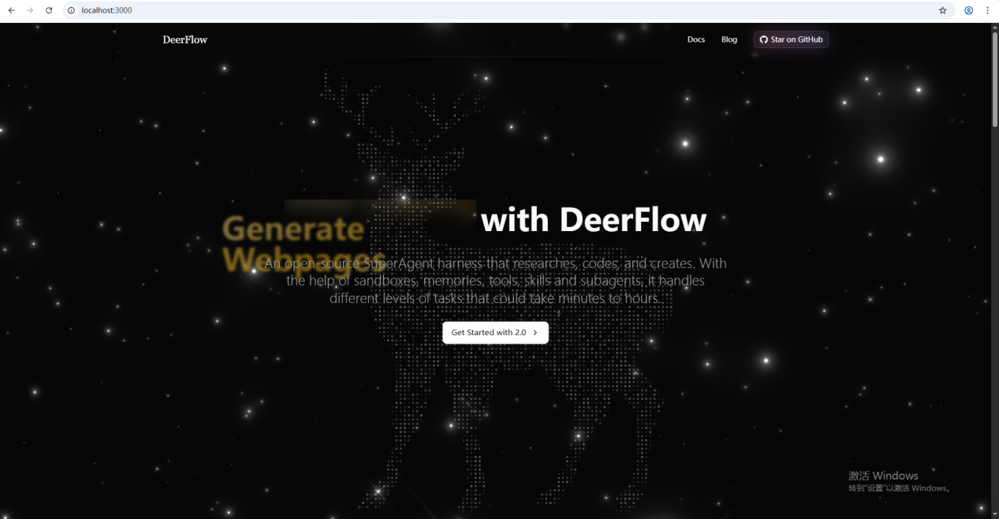
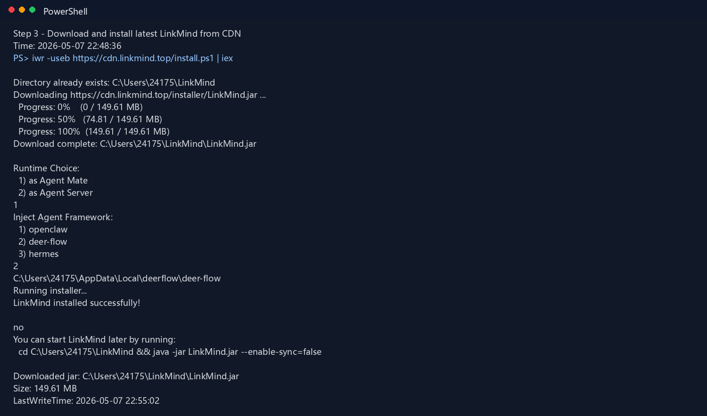
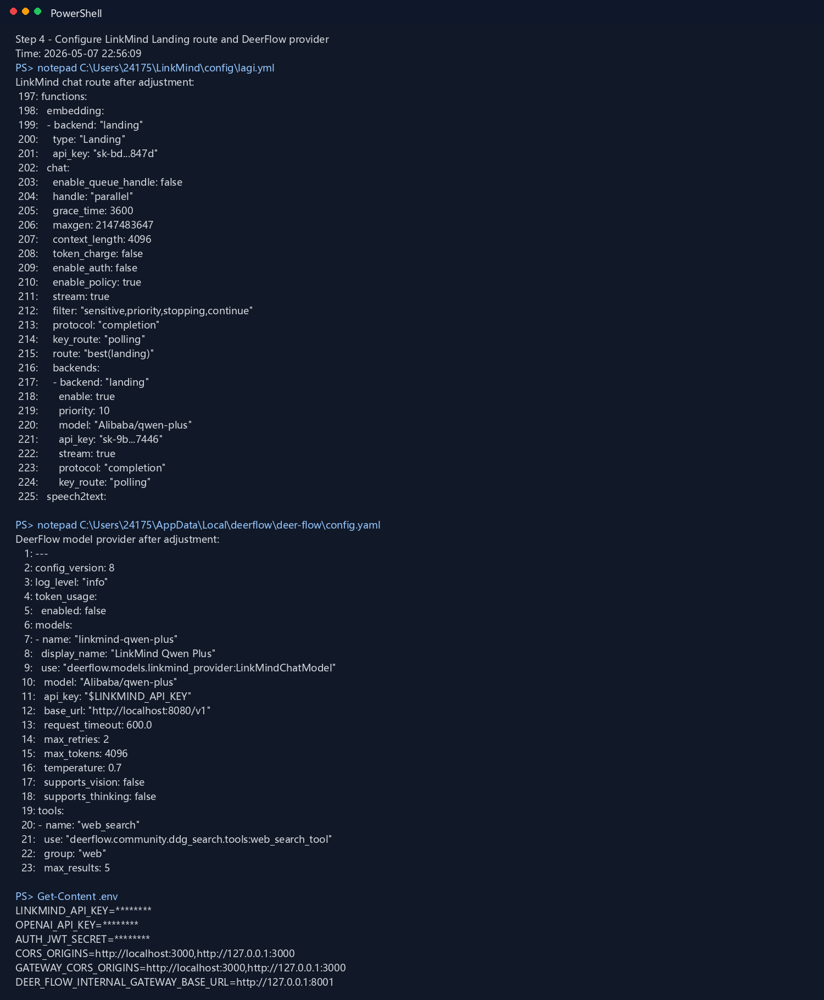
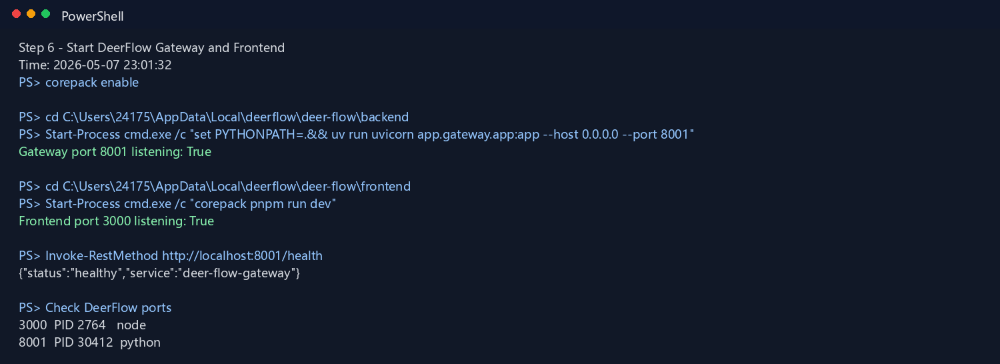
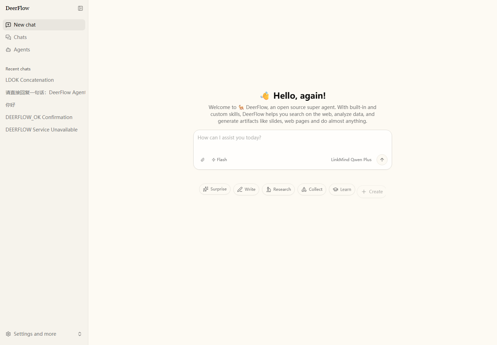
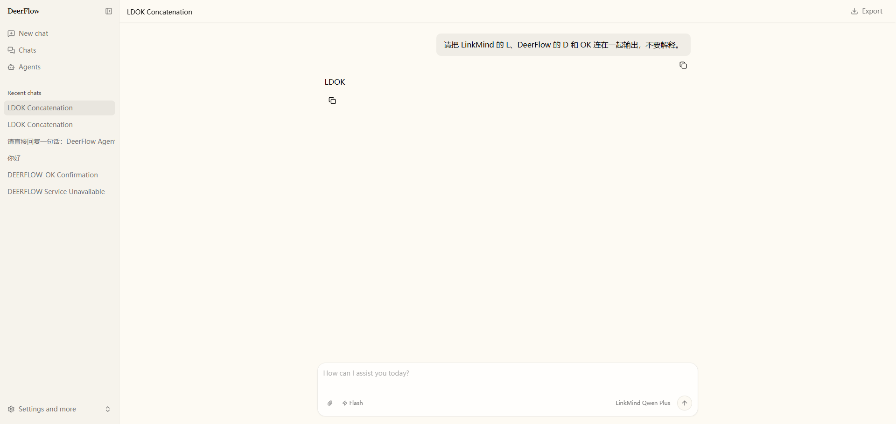
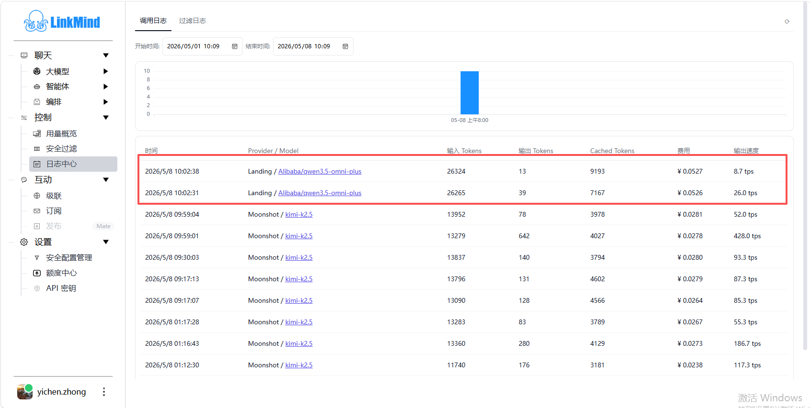

# DeerFlow 接入 LinkMind

[中文](#zh-cn) · [English](#english)

<a id="zh-cn"></a>

本页按“安装 -> 配置 -> 启动 -> 对话验证”的顺序完成 DeerFlow 接入。完成后 DeerFlow Gateway 将通过 LinkMind 调用模型。

## 一、准备 DeerFlow 运行环境

DeerFlow 需要 Python 3.12+、Node.js 22+、`uv`、`pnpm` 与项目依赖。建议将项目放在不含中文或空格的绝对路径。

```bash
python --version
node -v
pip install uv
git clone https://github.com/bytedance/deer-flow.git
cd deer-flow
make config
make check
make install
make dev
```

Windows 没有 `make` 时，可按 DeerFlow 自身说明分别在后端执行 `uv sync`、在前端执行 `pnpm install`。



## 二、准备 LinkMind

在 LinkMind 中先完成三项检查：

1. `http://localhost:8080` 可打开控制台。
2. **设置 -> API 密钥** 中存在已启用的客户端 API Key。
3. 目标聊天模型在 LinkMind 控制台可先完成一条短对话。

安装 LinkMind 时可选择 DeerFlow Agent 前端接入，并填写 DeerFlow 项目绝对路径；也可以手动完成以下配置。



## 三、配置 DeerFlow 模型和环境变量

在 DeerFlow `config.yaml` 中加入 LinkMind 模型：

```yaml
models:
  - name: "linkmind-qwen-plus"
    display_name: "LinkMind Qwen Plus"
    use: "deerflow.models.linkmind_provider:LinkMindChatModel"
    model: "Alibaba/qwen-plus"
    api_key: "$LINKMIND_API_KEY"
    base_url: "http://localhost:8080/v1"
    request_timeout: 600.0
    max_retries: 2
    max_tokens: 4096
    temperature: 0.7
    supports_vision: false
    supports_thinking: false
    disable_streaming: true
```

在 DeerFlow `.env` 中只保存变量名和本地开发地址，不提交真实 Key：

```env
LINKMIND_API_KEY=<your-linkmind-api-key>
CORS_ORIGINS=http://localhost:3000,http://127.0.0.1:3000
GATEWAY_CORS_ORIGINS=http://localhost:3000,http://127.0.0.1:3000
DEER_FLOW_INTERNAL_GATEWAY_BASE_URL=http://127.0.0.1:8001
```

LinkMind 与 DeerFlow 不在同一主机时，将 `base_url` 更换为 DeerFlow 实际可访问的 LinkMind 地址。



## 四、启动 Gateway 与前端

示例中 Gateway 监听 `8001`，前端监听 `3000`：

```powershell
cd D:\workspace\deer-flow\backend
$env:PYTHONPATH = "."
uv run uvicorn app.gateway.app:app --host 0.0.0.0 --port 8001

cd D:\workspace\deer-flow\frontend
corepack pnpm run dev
```



打开 `http://localhost:3000/workspace/chats/new`，选择 **LinkMind Qwen Plus** 并发起对话。





## 五、验证闭环与排查

接入成功需要同时确认：DeerFlow 页面出现助手回复；LinkMind **控制** 出现同一时间的新调用；开启计费时，Token 或额度记录变化。



没有回复时，依次检查 DeerFlow `config.yaml` 中的 `use`、模型 ID、`base_url`、`.env` 的 Key 是否被实际加载，接着在 LinkMind 控制台直接验证该模型，再检查 Gateway 日志和 LinkMind 调用日志。

<a id="english"></a>

## English

Start LinkMind, enable the model and route, and send a short chat in its console first. Use a LinkMind client key for the external runtime. Set the endpoint to a host reachable from that runtime.

DeerFlow requires Python 3.12+, Node.js 22+, `uv`, `pnpm`, and its project dependencies. Use an absolute path without spaces where possible.

```bash
git clone https://github.com/bytedance/deer-flow.git
cd deer-flow
pip install uv
make config
make check
make install
make dev
```

Configure a LinkMind model in DeerFlow `config.yaml`:

```yaml
models:
  - name: "linkmind-qwen-plus"
    display_name: "LinkMind Qwen Plus"
    use: "deerflow.models.linkmind_provider:LinkMindChatModel"
    model: "Alibaba/qwen-plus"
    api_key: "$LINKMIND_API_KEY"
    base_url: "http://localhost:8080/v1"
    request_timeout: 600.0
    max_retries: 2
    max_tokens: 4096
    temperature: 0.7
    supports_vision: false
    supports_thinking: false
    disable_streaming: true
```

Put the API key in `.env`, start the Gateway and frontend, then open `http://localhost:3000/workspace/chats/new`. Select the LinkMind model and verify a response.

For a local gateway and frontend, set the following in the local `.env`. Supply the client key privately.

```env
LINKMIND_API_KEY=<your-linkmind-api-key>
CORS_ORIGINS=http://localhost:3000,http://127.0.0.1:3000
GATEWAY_CORS_ORIGINS=http://localhost:3000,http://127.0.0.1:3000
DEER_FLOW_INTERNAL_GATEWAY_BASE_URL=http://127.0.0.1:8001
```

For the Windows source layout below run the backend and frontend commands in separate terminals. Adapt the checkout directory and verify that the installed DeerFlow integration provides `deerflow.models.linkmind_provider`.

```powershell
cd D:\workspace\deer-flow\backend
$env:PYTHONPATH = "."
uv run uvicorn app.gateway.app:app --host 0.0.0.0 --port 8001

cd D:\workspace\deer-flow\frontend
corepack pnpm run dev
```

Confirm the reply in DeerFlow and the same model and request in LinkMind **Control**.


