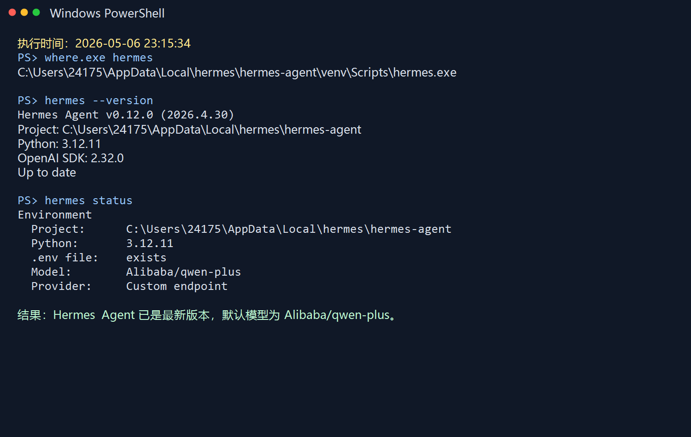
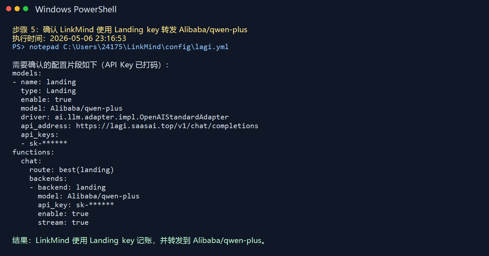
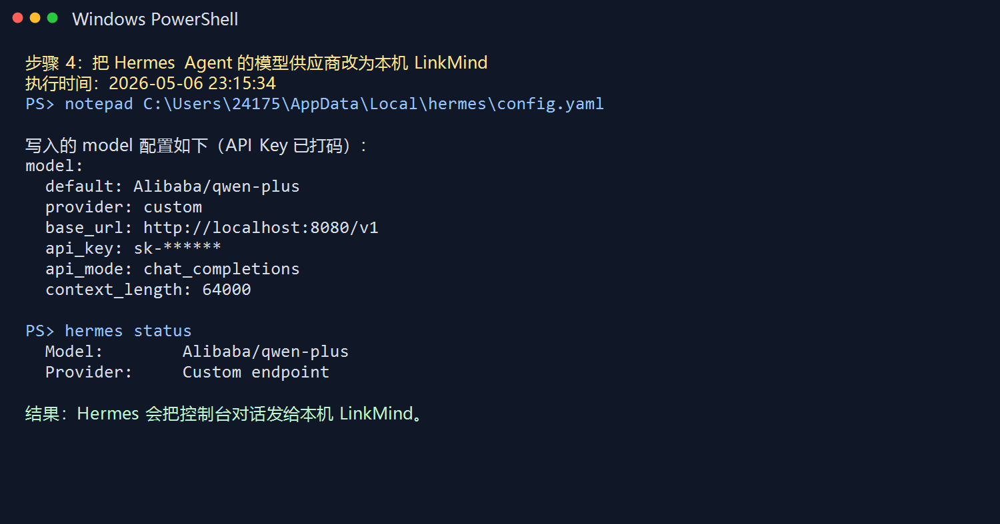
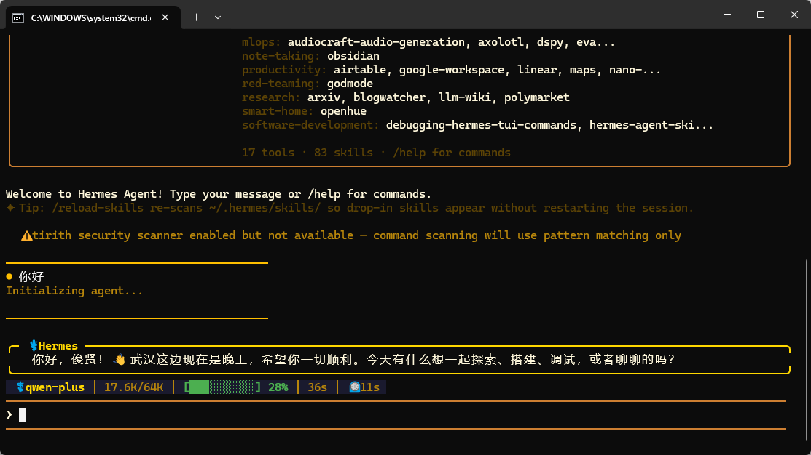
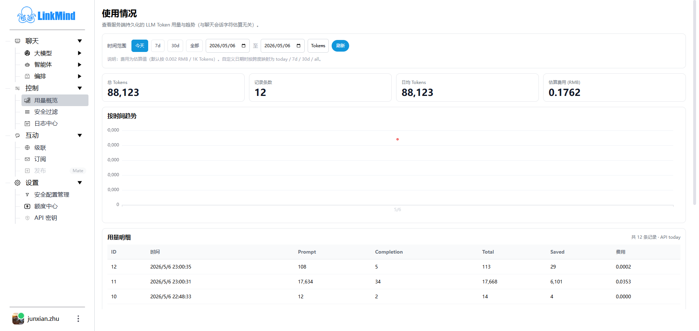

# Hermes Agent 接入 LinkMind

[中文](#zh-cn) · [English](#english)

<a id="zh-cn"></a>

本页说明如何把 Hermes Agent 的 custom provider 指向 LinkMind，并完成本机或 WSL 场景的验证。

## 一、前置条件与网络选择

先确认 Hermes 已安装且 LinkMind 已启动：

```powershell
where.exe hermes
hermes --version
hermes status
```



- Hermes 与 LinkMind 在同一 Windows 主机时，使用 `http://localhost:8080/v1`。
- Hermes 在 WSL、虚拟机或另一台主机时，使用该环境可访问的 Windows 主机地址，例如 `http://<windows-host-ip>:8080/v1`。
- 跨主机场景需要让 LinkMind 监听可信网卡，并检查 Windows 防火墙；不要将开发端口直接暴露到公网。

## 二、准备 LinkMind 路由与 Key

在 LinkMind 控制台确认：目标模型可在 **聊天** 中完成一次短对话；用于 Hermes 的 API Key 已在 **设置 -> API 密钥** 中启用；对应 Provider 和聊天后端均为启用状态。

手工配置时，至少要有已启用的 `functions.chat.backends` 项和匹配的 `route`。例如：

```yaml
functions:
  chat:
    route: pass(landing)
    backends:
      - backend: landing
        model: Alibaba/qwen-plus
        enable: true
        stream: true
        protocol: completion
        priority: 100
```



## 三、配置 Hermes custom provider

在 Hermes 的 `config.yaml` 中配置：

```yaml
model:
  default: Alibaba/qwen-plus
  provider: custom
  base_url: http://localhost:8080/v1
  api_key: <your-linkmind-api-key>
  api_mode: chat_completions
  context_length: 64000
```

将 `default` 替换为 LinkMind 实际启用的模型，将 `api_key` 替换为刚创建的 LinkMind Key；不要在文档、截图、代码仓库中保存真实 Key。WSL 场景同时替换 `base_url` 的主机部分。



## 四、启动与快速验证

保存配置后，用 `Ctrl+C` 退出当前 Hermes 会话，再重新启动：

```powershell
hermes
```

在 Hermes 控制台输入一条短消息。若直接获得模型回复，说明 Hermes 已完成一次经 LinkMind 的真实调用。



随后回到 LinkMind 控制台的 **控制**，核对调用时间、模型、路由和 Token 记录。启用计费时，还应确认用量或余额发生变化。



## 五、排查顺序

1. `hermes status` 是否正常，LinkMind 的 `8080` 是否监听。
2. `base_url` 是否是 Hermes 运行环境可访问的地址，且以 `/v1` 结尾。
3. `api_mode` 是否为 `chat_completions`，模型名是否已在 LinkMind 启用。
4. LinkMind 控制台中是否能先完成同模型的短对话。
5. WSL 场景检查宿主机 IP 与防火墙，不要使用 WSL 自己的 `localhost` 指向 Windows 服务。

<a id="english"></a>

## English

Start LinkMind, enable the model and route, and send a short chat in its console first. Use a LinkMind client key for the external runtime. Set the endpoint to a host reachable from that runtime.

Verify that the command is available:

```powershell
where.exe hermes
hermes --version
hermes status
```

Configure Hermes with a custom provider in `config.yaml`:

```yaml
model:
  default: Alibaba/qwen-plus
  provider: custom
  base_url: http://localhost:8080/v1
  api_key: <your-linkmind-api-key>
  api_mode: chat_completions
  context_length: 64000
```

Restart the Hermes session and send a message. For WSL, replace `localhost` with the reachable Windows-host address.

Start `hermes` in a fresh shell and send a short question. Visit the configured local management UI if available, then match the request time and usage in LinkMind **Control**. On WSL verify the address and firewall from inside WSL. If no record appears, check the URL, the client key, `api_mode`, and the exact model returned by `/v1/models`.


