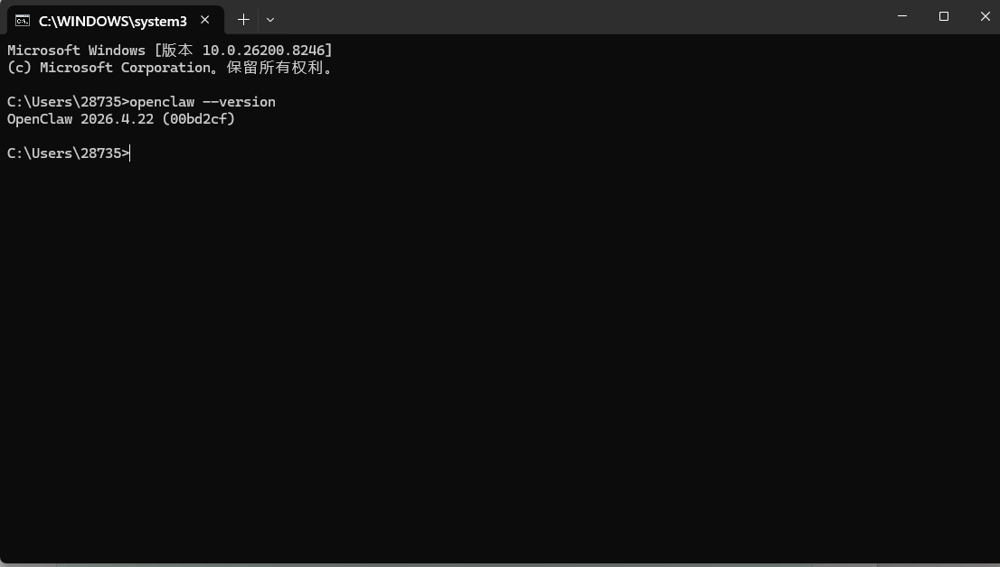
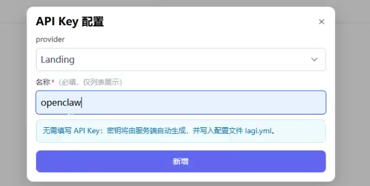
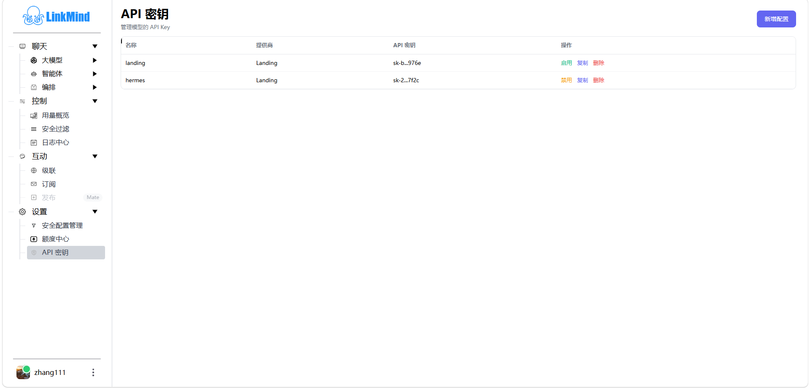
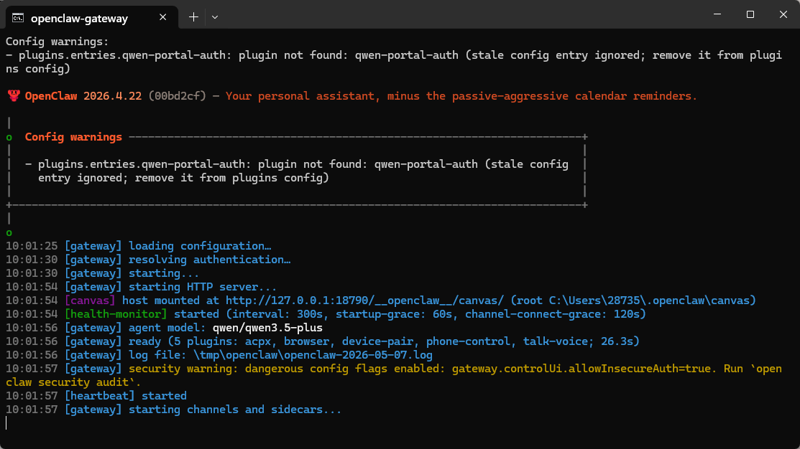
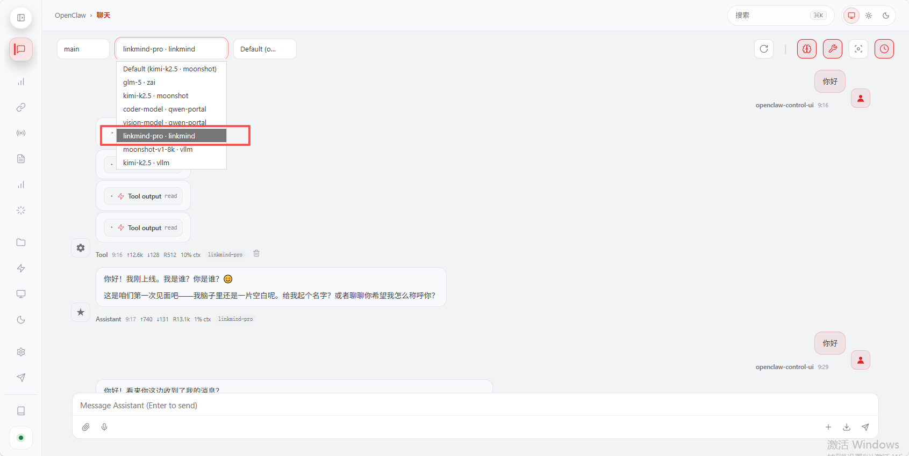
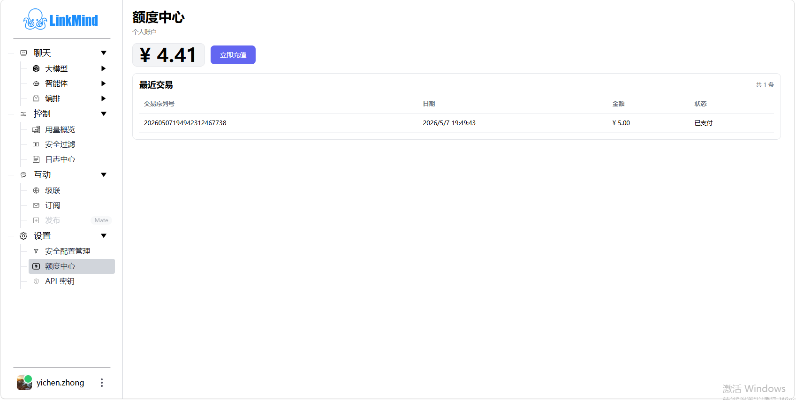

# OpenClaw 接入 LinkMind

[中文](#zh-cn) · [English](#english)

<a id="zh-cn"></a>

本页是可直接复刻的 OpenClaw 接入步骤。完成后，OpenClaw 的模型请求会进入 LinkMind，并可在 LinkMind 控制台核对调用记录和用量。

## 一、前置条件

- 已启动 LinkMind，浏览器能访问 `http://localhost:8080`。
- LinkMind 中至少有一个已启用的聊天模型、可用路由和 API Key。
- 本机已安装 Node.js 与 Git；PowerShell 允许当前用户运行本地安装脚本。

在 PowerShell 中核验：

```powershell
node -v
git -v
Set-ExecutionPolicy -ExecutionPolicy RemoteSigned -Scope CurrentUser
```



## 二、配置 LinkMind

在 LinkMind 控制台的 **设置 -> API 密钥** 中新增或启用用于客户端的 Key；在 **聊天** 中确认目标模型可以正常对话。手工维护 `lagi.yml` 时，聊天后端必须已启用：

```yaml
functions:
  chat:
    route: pass(landing)
    backends:
      - backend: landing
        model: Alibaba/qwen-plus
        enable: true
        stream: true
        protocol: completion
        priority: 100
```

将示例中的 `landing`、模型名替换为实际可用的后端与模型。先在 LinkMind 控制台发送一条短消息，确认模型和上游额度正常。





## 三、安装并启动 OpenClaw

尚未安装 OpenClaw 时执行官方安装脚本；已安装时直接核验版本并启动 Gateway：

```powershell
iwr -useb https://openclaw.ai/install.ps1 | iex
openclaw --version
openclaw gateway start
```

Gateway 启动后打开 `http://127.0.0.1:18789`。



## 四、在 OpenClaw 中选择 LinkMind

1. 打开 OpenClaw Web UI：`http://127.0.0.1:18789`。
2. 在 OpenClaw 控制台中选择 LinkMind 作为中间件。
3. 返回聊天页面，将模型切换到 `linkmind-Pro` 或安装器同步出的 LinkMind 模型。
4. 发送一条简短测试消息。

客户端和 LinkMind 位于同一台机器时，OpenAI 兼容地址使用 `http://localhost:8080/v1`。若二者不在同一台机器，应填写客户端实际可访问的 LinkMind 地址，且只在可信网络开放所需端口。



## 五、验证与日常启动

一次接入成功需同时满足：

1. OpenClaw 聊天页面返回模型回复。
2. LinkMind **控制** 中出现对应调用记录或 Token 记录。
3. 已启用计费时，额度中心或用量概览随本次请求变化。



日常启动顺序是先启动 LinkMind，再启动 OpenClaw：

```powershell
openclaw gateway start
```

如果 OpenClaw 无法连接，依次检查 LinkMind 服务是否监听、客户端填写的 base URL 是否包含 `/v1`、模型和 Key 是否启用，以及 Windows 防火墙是否阻断跨主机访问。

<a id="english"></a>

## English

Start LinkMind, enable the model and route, and send a short chat in its console first. Use a LinkMind client key for the external runtime. Set the endpoint to a host reachable from that runtime.

#### Install or verify

Open PowerShell and verify the prerequisites:

```powershell
node -v
git -v
```

If local policy blocks the installer, use the execution policy approved for your account. On Windows the documented per-user setting is `Set-ExecutionPolicy -ExecutionPolicy RemoteSigned -Scope CurrentUser`.

Install OpenClaw when it is not already present, then start its gateway:

```powershell
iwr -useb https://openclaw.ai/install.ps1 | iex
openclaw --version
openclaw gateway start
```

Open `http://127.0.0.1:18789`. In the OpenClaw console, select LinkMind as the middleware, switch to `linkmind-Pro` or the model synchronized by the installer, and send a test message. Confirm that the response appears in OpenClaw and that LinkMind records the call.


Example LinkMind chat route (replace both model and backend with your enabled values):

```yaml
functions:
  chat:
    route: pass(landing)
    backends:
      - backend: landing
        model: Alibaba/qwen-plus
        enable: true
        stream: true
        protocol: completion
        priority: 100
```

Use `http://localhost:8080/v1` for a client on the same host. In the OpenClaw gateway UI choose the synchronized model, then match the request time and model in **Control**. On a later start, run `openclaw gateway start` and reopen the gateway URL.


