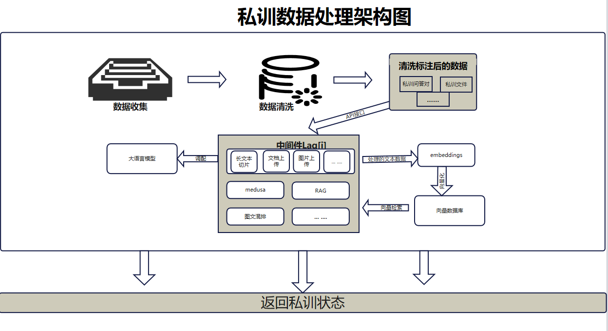

# Knowledge Base

This page combines the configuration, ingestion API, and verification path for document retrieval and RAG.

[Choose a vector store](#vector-store-choice) · [Stores and RAG](#retrieval-settings) · [Upsert](#vector-ingestion-1) · [Get](#vector-ingestion-2) · [Query](#vector-ingestion-3) · [Ingest files and QA](#vector-ingestion-5) · [File processing](#document-processing) · [QA and instruction sets](#curated-qa)

<a id="vector-store-choice"></a>

## 1. Choose and start a vector store

SQLite is the preferred option for a new local deployment: it runs with LinkMind and needs no extra service, which suits appliances, single hosts, and small knowledge bases. Choose Chroma, Milvus, or another store when it already exists in the environment.

Minimal SQLite configuration:

```yaml
stores:
  vector:
    - name: sqlite
      driver: ai.vector.impl.SqliteVectorStore
      default_category: default
      similarity_top_k: 10
      similarity_cutoff: 0.5
      parent_depth: 1
      child_depth: 1
      path: data/vector.db
```

Give the LinkMind process write access to the SQLite `path` and back up the database before upgrading. For a separate Chroma service, use `chroma run --path db_data` or mount the persistence directory for your image version. See [Chroma persistence and restart verification](best-practices/integrations/chroma-knowledge-base.md#chroma-persistence).

## 2. Configure storage, embedding, and RAG

```yaml
stores:
  vector:
    - name: chroma
      driver: ai.vector.impl.ChromaVectorStore
      default_category: default
      similarity_top_k: 10
      similarity_cutoff: 0.5
      url: http://localhost:8000
  rag:
    vector: chroma
    enable: true
    priority: 10
    track: true
    html: true
    default: "Please give prompt more precisely"
    enable_excel_to_md: true

functions:
  embedding:
    - backend: qwen
      type: Qwen
      api_key: your-api-key
      model_name: text-embedding
```

`stores.rag.vector` must match the vector-store `name`. Set the vector URL to the host reachable from LinkMind, not necessarily the browser's host. `similarity_top_k` and `similarity_cutoff` control retrieval breadth and threshold; `enable_excel_to_md` normalizes spreadsheet content before ingestion.

<a id="retrieval-settings"></a>

### Vector, object, term, relational and RAG settings

<a id="vector-store-fields"></a>

#### Vector Store

Current key: `stores.vector`

```yaml
stores:
  vector:
    - name: chroma
      driver: ai.vector.impl.ChromaVectorStore
      default_category: default
      similarity_top_k: 10
      similarity_cutoff: 0.5
      parent_depth: 1
      child_depth: 1
      url: http://localhost:8000
```

Common fields:

| Field | Meaning |
| --- | --- |
| `name` | Vector backend name |
| `driver` | Java vector store implementation |
| `type` | Optional vector vendor label |
| `default_category` | Default collection or category name |
| `url` | Remote vector endpoint |
| `metric` | Similarity metric, usually cosine |
| `similarity_top_k` | Number of nearest results |
| `similarity_cutoff` | Minimum similarity threshold |
| `parent_depth` / `child_depth` | Parent-child retrieval expansion depth |
| `api_key` / `token` | Optional auth fields |
| `index_name` / `environment` / `project_name` | Vendor-specific vector fields |
| `concurrency` | Optional request concurrency |

<a id="object-storage"></a>

#### Object Storage (OSS)

```yaml
stores:
  oss:
    - name: landing
      driver: ai.oss.impl.LandingOSS
      bucket_name: lagi
      enable: true

    - name: alibaba
      driver: ai.oss.impl.AlibabaOSS
      endpoint: oss-cn-hangzhou.aliyuncs.com
      access_key_id: your-access-key-id
      access_key_secret: your-access-key-secret
      bucket_name: your-bucket
      enable: true
```

Common fields:

| Field | Meaning |
| --- | --- |
| `name` | Storage profile name |
| `driver` | OSS implementation class |
| `endpoint` | Object storage endpoint |
| `access_key_id` / `access_key_secret` | Cloud credentials |
| `bucket_name` | Bucket used by the adapter |
| `enable` | Whether this OSS profile is enabled |

<a id="term-store"></a>

#### Full-Text / Term Store

```yaml
stores:
  term:
    - name: elastic
      driver: ai.bigdata.impl.ElasticSearchAdapter
      host: localhost
      port: 9200
      enable: false
```

Common fields:

| Field | Meaning |
| --- | --- |
| `name` | Term-search backend name |
| `driver` | Full-text adapter class |
| `host` | Hostname |
| `port` | Service port |
| `username` / `password` | Optional auth |
| `enable` | Whether the backend is active |

<a id="relational-database"></a>

#### Relational Database

```yaml
stores:
  database:
    - name: mysql
      jdbc_url: jdbc:mysql://127.0.0.1:3306/demo
      driver: com.mysql.cj.jdbc.Driver
      username: linkmind_reader
      password: your-password
      maximum_pool_size: 20
      idle_timeout: 0
      max_lifetime: 2877700
```

Common fields:

| Field | Meaning |
| --- | --- |
| `name` | Database profile name |
| `jdbc_url` | JDBC connection string |
| `driver` | JDBC driver class |
| `username` / `password` | Login credentials |
| `maximum_pool_size` | Hikari max pool size |
| `idle_timeout` | Connection idle timeout |
| `max_lifetime` | Maximum connection lifetime |

<a id="rag-fields"></a>

#### RAG

```yaml
stores:
  rag:
    vector: chroma
    term: elastic
    graph: landing
    enable: true
    priority: 10
    track: true
    html: true
    default: "Please give prompt more precisely"
    cache_size: 1000
    preload_cache: false
    preload_cache_category: default
    enable_excel_to_md: true
```

Common fields:

| Field | Meaning |
| --- | --- |
| `vector` | Vector backend name to use |
| `term` | Optional term-search backend |
| `graph` | Optional graph-style backend |
| `enable` | Whether RAG is enabled |
| `priority` | Priority when RAG competes with direct model calls |
| `track` | Whether to keep document trace information |
| `html` | Whether HTML-style content handling is enabled |
| `default` | Fallback reply when no context is found |
| `cache_size` | Optional RAG cache size |
| `preload_cache` | Whether to preload cache |
| `preload_cache_category` | Category used during preload |
| `enable_excel_to_md` | Whether spreadsheet content should be normalized into Markdown |

## 3. Ingest and manage knowledge

| Task | Endpoint |
| --- | --- |
| Create an embedding | `POST /v1/embeddings` |
| Add, update, get, or delete vectors | `POST /v1/vector/add`, `/update`, `/get`, `/delete` |
| Query vectors | `POST /v1/vector/query` |
| List collections | `GET /v1/vector/listCollections` |
| Extract, OCR, or structure a document | `POST /doc/doc2ext`, `/ocr/doc2ocr`, `/doc/doc2struct` |
| Upload private-training material or Q&A | `POST /training/upload`, `POST /uploadFile/pairing` |

Use one deliberate collection/category per knowledge domain. Preserve source metadata and record IDs that you supplied or retrieved through `/v1/vector/get` for subsequent updates and deletions. A successful `/v1/vector/add` response does not return record IDs.

<a id="vector-ingestion-1"></a>

### 1. Add or update vectors

`POST /v1/vector/add` writes text and metadata to a collection; `/update`, `/get`, and `/delete` update, fetch, and remove records. Supply a collection/category, document text, and metadata when adding records. For updates or deletions, use stable IDs that you supplied or retrieved through `/get`. The existing property-management example is retained below:

```json
{
  "category": "property-manual",
  "data": [
    {
      "document": "A maintenance request must receive its first response within two working days.",
      "metadata": {"source": "manual.pdf", "page": "3"}
    }
  ]
}
```

#### Add request and parameters

This complete request from the previous documentation includes the source category, file name, file path, and source identifier. It supplies neither `id` nor `embedding`; the current SQLite and Chroma drivers generate record IDs and use the configured embedding capability to convert the text into vectors:

```json
{
  "category": "default",
  "data": [
    {
      "metadata": {
        "category": "default",
        "filename": "sample-handbook.pdf",
        "filepath": "202504240001.pdf",
        "source": "file"
      },
      "document": "LinkMind provides a unified AI middleware layer."
    }
  ]
}
```

```bash
curl --request POST "http://localhost:8080/v1/vector/add" \
  -H "Authorization: Bearer <linkmind-api-key>" \
  -H "Content-Type: application/json" \
  --data-raw '{"category":"default","data":[{"metadata":{"category":"default","filename":"sample-handbook.pdf","filepath":"202504240001.pdf","source":"file"},"document":"LinkMind provides a unified AI middleware layer."}]}'
```

The request body is a JSON object. The table retains the previous fields and describes current defaults and conditions. Fields marked as needed for a meaningful write should be supplied to create records; this does not mean every backend validates them uniformly at the endpoint:

| Field | Location | Type | Required | Description |
| --- | --- | --- | --- | --- |
| Request body | body | object | Yes | JSON request object |
| `Content-Type` | header | string | Yes | `application/json` |
| `Authorization` | header | string | As required by deployment authentication | `Bearer <linkmind-api-key>`; supply a valid client key when authentication is enabled |
| `category` | body | string | No; explicit selection recommended | Knowledge category or vector collection name. SQLite and Chroma use the store's `default_category` when omitted or `null` |
| `data` | body | object[] | Yes, for a meaningful write | Records to insert; provide a non-empty array |
| `data[].document` | body | string | Required for text ingestion | Text content. When no usable `embedding` is supplied, the backend generates a vector from this text; provide non-empty text |
| `data[].metadata` | body | object | Recommended; backend-dependent | Metadata associated with the text. SQLite allows omission or an empty object. Chroma passes it to the upstream service for validation; fields and value types must meet that service's requirements |
| `data[].id` | body | string | No | Stable record ID supplied by the caller. SQLite and Chroma generate a random UUID without hyphens when this field is omitted, `null`, or an empty string |
| `data[].embedding` | body | number[] | No | Vector for one record; the field name is singular, `embedding`. If omitted, `null`, or empty, the configured embedding capability is called with `document` |

The four metadata keys in the previous example are application-defined fields. Supply them as needed; the endpoint does not populate them automatically:

| Metadata field | Example type | Description |
| --- | --- | --- |
| `data[].metadata.category` | string | Category or collection identifier stored in metadata; the top-level request `category` selects the target collection |
| `data[].metadata.filename` | string | Source file name, such as `sample-handbook.pdf` |
| `data[].metadata.filepath` | string | Source file path or storage identifier, such as `202504240001.pdf` |
| `data[].metadata.source` | string | Source identifier, such as `file`, which can be used as a filter in a subsequent `/get` request |

To manage IDs yourself, add your chosen `id` to each record in `data` and retain it. Automatically generated IDs are not returned by this endpoint. To change an existing record, use `/update` with its ID; the add endpoint does not define automatic matching of existing records by identical text.

If supplying `embedding`, use vector dimensions and an embedding model consistent with the target collection. If omitting vectors, first check that the deployment's embedding configuration is usable. The singular input field `embedding` differs from the optional `embeddings` field in read responses.

#### Add response

A normal response uses HTTP **200** and the following complete JSON, retaining the previous response contract:

```json
{
  "status": "success"
}
```

| Field | Type | Meaning and availability |
| --- | --- | --- |
| `status` | string | Set to `success` on normal return. The response contains no record IDs, inserted-record count, or vector values; verify stored results by reading them back |

#### Read-back verification and troubleshooting

1. Write one record with known content using a non-empty `data` array. Retain the collection and metadata that identify it, along with any ID you supplied.
2. Call `/v1/vector/get` using the [read instructions below](#2-read-raw-records-by-condition). Use `ids` if you already have the ID. For generated IDs, retrieve records from the same collection using source metadata, match the document text, and save the returned `id`. One source can contain multiple records, so check each match.
3. Compare the returned document and metadata with the submitted content. If checking vector values, request them within the read endpoint's backend support limits and confirm their dimensions.

SQLite currently returns without writing when `data` is missing or empty, after which the endpoint can still return `status: "success"`. This response does not establish that a record was added. If a record was not stored or cannot be retrieved, check the target collection, non-empty data, record IDs, embedding configuration and its output, vector dimensions, storage connectivity or write permissions, and server logs. Exceptions do not guarantee a uniform failure JSON response; inspect the HTTP status and logs as well.

#### Update request and parameters

`POST /v1/vector/update` updates an existing record's text, metadata, or vector by collection and record ID. First use `/v1/vector/get` to confirm that the target ID exists, then replace `category`, `id`, and the content in this complete example from the previous documentation with your actual values:

```json
{
  "category": "default",
  "data": [
    {
      "id": "doc_001",
      "metadata": {
        "category": "default",
        "filename": "sample-handbook.pdf",
        "filepath": "202504240001.pdf",
        "source": "file"
      },
      "document": "LinkMind provides a unified AI middleware layer for model routing."
    }
  ]
}
```

```bash
curl --request POST "http://localhost:8080/v1/vector/update" \
  -H "Authorization: Bearer <linkmind-api-key>" \
  -H "Content-Type: application/json" \
  --data-raw '{"category":"default","data":[{"id":"doc_001","metadata":{"category":"default","filename":"sample-handbook.pdf","filepath":"202504240001.pdf","source":"file"},"document":"LinkMind provides a unified AI middleware layer for model routing."}]}'
```

The request body is a JSON object. This table retains every previous field and adds the optional `embedding`. Fields marked as needed for a meaningful update identify and modify records; the endpoint does not perform uniform required-field validation across all backends:

| Field | Location | Type | Required | Description |
| --- | --- | --- | --- | --- |
| Request body | body | object | Yes | JSON request object |
| `Content-Type` | header | string | Yes | `application/json` |
| `Authorization` | header | string | As required by deployment authentication | `Bearer <linkmind-api-key>`; supply a valid client key when authentication is enabled |
| `category` | body | string | No; explicit selection recommended | Target knowledge category or vector collection name. SQLite and Chroma use the store's `default_category` when omitted or `null` |
| `data` | body | object[] | Yes, for a meaningful update | Records to update; provide a non-empty array |
| `data[].id` | body | string | Yes, for a meaningful update | Existing record ID in the target collection; update does not generate an ID |
| `data[].document` | body | string | According to the intended change | New text to store. If it is non-blank and no non-empty `embedding` is supplied, SQLite and Chroma call the configured embedding capability to generate a vector |
| `data[].metadata` | body | object | According to the intended change | Metadata to change. SQLite merges the supplied keys; Chroma's update semantics are determined by the upstream service |
| `data[].metadata.chapter` | body | integer | No | Application metadata example from the previous table, usable as a chapter number; it is not a fixed required field |
| `data[].metadata.verse` | body | integer | No | Application metadata example from the previous table, usable as a verse number; it is not a fixed required field |
| `data[].embedding` | body | number[] | No | New vector for one record; the field name is singular, `embedding`. A supplied non-empty array is used directly; its dimensions and model must match the target collection |

The previous table marked `chapter` and `verse` as required integers. The current request structure defines `metadata` as an extensible object and imposes no fixed requirement or additional numeric constraints on these keys. This example retains their use as integer application fields. It updates metadata only in SQLite, without changing the text or supplying a new vector:

```json
{
  "category": "default",
  "data": [
    {
      "id": "doc_001",
      "metadata": {
        "chapter": 1,
        "verse": 2
      }
    }
  ]
}
```

#### Update behavior and backend differences

| Behavior | SQLite | Chroma |
| --- | --- | --- |
| Changing text and generating a vector | Calls the embedding capability when the new `document` is non-blank and `embedding` is omitted, `null`, or empty. Uses a supplied non-empty vector directly | Uses the same text and vector conditions to decide whether to call the embedding capability, then sends the update to Chroma |
| Omitted text or vector | Retains the original text when `document` is omitted or `null`; retains the original vector when no usable new vector is available | The current adapter sends fields per record; omitted values may be sent upstream as `null` array entries. Field preservation and support for metadata-only updates depend on the Chroma service |
| Updating metadata | Merges keys into the original metadata: supplied keys overwrite matching values and omitted keys are retained. Omitted or `null` metadata preserves the original object | Sends metadata upstream without first merging the existing metadata locally. Merge behavior, field types, and null handling depend on the service |
| Missing targets or empty input | Can return immediately for missing or empty `data` or a missing collection; skips records whose IDs do not exist. The endpoint can still return `success` | Delegates handling to the upstream service. The endpoint response contains neither per-record matches nor an updated-record count; read back to verify |

An empty string differs from omitting `document`: SQLite writes explicitly supplied empty text into the record, while blank text does not trigger vector regeneration. For metadata-only changes, omit `document` and `embedding`, and verify the result according to the selected backend's rules.

SQLite converts metadata values to strings when storing them and reads them as strings. The integer `chapter` and `verse` values above can therefore be returned as `"1"` and `"2"`. Check metadata types when changing backends; JSON number types are not preserved uniformly across drivers.

#### Update response and verification

A normal response uses HTTP **200** and the following complete JSON, retaining the previous response contract:

```json
{
  "status": "success"
}
```

| Field | Type | Meaning and availability |
| --- | --- | --- |
| `status` | string | Set to `success` on normal return. It contains no matched-record count, updated-record count, or record details; read back to confirm whether the target was updated |

1. Before updating, use the [read instructions](#2-read-raw-records-by-condition) to confirm the collection and ID, and record the original text and relevant metadata.
2. After submitting the update, call `/v1/vector/get` again with the same collection and ID. Check the new text, changed metadata, and original fields that should be retained under the selected backend's rules.
3. When changing text, check that the embedding call succeeds. If vector values must be inspected, read them within the read endpoint's backend support limits and confirm their dimensions. For metadata-only updates, confirm that the text is unchanged.

SQLite can return `status: "success"` after skipping a nonexistent ID, so read-back verification is still needed. If the target was not updated, check the collection and ID, non-empty `data`, submitted fields, embedding configuration and output, vector dimensions, storage connectivity or write permissions, and server logs. Exceptions do not guarantee a uniform failure JSON response; inspect the HTTP status and logs as well.

<a id="vector-ingestion-2"></a>

### 2. Read raw records by condition

`POST /v1/vector/get` reads raw vector-store records by collection, metadata, record ID, or document-content conditions. Use it to inspect ingested content, retrieve record IDs, and page through stored material. It needs no query text and does not rank records by similarity. Use `/v1/vector/query` in the next section to retrieve content similar to a question.

#### Read request and parameters

This complete request example is retained from the previous documentation. It reads records whose `source` is `file` from the `default` collection, starting at offset `0` and returning at most `10` records.

```json
{
  "category": "default",
  "where": {
    "source": "file"
  },
  "limit": 10,
  "offset": 0
}
```

```bash
curl --request POST "http://localhost:8080/v1/vector/get" \
  -H "Authorization: Bearer <linkmind-api-key>" \
  -H "Content-Type: application/json" \
  --data-raw '{"category":"default","where":{"source":"file"},"limit":10,"offset":0}'
```

The request body is a JSON object. The previous table marked all four fields as required; the current endpoint has no such uniform requirement, and defaults depend on the storage driver. The following describes the current SQLite and Chroma drivers. Specify the target collection and pagination explicitly where possible:

| Field | Location | Type | Required | Description |
| --- | --- | --- | --- | --- |
| Request body | body | object | Yes | JSON request object |
| `Content-Type` | header | string | Yes | `application/json` |
| `Authorization` | header | string | As required by deployment authentication | `Bearer <linkmind-api-key>`; supply a valid client key when authentication is enabled |
| `category` | body | string | No; explicit selection recommended | Knowledge category or vector collection name. SQLite and Chroma use the store's `default_category` when omitted or `null` |
| `where` | body | object | No | Metadata filter, such as `{"source":"file"}`. Omit it when no metadata filter is needed; supported operators and value types depend on the backend |
| `limit` | body | integer | No; explicit value recommended | Maximum number of records to return; use a positive integer. There is no shared small-page default when omitted; see backend differences |
| `offset` | body | integer | No; explicit value recommended | Result offset starting at `0`; use a non-negative integer. SQLite uses `0` when omitted |
| `ids` | body | string[] | No | Record IDs to read, such as `["doc_001"]`; use IDs actually stored or retrieved |
| `where_document` | body | object | No | Document-content filter, such as `{"$contains":"LinkMind"}`. It filters the document text; see backend differences for support |
| `include` | body | string[] | No | Requested data items, such as `["documents","metadatas","embeddings"]`. Actual output depends on the backend and adapter; requesting embeddings alone does not establish that vector values will be returned |

Example combining the additional fields; replace the ID and document condition with values from your actual records:

```json
{
  "category": "default",
  "ids": ["doc_001"],
  "where_document": {"$contains": "LinkMind"},
  "limit": 10,
  "offset": 0,
  "include": ["documents", "metadatas", "embeddings"]
}
```

#### Backend differences

| Behavior | SQLite | Chroma |
| --- | --- | --- |
| Collection and pagination | Uses the default collection when `category` is omitted and `0` when `offset` is omitted. Omitting `limit` can return all matching records, depending on the read path; set a limit explicitly | Uses `category` to select the collection. Filters and pagination are sent to the configured Chroma service, which determines defaults for omitted fields |
| Metadata, document, and ID filters | Supports `where`, `ids`, and `$contains` / `$not_contains` in `where_document`; the supplied conditions filter records together | Sends `where`, `where_document`, and `ids` to Chroma; supported syntax and restrictions depend on the service version |
| `include` and returned fields | Normal read paths can return vector values when `include` contains `embeddings`. It still reads `document`, `id`, and `metadata`; `include` does not hide them | The current `/get` adapter builds records from the upstream ID list and can return `document`, `metadata`, and `embeddings`; fields not requested or not supplied upstream may be omitted |

In SQLite, some `$and` metadata-filter paths using equality or `$in` without explicit `ids` currently omit vector values even when `embeddings` is requested. When vectors are needed, retrieve the record IDs first, then read with `ids` and `include`, and check the returned fields.

For Chroma, use `include` to select `documents`, `metadatas`, or `embeddings`; request `["embeddings"]` when only vector values are needed. The current `/get` adapter does not require documents or metadata to accompany them and populates fields from the actual upstream response. Request the corresponding items when text and source information are needed. Recheck filters and returned fields when changing the storage driver or Chroma service version.

#### Complete response and field descriptions

A normal read uses HTTP **200** with a JSON body. This complete response example is retained from the previous documentation. Its ID, text, and seven metadata fields illustrate the structure; actual content comes from the stored record:

```json
{
  "status": "success",
  "data": [
    {
      "document": "LinkMind provides a unified AI middleware layer.",
      "id": "doc_001",
      "metadata": {
        "category": "default",
        "file_id": "file_001",
        "filename": "sample-handbook.pdf",
        "filepath": "202504240001.pdf",
        "level": "user",
        "parent_id": "chunk_root_001",
        "source": "file"
      }
    }
  ]
}
```

The table retains every previous field and its example type. `metadata` is an extensible object: field presence, actual values, and types depend on the stored record and driver. The read endpoint does not automatically populate these seven fields, and response fields without values may be omitted.

| Field | Type | Description |
| --- | --- | --- |
| `status` | string | Read execution status, set to `success` on normal completion; inspect `data` to determine whether records matched |
| `data` | object[] | Returned records; a normal read with no matches can return an empty array `[]` |
| `data[].document` | string | Text content of the record |
| `data[].id` | string | Record ID for subsequent reads, updates, or deletions by ID |
| `data[].metadata` | object | Metadata associated with the text, returned as stored |
| `data[].metadata.category` | string | Category or collection identifier stored in metadata. It is stored separately from the request's collection-selecting `category`; do not assume automatic synchronization |
| `data[].metadata.file_id` | string | Source file ID |
| `data[].metadata.filename` | string | Source file name |
| `data[].metadata.filepath` | string | Source file path or storage identifier, such as `202504240001.pdf` |
| `data[].metadata.level` | string | Knowledge level, such as `user` (the previous documentation's default convention). This read endpoint does not populate a default level |
| `data[].metadata.parent_id` | string | Parent chunk or record ID, returned when written during ingestion |
| `data[].metadata.source` | string | Source identifier, such as `file`; its meaning is defined by the writer |
| `data[].embeddings` | number[] | Optional vector values, depending on `include`, backend, and read path; see the support boundaries above |

#### Verify the retrieved records

1. Select a collection with stored records and run the complete request using known metadata. Check the text, IDs, and source information in `data`.
2. Read again with a returned ID in `ids` and confirm that it identifies the same record. If filtering document content, check that the returned text meets the condition.
3. Check pagination with a small `limit` and increasing `offset`. Keep the dataset stable while paging and check IDs for duplicates or missing records. The result order does not represent similarity ranking.
4. If requesting vector values, inspect whether `data[].embeddings` is present and follow the backend-specific guidance above.

`status: "success"` can accompany `data: []`. For empty results, check the collection, IDs, and filter values first; an empty collection or no matches is a valid read result. Invalid JSON, incompatible filter syntax, or a storage connection failure does not guarantee a uniform failure JSON response. Use the HTTP status and server logs to investigate.

<a id="vector-ingestion-3"></a>

### 3. Query retrieval results

`POST /v1/vector/query` searches by query text and returns similar vector-store records. The existing property-management example is retained below:

```json
{
  "category": "property-manual",
  "text": "How soon should a maintenance request receive a response?",
  "n": 5
}
```

`category` identifies the collection, `text` is the retrieval query, and `n` is the desired nearest-result count. The endpoint calls the selected vector store's query method directly. In the current SQLite and Chroma implementations, this direct path uses the request's `n` and filters without additionally applying the RAG retrieval chain's `similarity_top_k` or `similarity_cutoff` limits. Returned counts and distance semantics are described below.

#### Query request and parameters

This complete request example is retained from the previous documentation, including the `where` metadata filter:

```json
{
  "category": "default",
  "text": "How does model routing work?",
  "n": 5,
  "where": {
    "source": "file"
  }
}
```

```bash
curl --request POST "http://localhost:8080/v1/vector/query" \
  -H "Authorization: Bearer <linkmind-api-key>" \
  -H "Content-Type: application/json" \
  --data-raw '{"category":"default","text":"How does model routing work?","n":5,"where":{"source":"file"}}'
```

The request body is a JSON object. The table retains the previous request fields, explains current required conditions and defaults, and adds document-content filtering:

| Field | Location | Type | Required | Description |
| --- | --- | --- | --- | --- |
| Request body | body | object | Yes | JSON request object |
| `Content-Type` | header | string | Yes | `application/json` |
| `Authorization` | header | string | As required by deployment authentication | `Bearer <linkmind-api-key>`; supply a valid client key when authentication is enabled |
| `category` | body | string | No; explicit selection recommended | Target knowledge category or vector collection name. SQLite and Chroma use the store's `default_category` when omitted or `null` |
| `text` | body | string | Required for similarity search | Non-empty query text. The configured embedding capability generates the query vector and should match the target collection's model and dimensions |
| `n` | body | integer | No; explicit value recommended | Desired nearest-result count; use a positive integer. SQLite uses `10` when omitted or `null`; Chroma defaults are determined by the upstream service |
| `where` | body | object | No | Metadata filter, such as `{"source":"file"}`. Omit when unnecessary; supported operators and value types depend on the backend |
| `whereDocument` | body | object | No | Document-content filter for the current `/query` endpoint, such as `{"$contains":"LinkMind"}`. SQLite supports `$contains` and `$not_contains`; Chroma support depends on its service version |

The document-filter field name differs between endpoints: `/query` currently uses camel-case `whereDocument`, while `/get` and `/delete` use `where_document`. Sending `where_document` to `/query` does not enable that document filter. To filter both metadata and document content, use:

```json
{
  "category": "default",
  "text": "How does model routing work?",
  "n": 5,
  "where": {"source": "file"},
  "whereDocument": {"$contains": "LinkMind"}
}
```

#### Query behavior and distance semantics

| Behavior | SQLite | Chroma |
| --- | --- | --- |
| Default `n` | Uses `10` when omitted or `null`; a normal text query returns at most the requested `n` matching records | Sends `n` as the upstream result-count parameter. No fixed local default is supplied when it is omitted; the service handles it |
| Filtering and result count | For a normal text query with filters, retrieves up to `5 × n` candidates before filtering and returns at most `n` matches. Fewer results do not establish that these are the only matching records in the collection | Sends metadata and document filters to Chroma; filtering behavior and returned counts are determined by the upstream query |
| `distance` | Returns the vector extension's raw distance and selects results in ascending distance order; this endpoint does not convert it to a probability or a shared similarity score | Returns Chroma's distance values unchanged. Their scale and meaning depend on the collection's configured distance metric; no common normalization is applied locally |
| Missing or empty-string `text` | Falls back to reading records by condition, with `n` as the limit. It performs no similarity ranking and computes no query distances for those records | This endpoint processes `text` as one embedding input; do not assume SQLite's read fallback. Supply non-empty text for similarity search |

`n` is a requested count, not a guarantee of a full result list. Compare `distance` values within the same collection, embedding model, and distance metric. The example value `0.12` illustrates a numeric field; it is neither a confidence value nor a fixed matching threshold. Use `/v1/vector/get` in the preceding section when reading raw records by condition.

#### Complete query response and field descriptions

When records are found, a normal response uses HTTP **200** with a JSON body. This complete response example is retained from the previous documentation:

```json
{
  "status": "success",
  "data": [
    {
      "document": "LinkMind can route requests across multiple model backends.",
      "id": "doc_002",
      "metadata": {
        "category": "default",
        "file_id": "file_001",
        "filename": "sample-handbook.pdf",
        "filepath": "202504240001.pdf",
        "level": "user",
        "parent_id": "chunk_root_001",
        "source": "file"
      },
      "distance": 0.12
    }
  ]
}
```

The table restores every previous response field, including `reference_document_id`, which appeared in the old table but not its example JSON. Metadata field presence, actual values, and types depend on ingested records and the driver. Queries do not populate every field automatically, and fields without values may be omitted.

| Field | Type | Meaning and availability |
| --- | --- | --- |
| `status` | string | `success` when records are found; the current endpoint returns `failed` when the query returns an empty list |
| `data` | object[] | Matching records; the current no-match response omits this field |
| `data[].document` | string | Text content of the result record |
| `data[].id` | string | Result record ID for subsequent reads, updates, or deletions |
| `data[].metadata` | object | Metadata associated with the text, returned as stored |
| `data[].metadata.category` | string | Knowledge category or collection identifier stored in metadata |
| `data[].metadata.file_id` | string | Source file ID |
| `data[].metadata.filename` | string | Source file name |
| `data[].metadata.filepath` | string | Source file path or storage identifier |
| `data[].metadata.level` | string | Knowledge level, such as `user` (the previous documentation's default convention). Queries do not populate a default level |
| `data[].metadata.parent_id` | string | Parent chunk or record ID, returned when stored during ingestion |
| `data[].metadata.source` | string | Source identifier, such as `file`, defined by the writer |
| `data[].metadata.reference_document_id` | string | Associated reference-document record ID. Returned only when metadata stores that reference; it is not a fixed field present in every record |
| `data[].distance` | number | Backend distance value, interpreted as described above; SQLite does not compute it when falling back to reading raw records |

When a query completes normally but returns no records, the current endpoint returns this JSON, usually still with HTTP **200**:

```json
{
  "status": "failed"
}
```

Here, `failed` can mean “no matching results” and omits `data`. This differs from `/get`, which can return `{"status":"success","data":[]}` for no matches. Request parsing, embedding, or storage exceptions do not guarantee the same failure JSON; inspect the HTTP status and logs as well.

#### Query verification and troubleshooting

1. Select a collection with known records and query with non-empty `text` and an explicit `n`. Check the returned IDs, text, and source information.
2. Add `where` and `whereDocument` gradually, and check that records meet the metadata and document conditions. Use the camel-case document-filter field for `/query`.
3. Check result counts and the backend's distance semantics. If SQLite returns fewer than `n` results after filtering, page through matching raw records with `/get` to distinguish limited candidate retrieval from an actual absence of matches.
4. For `failed`, first inspect the collection and records with `/get`, then check filters, query text, embedding model and dimensions, backend connectivity, and logs. Verify conversational RAG retrieval using the RAG chain's own configuration and steps.

<a id="vector-ingestion-4"></a>

### 4. Delete vectors

`POST /v1/vector/delete` deletes vector records from the selected collection. This complete request retains the previous documentation's example of deletion by record ID. Before executing it, use `/v1/vector/get` to confirm the content identified by the collection and ID, and replace the example values with the actual deletion targets:

```json
{
  "category": "default",
  "ids": [
    "doc_001"
  ]
}
```

```bash
curl --request POST "http://localhost:8080/v1/vector/delete" \
  -H "Authorization: Bearer <linkmind-api-key>" \
  -H "Content-Type: application/json" \
  --data-raw '{"category":"default","ids":["doc_001"]}'
```

#### Delete request parameters

The request body is a JSON object. The previous `category` and `ids` fields and their types are retained, with the filter fields supported by the code added. Required conditions reflect the current implementation and the chosen deletion method:

| Field | Location | Type | Required | Description |
| --- | --- | --- | --- | --- |
| Request body | body | object | Yes | JSON request object |
| `Content-Type` | header | string | Yes | `application/json` |
| `Authorization` | header | string | As required by deployment authentication | `Bearer <linkmind-api-key>`; supply a valid client key when authentication is enabled |
| `category` | body | string | No; specify explicitly for deletion | Target knowledge category or vector collection name. SQLite and Chroma use the store's `default_category` when omitted or `null` |
| `ids` | body | string[] | Required for deletion by ID | IDs of records to delete. Use a verified, non-empty list, such as `["doc_001"]`. When filters are also supplied, the combination rules depend on the backend |
| `where` | body | object | No | Metadata filter, such as `{"source":"file"}`; supported syntax and value types depend on the backend |
| `where_document` | body | object | No | Document-content filter, such as `{"$contains":"LinkMind"}`. SQLite supports `$contains` and `$not_contains`; Chroma support depends on the service version |

#### Deletion scope and backend differences

| Case | SQLite | Chroma |
| --- | --- | --- |
| Only `ids` supplied | Deletes listed records and their metadata; nonexistent IDs cause no actual deletion | Sends the request to the configured Chroma service to process the specified IDs |
| Only filters supplied | Deletes matching records. When both `where` and `where_document` are supplied, a record must satisfy both filters | Sends filters to Chroma, which applies its supported syntax and rules |
| Both `ids` and filters supplied | Combines explicitly specified IDs with filter-matched IDs and deletes their union. Filters do not further restrict the explicitly specified IDs | The current adapter sends these fields directly without computing an intersection or union locally; Chroma determines how they are combined |
| No IDs and empty filters | Has no records to delete and performs no record deletion; the endpoint can still return `success` | Empty-condition validation and behavior depend on Chroma; provide an explicit deletion scope |
| Missing collection or no matching records | Can return immediately for a missing collection and deletes nothing when no records match; the endpoint can still return `success` | Handling depends on the upstream service result; the endpoint provides no deletion count for confirmation |

For example, if `ids` specifies `doc_001` and `where` matches `doc_002`, SQLite adds both records to the deletion set, even if `doc_001` does not satisfy the filter. This differs from SQLite `/get`, which filters the supplied IDs using the accompanying conditions.

To delete only records among given IDs that also satisfy filters, first combine those conditions in `/v1/vector/get`, inspect and collect the final IDs, and send only the target `category` and final `ids` to `/delete`. For filter-based deletion, page through the intended matching range beforehand. Recheck filtering and combination rules after changing backends.

#### Delete response and verification

A normal response uses HTTP **200** and the following complete JSON, retaining the previous response contract:

```json
{
  "status": "success"
}
```

| Field | Type | Meaning and availability |
| --- | --- | --- |
| `status` | string | Set to `success` on normal return. It contains no deletion count, deleted IDs, or per-record results; verify by reading records |

1. Before deleting, use the [read instructions](#2-read-raw-records-by-condition) to confirm the target collection, IDs, text, and source metadata. If using filters, inspect the complete matching scope first.
2. After submitting the verified deletion request, call `/v1/vector/get` again with the same collection and the target `ids`. A normal read should return an empty `data` array when all those records have been deleted.
3. Check that a control record outside the selected set remains readable. For filter-based deletion, read again using the original filters and check for remaining matches.

`status: "success"` alone does not report how many records were deleted and can also accompany requests with no matches or no effective scope. If results differ from expectations, check the collection, IDs, filter syntax, and backend combination rules, along with the HTTP status, storage connectivity or write permissions, and server logs. Exceptions do not guarantee a uniform failure JSON response.

<a id="vector-ingestion-5"></a>

### 5. Upload a file or Q&A pairs

#### Upload a training file

Use `POST /training/upload?category=property-manual` with `multipart/form-data` and a `fileToUpload` field to upload a general knowledge file into the private knowledge base. Specify the target category explicitly and supply authentication as required by the deployment:

```bash
curl --request POST "http://localhost:8080/training/upload?category=property-manual&level=user" \
  -H "Authorization: Bearer <linkmind-api-key>" \
  --form "fileToUpload=@./examples/docs/sample.pdf"
```

The file-field illustration from the previous documentation is retained below. `file://` represents a local file selected by the caller. Send the file contents as in the curl example; sending this path string alone does not upload the file or let the server read the caller's local filesystem:

```yaml
fileToUpload: file://./examples/docs/sample.pdf
```

| Field | Location | Type | Required | Description |
| --- | --- | --- | --- | --- |
| `category` | query | string | Yes; supply it explicitly | Knowledge category or vector collection name, such as `property-manual` |
| `level` | query | string | No | Knowledge level written to source metadata; defaults to `user` when omitted. An empty string does not trigger this default |
| `body` | body | object (multipart/form-data) | Required for a file upload | The entire multipart request body, not a JSON field named `body` |
| `fileToUpload` | file part in body | string(binary) | Yes | Contents of the knowledge file; multiple file parts can upload multiple files |
| `Content-Type` | header | string | Yes; generated by the upload client | `multipart/form-data` with a client-generated boundary; do not override it manually when using curl `--form` |
| `Authorization` | header | string | As required by deployment authentication | The example uses `Bearer <linkmind-api-key>`; supply credentials appropriate to the deployment |

The previous table marked `body` as optional, but uploading a file requires a multipart body and a file part. The current handler reads `category` and `level` from URL query parameters; its file-processing loop does not read ordinary multipart text fields as these parameters, so use query parameters as shown. The endpoint has no uniform validation response for a missing category or an invalid level value. Supply the category explicitly rather than depending on omitted-category behavior.

#### Complete file-upload response

A normal response uses HTTP **200** with a JSON body. The current upload handler may still send `text/html;charset=utf-8` as its response content type; clients should parse the body as JSON. This complete example from the previous documentation uses illustrative filenames and IDs:

```json
{
  "status": "success",
  "data": "[{\"filename\":\"sample.pdf\",\"filepath\":\"202504240001.pdf\",\"fileId\":\"file_001\",\"vectorIds\":[[\"vec_001\",\"vec_002\"]]}]",
  "task_id": "task_001"
}
```

| Field | Type | Meaning and availability |
| --- | --- | --- |
| `status` | string | Normally `success`; also inspect `msg`, the file results, and the actual stored records |
| `data` | string | A JSON string containing the file-info array. Parse the outer response, then parse `data` once more to obtain the file objects; no file results may be represented by the string `"[]"` |
| `task_id` | string | Progress-tracking ID for this upload request. Both synchronous and asynchronous uploads generate one; its presence does not imply asynchronous processing |
| `msg` | string | Optional message or error, such as `解析文件出现错误` for a multipart parsing error; handle it even when `status` remains `success` |

After parsing `data` a second time, each file object in the array contains:

| Field | Type | Meaning |
| --- | --- | --- |
| `filename` | string | Original filename supplied by the caller, such as `sample.pdf` |
| `filepath` | string | Server-generated stored filename, including its extension; it is neither the caller's local path nor a complete download URL |
| `fileId` | string | File identifier corresponding to `file_id` in vector-record metadata, linking the file to its derived records |
| `vectorIds` | string[][] | Vector IDs grouped by document processing; groups can be empty. The current result is not guaranteed to enumerate every derived Q&A vector; read by `file_id` for a complete check |

The previous documentation described `task_id` uniformly as an asynchronous task ID. The current `/training/upload` waits for the file-processing flow to return before assembling the response with `fileId` and `vectorIds`; its internal thread pool does not make the HTTP request return early. Some vector-processing errors are recorded in service logs, so returned IDs or `success` do not replace a read-back check.

#### Asynchronous upload and progress queries

To receive the upload result before ingestion finishes, use the separate endpoint `POST /training/asynchronousUpload`, with the same query parameters and multipart file:

```bash
curl --request POST "http://localhost:8080/training/asynchronousUpload?category=property-manual&level=user" \
  -H "Authorization: Bearer <linkmind-api-key>" \
  --form "fileToUpload=@./examples/docs/sample.pdf"
```

This endpoint returns after saving the uploaded files and submitting background processing. Its initial `data` is a **JSON array** containing only `filename` and `filepath`. Do not parse this `data` again as a string or expect complete `fileId` and `vectorIds` fields in the initial response:

```json
{
  "status": "success",
  "data": [
    {
      "filename": "sample.pdf",
      "filepath": "202504240001.pdf"
    }
  ],
  "task_id": "task_001"
}
```

Query the returned `task_id` with `GET /training/getProgress`; `GET /uploadFile/getProgress` reaches the same handler:

```bash
curl --get "http://localhost:8080/training/getProgress" \
  -H "Authorization: Bearer <linkmind-api-key>" \
  --data-urlencode "task_id=<task-id>"
```

| Field | Type | Meaning |
| --- | --- | --- |
| `status` | string | Progress-query status; normally `success` when the record exists and progress is nonnegative. It does not establish that every file has been ingested |
| `progress` | integer | Returned when the task exists; starts at `0`, may be `30` during processing, and can be set to `100` by a completion callback. A negative value indicates a marked failure |
| `files` | object[] | Per-file snapshots when the task exists. Asynchronous processing gradually populates `filename`, `filepath`, `fileId`, `status`, and `docs`; fields not yet populated may be omitted. `docs` can contain chunk text, questions, and `vectorId`. The synchronous path normally has no such snapshots |
| `msg` | string | Optional message: `上传完毕！` at `100`, `上传中...` for positive values other than `100`, and `上传失败！` for negative values. A missing task returns `未找到该taskId记录！！！` |

For example, after normal processing of a single synchronous upload, a progress query can return this complete result. Here `files: []` does not mean that the file was not processed:

```json
{
  "status": "success",
  "progress": 100,
  "files": [],
  "msg": "上传完毕！"
}
```

For asynchronous processing, match every `filepath` from the upload response to a snapshot in `files` and inspect each file's `status`: successful file processing sets `SUCCESS`, while failure can set `FAILED`. The current implementation can set overall progress to `100` when one file completes. An asynchronous failure may only set `files[].status` to `FAILED`, leaving the top-level `status` as `success`. For a batch, verify every expected file and its stored records instead of relying only on `progress: 100` or the message text.

Progress is held in the current service process's memory cache, which currently retains at most `100` task records. A restart, eviction, or query routed to another instance can make the task unavailable. Do not use `task_id` as a permanent ingestion receipt. A missing-task response contains `status: "failed"` and the message above, without `progress` or `files`.

#### Verify file ingestion

1. For a synchronous upload, inspect `msg`, parse the string `data`, confirm that the expected files are present, and retain their `fileId` and available `vectorIds`. A request with no file parts or a parsing error may still return `success` and `data: "[]"`; a partial parsing failure may return only the files already received.
2. For an asynchronous upload, retain the initial file list and `task_id`, query progress, and match each file. Wait for a completed status for every expected file. If a file is `FAILED`, missing, or stuck, inspect processing logs and document-processing, embedding, and vector-store connectivity.
3. Follow the [read instructions](#2-read-raw-records-by-condition) to call `/v1/vector/get` with the target `category`. Use returned vector `ids`, or page through records with `where: {"file_id": "<file-id>"}`, and verify text, source, and knowledge level. Flatten the synchronous response's `vectorIds` for ID-based reads; one group or one page does not establish complete ingestion.
4. Query `/v1/vector/query` with a distinctive fact from the file and check that the expected content is retrieved. Synchronous uploads can also be checked in the uploaded-file list. The current asynchronous path does not perform the same file-list registration, so verify actual vectors even if that list has no matching entry.

Processing exceptions do not guarantee a uniform failure JSON. For timeouts, non-JSON responses, or incomplete writes, inspect the HTTP status, messages, logs, and stored records. Check existing results before deciding to retry, to avoid duplicate ingestion.

#### Upload Q&A pairs

Use `POST /uploadFile/pairing` for Q&A pairs:

```json
{
  "category": "property-manual",
  "level": "user",
  "data": [
    {
      "instruction": ["How soon does maintenance respond?"],
      "output": "The first response is due within two working days."
    }
  ]
}
```

##### Complete request and parameters

`POST /uploadFile/pairing` accepts JSON containing general questions or instructions and their answers for the private knowledge base. This complete request from the previous documentation is retained; the maintenance Q&A example above remains valid:

```json
{
  "category": "default",
  "level": "user",
  "data": [
    {
      "instruction": [
        "What is LinkMind?"
      ],
      "output": "LinkMind is an AI middleware layer for routing, RAG, and multimodal orchestration."
    }
  ]
}
```

Save this request locally as `qa-pairs.json`, then submit it with authentication appropriate to the deployment:

```bash
curl --request POST "http://localhost:8080/uploadFile/pairing" \
  -H "Content-Type: application/json" \
  -H "Authorization: Bearer <linkmind-api-key>" \
  --data-binary "@qa-pairs.json"
```

| Field | Location | Type | Required | Description |
| --- | --- | --- | --- | --- |
| `body` | body | object | Yes | The entire JSON request body, not a nested field named `body` |
| `category` | body | string | Yes; supply it explicitly | Knowledge category or vector collection name; put it in JSON rather than using the query-parameter form for file uploads |
| `level` | body | string | No | Knowledge level; defaults to `user` when omitted or `null`. An empty string is retained |
| `data` | body | object[], also accepts object | Yes | Q&A list, with questions and an answer in each item; a single Q&A object is also accepted |
| `data[].instruction` | body | string[], also accepts string | Yes | Questions or instructions; multiple questions in an item share that item's `output`. A single string is also accepted |
| `data[].output` | body | string | Yes | Corresponding answer or output content |
| `Content-Type` | header | string | Yes | Use `application/json` |
| `Authorization` | header | string | As required by deployment authentication | The example uses `Bearer <linkmind-api-key>`; supply credentials appropriate to the deployment |

The previous table marked `body` as optional, but a valid call requires the JSON object above. The required fields describe how to construct a valid request; the current endpoint does not uniformly validate every field for completeness. Leading and trailing whitespace is trimmed from questions and answers before writing. Supply nonempty text and avoid missing fields, `null` entries, empty question lists, or empty `data`. Empty lists or unexpected types may produce no records, while missing values can cause background errors instead of a uniform parameter-error JSON response.

##### Single-item compatibility form

This example supplies `data` as one object and `instruction` as one string, and omits `level` to use the default `user`. The current server accepts both container forms with the same meaning as the list form:

```json
{
  "category": "default",
  "data": {
    "instruction": "What is LinkMind?",
    "output": "LinkMind is an AI middleware layer for routing, RAG, and multimodal orchestration."
  }
}
```

Continue to use a `data` array for batches. Each item may contain multiple questions, but its `output` is paired only with questions in that item; use separate Q&A objects for different answers.

##### Successful response and background processing

A normal response uses HTTP **200** and the complete JSON below, preserving the previous response structure:

```json
{
  "status": "success"
}
```

| Field | Type | Meaning and availability |
| --- | --- | --- |
| `status` | string | A normal response contains `success`, meaning the request was parsed and background processing was started; it does not establish that all Q&A pairs were successfully ingested |

The current handler starts a background thread and returns without waiting for vector writes or subsequent processing to finish. The response contains no `data`, `task_id`, file ID, vector IDs, ingestion count, or per-item results. The file-upload `/training/getProgress` endpoint cannot directly track this request. The response content type may still be `text/html;charset=utf-8`; clients should parse the body as JSON.

JSON parsing errors can fail before background processing starts; a background error cannot change a `success` response already sent. The endpoint does not guarantee a single JSON format for every failure. Check the HTTP status, service logs, and actual records.

##### Verify Q&A ingestion

1. For the first integration check, submit one distinctive Q&A pair and retain its `category`, question, and answer. After `success`, allow background processing to run and verify results with a bounded number or duration of read attempts; the response is not a completion notification.
2. Follow the [read instructions](#2-read-raw-records-by-condition) to call `/v1/vector/get` with the same `category`. Find the question using `where_document: {"$contains": "<distinctive question text>"}`, then verify the full text and metadata for category, `level`, the Q&A source marker, and `seq`. Page as needed and retain the actual returned record IDs.
3. The current path writes each question and its answer as linked records. Once you have the question record ID, read the related answer using `where: {"parent_id": "<question-record-id>"}` and verify its text. Check each question separately when there are several. `seq` is a time marker generated for the request, not a task ID that can be used to query progress.
4. Use `/v1/vector/query` to check retrieval for related questions. If records are not yet found, inspect background logs, embedding and vector-store connectivity, and category configuration. Finding some matching records does not establish that this entire batch completed; verify every expected pair.

The Q&A response provides no file identifier, so the uploaded-file list does not replace these vector checks. Repeated submissions may generate new vector records; the endpoint provides no question-text-based idempotency guarantee. Check what was already written before retrying to avoid duplicate ingestion.

#### File listing and deletion

Use `GET /uploadFile/getUploadFileList` to review uploaded files and `POST /uploadFile/deleteFile` with file IDs to remove files and their related vectors.

##### List request and pagination

`GET /uploadFile/getUploadFileList` pages through registered knowledge-file records and needs no request body. This example requests the first page in the `default` category, with at most `10` records per page:

```bash
curl --get "http://localhost:8080/uploadFile/getUploadFileList" \
  -H "Authorization: Bearer <linkmind-api-key>" \
  --data-urlencode "category=default" \
  --data-urlencode "pageNumber=1" \
  --data-urlencode "pageSize=10"
```

| Field | Location | Type | Required | Description |
| --- | --- | --- | --- | --- |
| `category` | query | string | No | Exact match against the category stored in the file record. Omission adds no category filter; an empty string filters for an empty category |
| `pageSize` | query | string (positive integer text) | Supply together with `pageNumber` for pagination | Page size, such as `10`; parsed as an integer, without decimal fractions |
| `pageNumber` | query | string (positive integer text) | Supply together with `pageSize` for pagination | Page number starting at `1`, such as `1` |
| `lagiUserId` | query | string | No | Additional user filter supported by the current implementation, matching the user identifier saved in file records. The parameter is named `lagiUserId`, not `userId` |
| `Authorization` | header | string | As required by deployment authentication | The example uses `Bearer <linkmind-api-key>`; supply credentials appropriate to the deployment |

The previous parameter table marked both pagination parameters as individually optional. The current implementation checks whether `pageNumber` is present before reading both, so use them together as follows:

| Parameters supplied | Current behavior |
| --- | --- |
| Neither `pageNumber` nor `pageSize` | Uses `pageNumber: 1` and `pageSize: 2147483647`; the default is not `10` records per page |
| Only `pageSize` | Ignores that value and uses the defaults above |
| Only `pageNumber` | Still tries to parse the missing `pageSize`, which can cause a parameter-parsing error |
| Both as valid positive integers | Uses the supplied page and size, with offset `(pageNumber - 1) * pageSize` |

Use positive integers within a practical range. Empty strings, nonintegers, or values outside the integer parsing range may cause errors. The endpoint has no uniform validation for positive values or pagination bounds; do not depend on automatic correction of `0`, negative values, or excessively large page numbers. Supply both pagination parameters explicitly.

When both category and user filters are supplied, both must match. `lagiUserId` only matches user identifiers already saved in file records; it does not populate missing ownership information. Files without a matching saved user identifier will not match that filter. Omitting both fields adds neither filter.

##### Complete list response

A normal response uses HTTP **200** and `application/json;charset=utf-8`. This complete response from the previous documentation is retained. Here `data` is already an array and does not need the second string-parsing step required for synchronous file uploads:

```json
{
  "status": "success",
  "totalRow": 1,
  "pageNumber": 1,
  "data": [
    {
      "fileId": "file_001",
      "filename": "sample.pdf",
      "filepath": "202504240001.pdf",
      "category": "default",
      "createTime": 1700000000000
    }
  ],
  "totalPage": 1,
  "pageSize": 10
}
```

| Field | Type | Meaning and availability |
| --- | --- | --- |
| `status` | string | `success` when the list query returns a non-`null` result, including an empty array; `failed` when no result was obtained |
| `totalRow` | integer | Matching file-record count across all pages in a successful response; neither the current page length nor the vector count |
| `pageNumber` | integer | Page number actually used in a successful response; an out-of-range page is not automatically changed to the last page |
| `data` | object[] | File records for the current page in a successful response; may be empty |
| `data[].fileId` | string | File identifier corresponding to `file_id` in vector-record metadata; not an individual vector record ID |
| `data[].filename` | string | Original filename stored in the file record |
| `data[].filepath` | string | Relative file path or generated stored filename. The current synchronous upload stores a generated filename, not a complete download URL |
| `data[].category` | string | File category for checking the upload target and retrieval collection |
| `data[].createTime` | integer (64-bit) | File-record creation time as a Unix timestamp in milliseconds; convert to the desired time zone for display |
| `data[].userId` | string | Optional user identifier associated with the file. Queries with a category or user filter read this field; a `null` value is normally omitted. Queries without either filter do not populate it |
| `totalPage` | integer | Total pages in a successful response; with a normal positive `pageSize`, calculated as `ceil(totalRow / pageSize)`, or `0` when no records match |
| `pageSize` | integer | Page size actually used in a successful response, either the explicit value or the default above |

Null-valued file fields may be omitted. The current list query specifies no fixed ordering, so do not assume creation-time or file-ID order. Concurrent additions or deletions during pagination also prevent treating multiple requests as a single data snapshot.

##### Empty lists and failed responses

When no records match and the request explicitly uses page `1` with a size of `10`, a normal response is:

```json
{
  "status": "success",
  "totalRow": 0,
  "pageNumber": 1,
  "data": [],
  "totalPage": 0,
  "pageSize": 10
}
```

| Case | How to distinguish it |
| --- | --- |
| No file records match the filters | `success` and `data: []`; with a successful count query, both `totalRow` and `totalPage` are `0` |
| Requested page is beyond the available records | Can also return `success` and `data: []`, but `totalRow` remains greater than `0`; check the returned page and total pages |
| File-list query fails without returning a result | The current handler normally returns the `failed` JSON below, without list or pagination fields |

```json
{
  "status": "failed"
}
```

This `failed` response can also use HTTP **200**; it differs from a successful query with no records. Parameter-parsing and other exceptions do not guarantee the same JSON format. The list and count queries also run separately: if the list succeeds but the subsequent count query fails, the current handler can still return `success` with the count left at its initial value of `0`. For inconsistent records, counts, or pagination, inspect database connectivity and service logs and verify the results again.

##### Verify file records

1. Keep the category and any user filter fixed and supply both `pageNumber` and `pageSize`. Match `fileId` against the synchronous upload response and check the filename, stored path, and creation time. A filename alone is insufficient because different records can share one.
2. To collect file records, page while avoiding concurrent additions and deletions where possible, then deduplicate by `fileId` and compare with `totalRow`. The endpoint guarantees no fixed order; a page's length or a single page transition does not establish completeness.
3. Follow the [read instructions](#2-read-raw-records-by-condition) to call `/v1/vector/get` with the target `category` and `where: {"file_id": "<file-id>"}`. Verify the actual vector records, text, and sources for that file. One file may produce multiple vectors, so do not compare the file list's `totalRow` directly with the vector count.
4. A listed record establishes that file registration data can be queried; it does not prove that the file remains downloadable or that all vectors were written. The current synchronous upload registers file records, while the asynchronous path does not perform the same registration. Direct vector additions and Q&A uploads also require checks beyond this list. If an entry is missing, consider the upload path, progress, vector reads, and logs.

##### Request to delete uploaded files

`POST /uploadFile/deleteFile` deletes file-registration records by file ID and removes related vectors by their `file_id` metadata. The request body is directly a string array. This complete example from the previous documentation is retained:

```json
[
  "file_001"
]
```

Replace the example ID with a verified file ID and specify the corresponding category explicitly:

```bash
curl --request POST "http://localhost:8080/uploadFile/deleteFile?category=default" \
  -H "Content-Type: application/json" \
  -H "Authorization: Bearer <linkmind-api-key>" \
  --data-raw '["file_001"]'
```

| Field | Location | Type | Required | Description |
| --- | --- | --- | --- | --- |
| `category` | query | string | No; explicit use is recommended | Knowledge category or collection whose related vectors should be removed. Omitted, empty, or all-whitespace values use the default branch described below |
| `body` | body | array[string] | Required for an actual deletion | One or more file IDs, such as `["file_001", "file_002"]`. The array is the entire body; do not wrap it in `{"ids": [...]}` or `{"body": [...]}` |
| `Content-Type` | header | string | Yes | Use `application/json` |
| `Authorization` | header | string | As required by deployment authentication | The example uses `Bearer <linkmind-api-key>`; supply credentials appropriate to the deployment |

The previous table marked `body` as optional, but a valid deletion needs an explicit file-ID array. Obtain file IDs from a synchronous upload response or the file list's `fileId`. These differ from individual vector-record `id` values returned by `/v1/vector/get`. To delete specific vector records, use the [vector deletion endpoint](#4-delete-vectors) instead of submitting vector IDs as file IDs.

Supply verified, deduplicated, nonempty string IDs. The current endpoint has no uniform validation for nulls, types, or list size. An omitted body, `null`, or an incorrect object structure may cause errors. An empty array or a request matching no records does not establish that anything was deleted, and a uniform parameter-error JSON is not guaranteed.

##### Category and deletion scope

| Object | Current scope |
| --- | --- |
| Related vectors | Each file ID becomes a `file_id` metadata condition, removing matching records in the selected collection; the body does not need every vector ID |
| Vector cleanup without a usable `category` | The current SQLite and Chroma drivers use the configured `default_category` and operate only on that default collection; they do not search every collection for the file |
| File-registration records | Deleted by the requested file IDs, without an additional `category` condition |

Use file IDs belonging to one target collection per request, and split files from different collections into separate calls. An incorrect `category` can allow file-registration records to be deleted while vectors remain in their original collection. The category parameter does not replace checking which collection each file ID belongs to.

##### Complete deletion response

A normal response uses HTTP **200** and `application/json;charset=utf-8`. This complete JSON from the previous documentation is retained:

```json
{
  "status": "success"
}
```

| Field | Type | Meaning and availability |
| --- | --- | --- |
| `status` | string | The current handler returns `success` when execution reaches the response stage. It includes no actual deletion count, matched file IDs, per-item results, or disk-file deletion results |

A request matching no records may also return `success`. The current file-registration deletion service logs SQL errors and attempts a rollback, but the endpoint does not check that service's return value. A registration deletion failure may therefore be absent from this response. Disk-deletion results are also omitted.

The endpoint does not guarantee uniform `failed` JSON for every error. Check actual state when a response is not JSON, the HTTP status indicates an error, or logs show failures. Even with `success`, verify the separate outcomes below.

##### Disk cleanup and consistency limits

Vector cleanup happens before file-registration deletion, and the two operations do not share one transaction. A failure can leave some operations completed. Rolling back file-registration database changes does not restore vectors already removed.

Disk-file cleanup has these implementation limits:

- During batch registration deletion, the current service repeatedly overwrites one file-object variable and, after the loop, attempts to clean up at most the one object retained there. If the last file lookup finds no record, disk cleanup may not run at all.
- Cleanup constructs a file path directly from the stored `filepath`, without joining it to the upload directory. The current synchronous upload normally stores only a generated filename, so this path may not locate the actual uploaded file.
- The response does not report whether disk deletion succeeded. A missing registration record alone does not establish that the disk file was removed.

Use these limits when interpreting the current endpoint's results. To verify physical cleanup, check each path saved before deletion against the deployment's actual upload directory; `status` alone cannot establish this outcome.

##### Verify before and after deletion

1. Before deleting, use the [file list](#list-request-and-pagination) to verify each `fileId`, filename, category, and stored path, and retain the records needed for checking. Follow the [read instructions](#2-read-raw-records-by-condition) with the same `category` and `where: {"file_id": "<file-id>"}` to identify the related vectors.
2. Submit the verified file-ID array for each collection. When a batch spans multiple collections, call separately for each one so that cleanup covers every intended collection.
3. Read the file list again with the same filters and confirm that each target `fileId` is absent. Establish that the query succeeded and pagination covered the relevant records; a query failure or viewing only one page does not prove registration deletion.
4. In the original target collection, call `/v1/vector/get` separately with each `file_id` condition. Once all related records are removed, a normal read should return `data: []`. Also confirm that an unselected file and its records remain. A change in retrieval ranking alone does not prove deletion.
5. When physical cleanup matters, check each original file's actual storage path. If registration, vector, and disk results differ, use logs to identify the remaining work and handle the incomplete part; repeated calls alone do not establish complete cleanup.

<a id="vector-ingestion-6"></a>

### 6. List vector collections

`GET /v1/vector/listCollections` lists collections in the currently selected vector store and the number of vector records in each. It needs no request body and has no request parameter for filtering by `category`.

#### Collection-list request

```bash
curl --request GET "http://localhost:8080/v1/vector/listCollections" \
  -H "Authorization: Bearer <linkmind-api-key>"
```

| Field | Location | Type | Required | Description |
| --- | --- | --- | --- | --- |
| `Content-Type` | header | string | No | Retains the optional header from the previous documentation; this GET request has no body, so the header can be omitted |
| `Authorization` | header | string | As required by deployment authentication | `Bearer <linkmind-api-key>`; supply a valid client key when authentication is enabled |

#### Complete response and count semantics

A normal response uses HTTP **200** with a JSON body. This complete example from the previous documentation represents `128` vector records in the `default` collection:

```json
{
  "status": "success",
  "data": [
    {
      "category": "default",
      "vectorCount": 128
    }
  ]
}
```

| Field | Type | Meaning and availability |
| --- | --- | --- |
| `status` | string | `success` when the returned collection list is non-empty; the current endpoint returns `failed` when the list is empty |
| `data` | object[] | Collections; the current empty-list response omits this field |
| `data[].category` | string | Knowledge category or vector collection name for subsequent reads and queries; see the backend naming details below |
| `data[].vectorCount` | integer | Number of vector records in the collection, which may be `0`. A file split during ingestion can produce multiple records; this field counts records |

The current SQLite driver counts records in each vector table; the Chroma driver uses the upstream collection count. Verify vector dimensions using embedding results or the length of vectors retrieved from records.

SQLite replaces category-name characters other than English letters, digits, underscores, and `$` with `_`, and the list returns that normalized name. For example, `property-manual` created through this driver appears as `property_manual`. Use the returned `category` with `/get` when verifying it. Chroma returns collection names from its service. Check the list name and the `category` stored in record metadata separately.

| Case | Current endpoint response |
| --- | --- |
| At least one collection exists and contains records | `success`, with collections and their record counts in `data` |
| A collection exists with `vectorCount: 0` | Can still return `success`; `data` retains the collection with a zero count |
| The vector store returns an empty collection list | `failed`, without `data`; this differs from an existing collection with zero records |

The complete empty-list response is shown below, usually still with HTTP **200**:

```json
{
  "status": "failed"
}
```

#### Verify collections and counts

1. List collections and check that the expected collection exists in the target store. Use the actual returned name, accounting for SQLite's normalization rules.
2. Select a returned `category` and call `/v1/vector/get` using the [read instructions](#2-read-raw-records-by-condition). Use a small `limit` to inspect IDs, text, and source information. For a collection with zero records, a normal read can return `data: []`.
3. To check the total, confirm that writes have completed and keep the dataset stable while paging through records. Count records by ID and compare the total with `vectorCount`; one page's length does not establish the collection total.

For `failed`, first check whether the current store has no collections and whether configuration points to the intended store. Connection, permission, or upstream-service exceptions do not guarantee the same failure JSON; inspect the HTTP status and logs as well.

<a id="document-processing"></a>

### File formats and ingestion processing

<a id="file-formats"></a>

#### Supported File Formats

- Text: `txt`, `doc`, `docx`, `pdf`
- Spreadsheets: `xls`, `xlsx`, `csv`
- Images: `jpeg`, `png`, `jpg`, `webp`
- Presentations: `ppt`, `pptx`

<a id="file-processing"></a>

#### File Processing Strategies

Different file categories are still handled differently:

1. QA files: extract and separate question-answer pairs.
2. Chapter-based documents: preserve paragraph completeness after structure cleanup.
3. Tables and spreadsheets: convert headers and rows into model-friendly text or structured content.
4. Numeric tables: optionally cooperate with text-to-SQL and relational storage.
5. Image-text mixed files: combine OCR and layout extraction.
6. Title-heavy files: keep titles as standalone knowledge anchors.
7. Presentation files: process page-by-page text and images together.
8. Pure image files: use OCR or image understanding to turn them into retrievable content.

#### Extraction, structured Markdown, and OCR

The current server supports these related capabilities:

- `POST /doc/doc2ext` for content extraction
- `POST /doc/doc2struct` for Markdown-style document structuring
- `POST /ocr/doc2ocr` for OCR on PDFs and images
- `POST /v1/vector/upsert` and related vector admin endpoints for knowledge ingestion and maintenance

<a id="curated-qa"></a>

### Prepare QA pairs from FAQs and documents

<a id="qa-preparation"></a>

#### Private Training With QA Pairs

Use curated QA pairs when a domain question has a reviewed answer.

Recommended flow:

1. Prepare domain FAQs or manually curated question-answer pairs.
2. Use LinkMind to normalize them into clear, reusable QA items.
3. Write them into your knowledge category and let RAG retrieve them during chat.

<a id="qa-diagrams"></a>

#### Private Training Architecture



#### Private Training Workflow


<a id="qa-authoring"></a>

#### Practical Advice

- Keep one topic per QA pair.
- Write questions the same way real users ask them.
- Keep answers direct and short before adding long explanations.
- Separate different business domains into different categories when possible.

<a id="instruction-generation"></a>

#### Generate Instruction Sets

Use instruction generation when you want to turn documents into training-oriented prompts or QA material.

Typical extraction criteria:

1. Extract questions and answers from the source document with clear structure.
2. Summarize key facts into concise and accurate responses.
3. Preserve enough context for later training or retrieval.
4. Segment by topic instead of dumping the entire source as one block.

`POST /instruction/generate` accepts a multipart file upload. Read the `data` array on success and review the generated questions and answers before ingestion.

```bash
curl --request POST http://localhost:8080/instruction/generate \
  --form "file=@./handbook.pdf"
```

See [document backend configuration](models-and-multimodal_en.md#function-backends).

## 4. Verify the answer path

1. Upload or add a short document containing one distinctive fact.
2. Check that the document-processing and embedding requests completed.
3. Query the collection directly with `POST /v1/vector/query`.
4. Ask the chat route about that exact fact.
5. Confirm the answer and any configured trace or citation data.

If the upload succeeds but chat misses the material, check the collection/category, embedding model, vector-store reachability, retrieval cutoff, and whether RAG is enabled on the chat path.

## 5. Related pages

- [Models and Multimodal](models-and-multimodal_en.md): configure the embedding and document-processing backends.
- [Extensions](extensions_en.md): implement a custom vector store.
