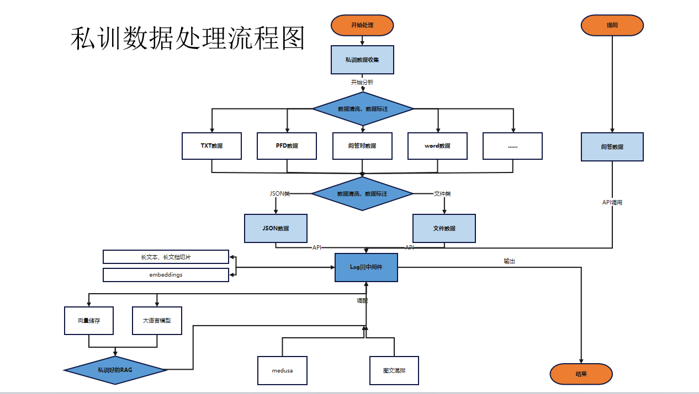

# 知识库

本页将文档检索和 RAG 所需的配置、入库接口、验证步骤放在一起。

[选择向量库](#vector-store-choice) · [存储与 RAG](#retrieval-settings) · [写入](#vector-ingestion-1) · [读取](#vector-ingestion-2) · [检索](#vector-ingestion-3) · [文件与问答入库](#vector-ingestion-5) · [文件处理](#document-processing) · [问答与指令集](#curated-qa)

<a id="vector-store-choice"></a>

## 一、选择并启动向量库

新部署优先使用 SQLite：它与 LinkMind 同机运行时不需要额外服务，适合盒子、单机和小规模资料库。已有 Chroma、Milvus 等服务时再选择对应存储。

SQLite 最小配置：

```yaml
stores:
  vector:
    - name: sqlite
      driver: ai.vector.impl.SqliteVectorStore
      default_category: default
      similarity_top_k: 10
      similarity_cutoff: 0.5
      parent_depth: 1
      child_depth: 1
      path: data/vector.db
```

SQLite 的 `path` 需要可写，升级前请备份数据库。需要独立服务时可选 Chroma。用 `chroma run --path db_data` 固定数据目录，或按镜像版本挂载 Docker 卷。见 [Chroma 持久化与重启验证](best-practices/integrations/chroma-knowledge-base.md#zh-cn)。

## 二、配置存储、Embedding 与 RAG

```yaml
stores:
  vector:
    - name: chroma
      driver: ai.vector.impl.ChromaVectorStore
      default_category: default
      similarity_top_k: 10
      similarity_cutoff: 0.5
      url: http://localhost:8000
  rag:
    vector: chroma
    enable: true
    priority: 10
    track: true
    html: true
    default: "Please give prompt more precisely"
    enable_excel_to_md: true

functions:
  embedding:
    - backend: qwen
      type: Qwen
      api_key: your-api-key
      model_name: text-embedding
```

`stores.rag.vector` 必须与向量库的 `name` 一致。向量库地址应填写 LinkMind 服务可访问的主机，并非一定是浏览器所在主机。`similarity_top_k` 与 `similarity_cutoff` 控制检索数量和阈值，`enable_excel_to_md` 会在入库前规范化表格内容。

<a id="retrieval-settings"></a>

### 向量、对象存储、全文检索与 RAG 参数

<a id="vector-store-fields"></a>

#### 向量库

配置字段使用 `stores.vector`。

```yaml
stores:
  vector:
    - name: chroma
      driver: ai.vector.impl.ChromaVectorStore
      default_category: default
      similarity_top_k: 10
      similarity_cutoff: 0.5
      parent_depth: 1
      child_depth: 1
      url: http://localhost:8000
```

常见字段：

| 字段 | 说明 |
| --- | --- |
| `name` | 向量后端名称 |
| `driver` | Java 向量库实现类 |
| `type` | 可选的向量服务类型标签 |
| `default_category` | 默认集合或分类名 |
| `url` | 远程向量服务地址 |
| `metric` | 相似度度量方式，通常为 cosine |
| `similarity_top_k` | 返回的近邻数量 |
| `similarity_cutoff` | 最低相似度阈值 |
| `parent_depth` / `child_depth` | 父子分块扩展检索深度 |
| `api_key` / `token` | 可选鉴权字段 |
| `index_name` / `environment` / `project_name` | 厂商相关扩展字段 |
| `concurrency` | 可选并发数限制 |

<a id="object-storage"></a>

#### 对象存储（OSS）

```yaml
stores:
  oss:
    - name: landing
      driver: ai.oss.impl.LandingOSS
      bucket_name: lagi
      enable: true

    - name: alibaba
      driver: ai.oss.impl.AlibabaOSS
      endpoint: oss-cn-hangzhou.aliyuncs.com
      access_key_id: your-access-key-id
      access_key_secret: your-access-key-secret
      bucket_name: your-bucket
      enable: true
```

常见字段：

| 字段 | 说明 |
| --- | --- |
| `name` | 存储配置名 |
| `driver` | OSS 实现类 |
| `endpoint` | 对象存储服务地址 |
| `access_key_id` / `access_key_secret` | 云存储密钥对 |
| `bucket_name` | 当前使用的桶名 |
| `enable` | 是否启用该 OSS 配置 |

<a id="term-store"></a>

#### 全文 / 词项检索

```yaml
stores:
  term:
    - name: elastic
      driver: ai.bigdata.impl.ElasticSearchAdapter
      host: localhost
      port: 9200
      enable: false
```

常见字段：

| 字段 | 说明 |
| --- | --- |
| `name` | 词项检索后端名 |
| `driver` | 全文检索适配器类 |
| `host` | 主机地址 |
| `port` | 服务端口 |
| `username` / `password` | 可选认证信息 |
| `enable` | 是否启用该后端 |

<a id="relational-database"></a>

#### 关系型数据库

```yaml
stores:
  database:
    - name: mysql
      jdbc_url: jdbc:mysql://127.0.0.1:3306/demo
      driver: com.mysql.cj.jdbc.Driver
      username: linkmind_reader
      password: your-password
      maximum_pool_size: 20
      idle_timeout: 0
      max_lifetime: 2877700
```

常见字段：

| 字段 | 说明 |
| --- | --- |
| `name` | 数据库配置名 |
| `jdbc_url` | JDBC 连接串 |
| `driver` | JDBC 驱动类 |
| `username` / `password` | 登录账号密码 |
| `maximum_pool_size` | Hikari 连接池最大连接数 |
| `idle_timeout` | 空闲连接超时时间 |
| `max_lifetime` | 连接最大生命周期 |

<a id="rag-fields"></a>

#### RAG

```yaml
stores:
  rag:
    vector: chroma
    term: elastic
    graph: landing
    enable: true
    priority: 10
    track: true
    html: true
    default: "Please give prompt more precisely"
    cache_size: 1000
    preload_cache: false
    preload_cache_category: default
    enable_excel_to_md: true
```

常见字段：

| 字段 | 说明 |
| --- | --- |
| `vector` | 使用哪个向量后端 |
| `term` | 可选的词项检索后端 |
| `graph` | 可选的图式检索后端 |
| `enable` | 是否启用 RAG |
| `priority` | 当 RAG 与直接模型调用竞争时的优先级 |
| `track` | 是否保留文档追踪信息 |
| `html` | 是否启用 HTML 内容处理 |
| `default` | 没检索到上下文时的兜底回复 |
| `cache_size` | 可选的 RAG 缓存大小 |
| `preload_cache` | 是否预加载缓存 |
| `preload_cache_category` | 预加载时使用的分类 |
| `enable_excel_to_md` | 是否把表格内容归一化为 Markdown |

## 三、入库与维护接口

| 任务 | 接口 |
| --- | --- |
| 生成 Embedding | `POST /v1/embeddings` |
| 新增、更新、读取或删除向量 | `POST /v1/vector/add`、`/update`、`/get`、`/delete` |
| 查询向量 | `POST /v1/vector/query` |
| 获取集合列表 | `GET /v1/vector/listCollections` |
| 抽取、OCR 或结构化文档 | `POST /doc/doc2ext`、`/ocr/doc2ocr`、`/doc/doc2struct` |
| 上传私训资料或问答对 | `POST /training/upload`、`POST /uploadFile/pairing` |

每个知识域使用明确的 collection/category，并保存来源元数据，以及自行指定或通过 `/v1/vector/get` 读取到的记录 ID，便于后续更新和删除。`/v1/vector/add` 的成功响应不返回记录 ID。

<a id="vector-ingestion-1"></a>

### 1. 写入或更新向量

`POST /v1/vector/add` 将文本及其元数据写入指定 collection；`/update`、`/get`、`/delete` 分别用于更新、读取、删除。新增时提供 collection/category、文本和元数据；更新或删除时使用自行指定或通过 `/get` 读取到的稳定 ID。下面保留已有的物业文档示例：

```json
{
  "category": "property-manual",
  "data": [
    {
      "document": "物业报修应在两个工作日内完成首次响应。",
      "metadata": {"source": "manual.pdf", "page": "3"}
    }
  ]
}
```

#### 添加向量请求与参数

下面补回旧文档的完整请求示例，包含来源分类、文件名、文件路径及来源标识。示例没有提供 `id` 和 `embedding`，当前 SQLite、Chroma 驱动会生成记录 ID，并使用已配置的 Embedding 能力将文本转换为向量：

```json
{
  "category": "default",
  "data": [
    {
      "metadata": {
        "category": "default",
        "filename": "sample-handbook.pdf",
        "filepath": "202504240001.pdf",
        "source": "file"
      },
      "document": "LinkMind provides a unified AI middleware layer."
    }
  ]
}
```

```bash
curl --request POST "http://localhost:8080/v1/vector/add" \
  -H "Authorization: Bearer <linkmind-api-key>" \
  -H "Content-Type: application/json" \
  --data-raw '{"category":"default","data":[{"metadata":{"category":"default","filename":"sample-handbook.pdf","filepath":"202504240001.pdf","source":"file"},"document":"LinkMind provides a unified AI middleware layer."}]}'
```

请求体为 JSON 对象。下表保留旧文档字段，并按当前实现说明默认值和条件；“有效写入所需”表示应提供这些内容来创建记录，不代表所有后端都会在入口统一校验：

| 字段 | 位置 | 类型 | 必填 | 说明 |
| --- | --- | --- | --- | --- |
| 请求体 | body | object | 是 | JSON 请求对象 |
| `Content-Type` | header | string | 是 | `application/json` |
| `Authorization` | header | string | 按部署鉴权要求 | `Bearer <linkmind-api-key>`；启用鉴权时携带有效的客户端 Key |
| `category` | body | string | 否，建议明确指定 | 知识分类或向量集合名称；SQLite、Chroma 在省略或为 `null` 时使用存储配置的 `default_category` |
| `data` | body | object[] | 是，有效写入所需 | 待写入记录列表，应提供非空数组 |
| `data[].document` | body | string | 文本入库时必填 | 文本内容；未提供有效 `embedding` 时，后端用该文本生成向量，应提供非空文本 |
| `data[].metadata` | body | object | 建议提供；后端相关 | 与文本关联的元数据。SQLite 允许省略或空对象；Chroma 传给上游服务校验，字段和值类型需符合该服务要求 |
| `data[].id` | body | string | 否 | 自行指定的稳定记录 ID；SQLite、Chroma 在省略、为 `null` 或空字符串时生成随机 UUID，并去掉连字符 |
| `data[].embedding` | body | number[] | 否 | 单条记录的向量，字段名为单数 `embedding`；省略、为 `null` 或空数组时，根据 `document` 调用已配置的 Embedding 能力 |

旧示例中的四个元数据键均为业务字段，按需写入；接口不会自动补齐这些键：

| 元数据字段 | 示例类型 | 说明 |
| --- | --- | --- |
| `data[].metadata.category` | string | 元数据中的知识分类或集合标识；请求顶层的 `category` 才用于选择目标集合 |
| `data[].metadata.filename` | string | 来源文件名，例如 `sample-handbook.pdf` |
| `data[].metadata.filepath` | string | 来源文件路径或存储标识，例如 `202504240001.pdf` |
| `data[].metadata.source` | string | 来源标识，例如 `file`，可在后续 `/get` 请求中用于过滤 |

如需自行管理 ID，在每条 `data` 记录中加入实际使用的 `id` 并保存。自动生成的 ID 不会在本接口响应中返回。修改已有记录时使用 `/update` 和对应 ID；新增接口不提供按相同文本自动识别已有记录的约定。

自行提供 `embedding` 时，应使用与目标集合一致的向量维度和 Embedding 模型。未提供向量时，先确认部署中的 Embedding 配置可用；字段名 `embedding` 用于写入单条向量，与读取响应中可能出现的 `embeddings` 不同。

#### 添加向量响应

正常响应使用 HTTP **200** 和以下完整 JSON，保留旧文档的返回约定：

```json
{
  "status": "success"
}
```

| 字段 | 类型 | 出现条件与含义 |
| --- | --- | --- |
| `status` | string | 正常返回时为 `success`；响应不包含记录 ID、写入数量或向量值，实际入库结果应通过读取验证 |

#### 写入后的读取验证与排查

1. 使用非空 `data` 写入一条内容已知的记录，并保存目标集合和用于定位记录的元数据；如自行提供了 ID，一并保存。
2. 按下一节的[读取方法](#2-按条件读取原始记录)调用 `/v1/vector/get`：已有 ID 时使用 `ids`；使用自动 ID 时，通过相同集合和来源元数据查回记录，结合文本核对后保存返回的 `id`。同一来源可能包含多条记录，需要逐条匹配。
3. 核对返回文本和元数据是否与提交内容一致。需要检查向量时，再按读取接口的后端支持范围请求向量值，并确认维度。

SQLite 当前在 `data` 缺失或为空数组时可以直接结束处理，随后接口仍返回 `status: "success"`；该响应不代表一定新增了记录。排查未入库或读取不到的情况时，检查目标集合、非空数据、记录 ID、Embedding 配置及其返回值、向量维度、存储连接或写入权限，以及服务日志。异常不保证返回统一的失败 JSON，需同时检查 HTTP 状态和日志。

#### 更新向量请求与参数

`POST /v1/vector/update` 按集合和记录 ID 更新已有记录的文本、元数据或向量。先通过 `/v1/vector/get` 确认目标 ID 已存在，再将旧文档完整示例中的 `category`、`id` 和内容替换为实际值：

```json
{
  "category": "default",
  "data": [
    {
      "id": "doc_001",
      "metadata": {
        "category": "default",
        "filename": "sample-handbook.pdf",
        "filepath": "202504240001.pdf",
        "source": "file"
      },
      "document": "LinkMind provides a unified AI middleware layer for model routing."
    }
  ]
}
```

```bash
curl --request POST "http://localhost:8080/v1/vector/update" \
  -H "Authorization: Bearer <linkmind-api-key>" \
  -H "Content-Type: application/json" \
  --data-raw '{"category":"default","data":[{"id":"doc_001","metadata":{"category":"default","filename":"sample-handbook.pdf","filepath":"202504240001.pdf","source":"file"},"document":"LinkMind provides a unified AI middleware layer for model routing."}]}'
```

请求体为 JSON 对象。下表保留旧表中的所有字段，并补充可选 `embedding`；“有效更新所需”表示定位并修改记录应提供的内容，入口并未对所有后端执行统一的必填校验：

| 字段 | 位置 | 类型 | 必填 | 说明 |
| --- | --- | --- | --- | --- |
| 请求体 | body | object | 是 | JSON 请求对象 |
| `Content-Type` | header | string | 是 | `application/json` |
| `Authorization` | header | string | 按部署鉴权要求 | `Bearer <linkmind-api-key>`；启用鉴权时携带有效的客户端 Key |
| `category` | body | string | 否，建议明确指定 | 目标知识分类或向量集合名称；SQLite、Chroma 在省略或为 `null` 时使用存储配置的 `default_category` |
| `data` | body | object[] | 是，有效更新所需 | 待更新记录列表，应提供非空数组 |
| `data[].id` | body | string | 是，有效更新所需 | 目标集合中已存在的记录 ID；更新不会自动生成 ID |
| `data[].document` | body | string | 按更新内容提供 | 要写入的新文本；传入非空白文本且未提供非空 `embedding` 时，SQLite、Chroma 会调用配置的 Embedding 能力生成向量 |
| `data[].metadata` | body | object | 按更新内容提供 | 要修改的元数据；SQLite 合并所提供的键，Chroma 的实际更新规则由上游服务决定 |
| `data[].metadata.chapter` | body | integer | 否 | 旧表中的业务元数据示例，可用于章节编号；不是接口固定必填字段 |
| `data[].metadata.verse` | body | integer | 否 | 旧表中的业务元数据示例，可用于节编号；不是接口固定必填字段 |
| `data[].embedding` | body | number[] | 否 | 单条记录的新向量，字段名为单数 `embedding`；传入非空数组时使用该值，维度和模型应与目标集合一致 |

`chapter`、`verse` 在旧表中标为必填整数，但当前请求结构把 `metadata` 定义为可扩展对象，没有对这两个键设置固定必填或额外数值约束。下面保留它们作为整数业务字段的用法；这是 SQLite 仅更新元数据的示例，不修改文本或主动提供新向量：

```json
{
  "category": "default",
  "data": [
    {
      "id": "doc_001",
      "metadata": {
        "chapter": 1,
        "verse": 2
      }
    }
  ]
}
```

#### 更新行为与后端差异

| 行为 | SQLite | Chroma |
| --- | --- | --- |
| 修改文本并生成向量 | 新 `document` 非空白，且 `embedding` 省略、为 `null` 或为空数组时，调用 Embedding 生成向量；提供非空向量时使用提供值 | 使用相同的文本与向量条件决定是否调用 Embedding，然后将更新内容发送给 Chroma 服务 |
| 未提供文本或向量 | `document` 省略或为 `null` 时保留原文；没有可用的新向量时保留原向量 | 当前适配器逐条发送更新字段，未提供的值可能作为数组中的 `null` 传给上游；字段保留及仅更新元数据的支持情况取决于 Chroma 服务 |
| 更新元数据 | 在原元数据上按键合并，提供的同名键覆盖原值，未提供的键保留；省略或为 `null` 时保留原元数据 | 将元数据传给上游服务，不在本地先合并旧元数据；合并、字段类型及空值规则以该服务为准 |
| 目标不存在或数据为空 | `data` 缺失或为空时可直接结束；集合不存在时可直接结束；ID 不存在时跳过该条记录，随后接口仍可能返回 `success` | 将请求交给上游处理，当前接口响应没有逐条命中情况或更新数量；应读回确认结果 |

空字符串与省略 `document` 的含义不同：SQLite 会把显式传入的空文本写入记录，而空白文本不会触发重新生成向量。只想修改元数据时，应省略 `document` 和 `embedding`，并按所用后端的规则验证结果。

SQLite 会将元数据值转换为字符串保存并按字符串读取，因此上面传入的整数 `chapter`、`verse` 读回时可能是 `"1"`、`"2"`。切换后端时应核对元数据类型；不要要求所有驱动保持相同的 JSON 数字类型。

#### 更新向量响应与验证

正常响应使用 HTTP **200** 和下面的完整 JSON，保留旧文档的返回约定：

```json
{
  "status": "success"
}
```

| 字段 | 类型 | 出现条件与含义 |
| --- | --- | --- |
| `status` | string | 正常返回时为 `success`；不包含命中或更新数量，也不返回记录详情，需读回确认目标记录是否已更新 |

1. 更新前按[读取方法](#2-按条件读取原始记录)确认集合和 ID，并记录原文本及相关元数据。
2. 提交更新后，用同一集合和 ID 再次调用 `/v1/vector/get`，核对新文本、修改的元数据，以及按所用后端规则应保留的原字段。
3. 修改文本时，确认 Embedding 调用正常；如需检查向量值，按读取接口的后端支持范围读取并核对维度。仅更新元数据时，确认文本保持原值。

SQLite 跳过不存在的 ID 后仍可能返回 `status: "success"`，因此成功响应不能代替读回验证。若目标未更新，检查集合和 ID、非空 `data`、实际提交的字段、Embedding 配置及返回值、向量维度、存储连接或写入权限，以及服务日志。异常不保证返回统一的失败 JSON，应同时检查 HTTP 状态和日志。

<a id="vector-ingestion-2"></a>

### 2. 按条件读取原始记录

`POST /v1/vector/get` 按集合、元数据、记录 ID 或正文条件读取向量库中的原始记录，适合检查入库内容、获取记录 ID 和分页查看资料。它不需要查询文本，也不进行相似度排序；按问题检索相近内容使用下一节的 `/v1/vector/query`。

#### 读取请求与参数

下面保留旧文档的完整请求示例：在 `default` 集合中读取 `source` 为 `file` 的记录，从偏移量 `0` 开始，最多返回 `10` 条。

```json
{
  "category": "default",
  "where": {
    "source": "file"
  },
  "limit": 10,
  "offset": 0
}
```

```bash
curl --request POST "http://localhost:8080/v1/vector/get" \
  -H "Authorization: Bearer <linkmind-api-key>" \
  -H "Content-Type: application/json" \
  --data-raw '{"category":"default","where":{"source":"file"},"limit":10,"offset":0}'
```

请求体为 JSON 对象。旧表将四个字段全部标为必填；当前接口没有这一统一要求，字段的默认行为由存储驱动决定。以下按当前 SQLite、Chroma 驱动说明，建议显式填写目标集合和分页参数：

| 字段 | 位置 | 类型 | 必填 | 说明 |
| --- | --- | --- | --- | --- |
| 请求体 | body | object | 是 | JSON 请求对象 |
| `Content-Type` | header | string | 是 | `application/json` |
| `Authorization` | header | string | 按部署鉴权要求 | `Bearer <linkmind-api-key>`；启用鉴权时携带有效的客户端 Key |
| `category` | body | string | 否，建议明确指定 | 知识分类或向量集合名称；SQLite、Chroma 在省略或为 `null` 时使用存储配置的 `default_category` |
| `where` | body | object | 否 | 元数据过滤条件；如 `{"source":"file"}`。不需要元数据过滤时省略；支持的运算符及值类型取决于后端 |
| `limit` | body | integer | 否，建议明确指定 | 返回记录数上限，建议使用正整数；省略时没有统一的小分页默认值，具体见后端差异 |
| `offset` | body | integer | 否，建议明确指定 | 结果偏移量，从 `0` 开始，应使用非负整数；SQLite 省略时按 `0` 处理 |
| `ids` | body | string[] | 否 | 指定要读取的记录 ID，例如 `["doc_001"]`；应使用实际已存储或读取到的 ID |
| `where_document` | body | object | 否 | 正文过滤条件，例如 `{"$contains":"LinkMind"}`；它过滤文档文本，具体支持范围见后端差异 |
| `include` | body | string[] | 否 | 请求包含的数据项，例如 `["documents","metadatas","embeddings"]`；实际返回内容取决于后端及适配器，不能仅凭请求值认定会返回向量 |

额外字段的组合示例，ID 和正文条件应替换为实际记录中的值：

```json
{
  "category": "default",
  "ids": ["doc_001"],
  "where_document": {"$contains": "LinkMind"},
  "limit": 10,
  "offset": 0,
  "include": ["documents", "metadatas", "embeddings"]
}
```

#### 后端支持差异

| 行为 | SQLite | Chroma |
| --- | --- | --- |
| 集合与分页 | 省略 `category` 时使用默认集合；省略 `offset` 时为 `0`；省略 `limit` 时读取路径可能返回全部匹配记录，应显式限制数量 | `category` 用于选择集合；过滤和分页参数发送给配置的 Chroma 服务，省略时的行为由该服务决定 |
| 元数据、正文与 ID 过滤 | 支持 `where`、`ids`，以及 `where_document` 中的 `$contains`、`$not_contains`；所用条件共同筛选记录 | `where`、`where_document`、`ids` 发送给 Chroma 服务，支持语法和限制取决于该服务版本 |
| `include` 与返回字段 | 正常读取路径可通过包含 `embeddings` 请求向量值；`document`、`id`、`metadata` 仍会读取，不通过 `include` 隐藏 | 当前 `/get` 适配器按上游 ID 列表组装记录，可返回 `document`、`metadata` 和 `embeddings`；未请求或上游未提供的字段可能省略 |

SQLite 当前在未指定 `ids`、且命中部分 `$and` 元数据组合过滤路径（等值或 `$in`）时，即使请求了 `embeddings`，结果也可能不含向量值。需要向量时，可以先取得记录 ID，再通过 `ids` 配合 `include` 读取，并检查返回字段。

Chroma 可通过 `include` 选择 `documents`、`metadatas`、`embeddings`；若只需要向量，可请求 `["embeddings"]`。当前 `/get` 适配器不要求响应同时包含正文或元数据，会按上游实际返回的内容填充字段；需要文本和来源信息时，按需请求相应项。切换存储驱动或 Chroma 服务版本后，应重新验证所用过滤条件和返回字段。

#### 完整响应与字段说明

正常读取使用 HTTP **200** 和 JSON 响应体。下面保留旧文档的完整响应示例；示例中的 ID、文本和七个元数据字段用于说明结构，实际内容以入库记录为准：

```json
{
  "status": "success",
  "data": [
    {
      "document": "LinkMind provides a unified AI middleware layer.",
      "id": "doc_001",
      "metadata": {
        "category": "default",
        "file_id": "file_001",
        "filename": "sample-handbook.pdf",
        "filepath": "202504240001.pdf",
        "level": "user",
        "parent_id": "chunk_root_001",
        "source": "file"
      }
    }
  ]
}
```

下表保留全部旧字段及其示例类型。`metadata` 是可扩展对象，其中字段是否出现、实际值和类型取决于写入记录及存储驱动；读取接口不会自动补齐这七个字段，未赋值的响应字段也可能省略。

| 字段 | 类型 | 说明 |
| --- | --- | --- |
| `status` | string | 读取执行状态，正常完成时为 `success`；是否匹配到记录需检查 `data` |
| `data` | object[] | 返回的记录列表；正常读取但没有匹配记录时可以为空数组 `[]` |
| `data[].document` | string | 记录的文本内容 |
| `data[].id` | string | 记录 ID，可用于后续按 ID 读取、更新或删除 |
| `data[].metadata` | object | 与文本关联的元数据；按存储内容返回 |
| `data[].metadata.category` | string | 元数据中保存的知识分类或集合标识；与请求中用于选择集合的 `category` 分别存储，不能假定自动同步 |
| `data[].metadata.file_id` | string | 来源文件 ID |
| `data[].metadata.filename` | string | 来源文件名 |
| `data[].metadata.filepath` | string | 来源文件路径或存储标识，例如 `202504240001.pdf` |
| `data[].metadata.level` | string | 知识级别，如 `user`（旧文档的默认约定）；本读取接口不会自动补充默认级别 |
| `data[].metadata.parent_id` | string | 父片段或父记录 ID；由入库流程写入时返回 |
| `data[].metadata.source` | string | 来源标识，例如 `file`；含义由写入方约定 |
| `data[].embeddings` | number[] | 可选的向量值，取决于 `include`、后端和读取路径；当前支持边界见上表 |

#### 读取结果验证

1. 选择已写入记录的集合，并使用已知元数据执行上面的完整请求；核对 `data` 中的文本、ID 和来源信息。
2. 将返回 ID 放入 `ids` 再次读取，确认定位到同一记录。若使用正文过滤，核对实际返回文本满足条件。
3. 用小的 `limit` 和递增的 `offset` 检查分页；分页过程中保持数据集稳定，并按 ID 检查重复或遗漏。此接口没有相似度排序含义。
4. 若请求向量值，实际检查 `data[].embeddings` 是否存在，按上面的后端差异处理。

`status: "success"` 可以与 `data: []` 同时出现。空结果先检查集合、ID 和过滤值；不要把正常的空集合或无匹配结果当成返回格式错误。JSON 无效、过滤语法不兼容或存储连接失败等异常不保证返回统一的失败 JSON，应结合 HTTP 状态和服务日志排查。

<a id="vector-ingestion-3"></a>

### 3. 查询检索结果

`POST /v1/vector/query` 根据查询文本执行向量检索并返回相似记录。下面保留已有的物业资料查询示例：

```json
{
  "category": "property-manual",
  "text": "报修后多久响应？",
  "n": 5
}
```

`category` 对应知识分类或 collection，`text` 是检索问题，`n` 是期望返回的近邻数量。当前接口直接调用所选向量存储的查询方法；SQLite、Chroma 的这条直接查询路径使用请求中的 `n` 和过滤条件，不额外应用 RAG 检索链路的 `similarity_top_k`、`similarity_cutoff` 截断。实际返回数量和距离含义见下文。

#### 查询请求与参数

下面保留旧文档的完整请求示例，包括元数据过滤字段 `where`：

```json
{
  "category": "default",
  "text": "How does model routing work?",
  "n": 5,
  "where": {
    "source": "file"
  }
}
```

```bash
curl --request POST "http://localhost:8080/v1/vector/query" \
  -H "Authorization: Bearer <linkmind-api-key>" \
  -H "Content-Type: application/json" \
  --data-raw '{"category":"default","text":"How does model routing work?","n":5,"where":{"source":"file"}}'
```

请求体为 JSON 对象。下表保留旧请求字段，并按当前代码说明必填条件和默认值，另补充正文过滤字段：

| 字段 | 位置 | 类型 | 必填 | 说明 |
| --- | --- | --- | --- | --- |
| 请求体 | body | object | 是 | JSON 请求对象 |
| `Content-Type` | header | string | 是 | `application/json` |
| `Authorization` | header | string | 按部署鉴权要求 | `Bearer <linkmind-api-key>`；启用鉴权时携带有效的客户端 Key |
| `category` | body | string | 否，建议明确指定 | 目标知识分类或向量集合名称；SQLite、Chroma 在省略或为 `null` 时使用存储配置的 `default_category` |
| `text` | body | string | 相似度检索时必填 | 输入的查询文本，应提供非空文本；查询向量由已配置的 Embedding 能力生成，应与目标集合使用的模型及维度匹配 |
| `n` | body | integer | 否，建议明确指定 | 期望返回的近邻数量，应使用正整数；SQLite 省略或为 `null` 时使用 `10`，Chroma 的默认行为由上游服务决定 |
| `where` | body | object | 否 | 元数据过滤条件，例如 `{"source":"file"}`；不需要时省略，支持的运算符和字段值类型取决于后端 |
| `whereDocument` | body | object | 否 | 当前 `/query` 入口的正文过滤字段，例如 `{"$contains":"LinkMind"}`；SQLite 支持 `$contains`、`$not_contains`，Chroma 的支持范围由服务版本决定 |

正文过滤的字段名在接口之间不同：`/query` 当前使用驼峰形式 `whereDocument`，而 `/get`、`/delete` 使用 `where_document`。在 `/query` 中提交 `where_document` 不会启用该正文过滤条件。需要同时按元数据和正文过滤时，使用以下写法：

```json
{
  "category": "default",
  "text": "How does model routing work?",
  "n": 5,
  "where": {"source": "file"},
  "whereDocument": {"$contains": "LinkMind"}
}
```

#### 查询行为与距离含义

| 行为 | SQLite | Chroma |
| --- | --- | --- |
| `n` 的默认值 | 省略或为 `null` 时使用 `10`；正常文本查询最多返回请求的 `n` 条匹配记录 | 将 `n` 作为上游的结果数量参数发送，省略时不在本地补固定值，由服务处理 |
| 过滤与返回数量 | 正常文本查询存在过滤条件时，先召回最多 `5 × n` 个候选，再过滤并最多返回 `n` 条；结果可能不足 `n`，不表示集合中只有这些符合条件的记录 | 将元数据和正文过滤条件发送给 Chroma，过滤方式及返回数量由上游查询决定 |
| `distance` | 返回向量扩展计算的原始距离，并按距离升序取结果；本接口不将其转换为概率或统一的相似度分数 | 原样返回 Chroma 提供的距离值，其尺度和含义取决于集合配置的距离度量；不在本地统一归一化 |
| `text` 缺失或为空字符串 | 退化为按条件读取记录，数量上限为 `n`，不进行相似度排序，也不会为这些记录计算查询距离 | 本入口会把 `text` 作为单条 Embedding 输入处理，不能假定存在与 SQLite 相同的读取回退；相似度查询应提供非空文本 |

`n` 是请求数量，不保证每次返回足量结果。比较 `distance` 时应保持集合、Embedding 模型和距离度量一致；示例中的 `0.12` 仅用于说明数字类型，不表示置信度或固定的命中阈值。按条件查看原始记录时，可直接使用上一节的 `/v1/vector/get`。

#### 完整查询响应与字段说明

查询到记录时，正常响应使用 HTTP **200** 和 JSON 响应体。下面保留旧文档的完整响应示例：

```json
{
  "status": "success",
  "data": [
    {
      "document": "LinkMind can route requests across multiple model backends.",
      "id": "doc_002",
      "metadata": {
        "category": "default",
        "file_id": "file_001",
        "filename": "sample-handbook.pdf",
        "filepath": "202504240001.pdf",
        "level": "user",
        "parent_id": "chunk_root_001",
        "source": "file"
      },
      "distance": 0.12
    }
  ]
}
```

下表恢复旧文档的全部返回字段，包括原表中列出、但示例 JSON 未包含的 `reference_document_id`。元数据字段是否出现、实际值和类型取决于入库记录及驱动；查询不会自动补齐所有字段，未赋值的字段可能省略。

| 字段 | 类型 | 出现条件与含义 |
| --- | --- | --- |
| `status` | string | 有结果时为 `success`；查询返回空列表时，当前入口返回 `failed` |
| `data` | object[] | 匹配记录列表；当前无匹配响应不包含此字段 |
| `data[].document` | string | 结果记录的文本内容 |
| `data[].id` | string | 结果记录 ID，可用于后续读取、更新或删除 |
| `data[].metadata` | object | 与文本关联的元数据，按存储内容返回 |
| `data[].metadata.category` | string | 元数据中保存的知识分类或集合标识 |
| `data[].metadata.file_id` | string | 来源文件 ID |
| `data[].metadata.filename` | string | 来源文件名 |
| `data[].metadata.filepath` | string | 来源文件路径或存储标识 |
| `data[].metadata.level` | string | 知识级别，如 `user`（旧文档的默认约定）；查询不会自动填充默认级别 |
| `data[].metadata.parent_id` | string | 父片段或父记录 ID，入库时保存该字段的记录才会返回 |
| `data[].metadata.source` | string | 来源标识，例如 `file`，由写入方约定 |
| `data[].metadata.reference_document_id` | string | 关联的参考文档记录 ID；仅在元数据保存该引用时返回，不是每条记录的固定必有字段 |
| `data[].distance` | number | 后端返回的距离值，含义见上表；SQLite 退化为原始记录读取时不计算此值 |

查询正常完成但结果为空时，当前入口返回以下 JSON，通常仍为 HTTP **200**：

```json
{
  "status": "failed"
}
```

这里的 `failed` 可表示“没有匹配结果”，并且不包含 `data`。这与 `/get` 无匹配时可以返回 `{"status":"success","data":[]}` 的约定不同。请求解析、Embedding 或存储异常不保证使用同一失败 JSON，应同时检查 HTTP 状态和日志。

#### 查询验证与排查

1. 选择已知存在记录的集合，先用非空 `text` 和明确的 `n` 查询；核对返回 ID、文本及来源信息。
2. 逐步加入 `where` 和 `whereDocument`，核对返回记录满足元数据和正文条件；确认 `/query` 的正文过滤字段使用驼峰写法。
3. 检查结果数量和后端距离含义。SQLite 过滤后的结果不足 `n` 时，可用 `/get` 分页核对符合条件的原始记录，区分候选召回不足与实际没有匹配记录。
4. 收到 `failed` 时，先通过 `/get` 检查集合和记录，再检查过滤条件、查询文本、Embedding 模型及维度、后端连通性和日志。验证聊天中的 RAG 召回时，另按 RAG 链路的配置和步骤检查。

<a id="vector-ingestion-4"></a>

### 4. 删除向量

`POST /v1/vector/delete` 删除指定集合中的向量记录。下面保留旧文档按记录 ID 删除的完整请求；执行前应通过 `/v1/vector/get` 确认集合与 ID 对应的内容，并将示例值替换为实际删除目标：

```json
{
  "category": "default",
  "ids": [
    "doc_001"
  ]
}
```

```bash
curl --request POST "http://localhost:8080/v1/vector/delete" \
  -H "Authorization: Bearer <linkmind-api-key>" \
  -H "Content-Type: application/json" \
  --data-raw '{"category":"default","ids":["doc_001"]}'
```

#### 删除请求参数

请求体为 JSON 对象。旧表中的 `category`、`ids` 及其类型完整保留，另补充代码支持的过滤字段；必填条件按当前实现和具体删除方式说明：

| 字段 | 位置 | 类型 | 必填 | 说明 |
| --- | --- | --- | --- | --- |
| 请求体 | body | object | 是 | JSON 请求对象 |
| `Content-Type` | header | string | 是 | `application/json` |
| `Authorization` | header | string | 按部署鉴权要求 | `Bearer <linkmind-api-key>`；启用鉴权时携带有效的客户端 Key |
| `category` | body | string | 否，删除时应明确指定 | 目标知识分类或向量集合名称；SQLite、Chroma 在省略或为 `null` 时使用存储配置的 `default_category` |
| `ids` | body | string[] | 按 ID 删除时必填 | 待删除记录的 ID 列表；使用已核实的非空列表，例如 `["doc_001"]`。与过滤字段同时传入时，组合规则取决于后端 |
| `where` | body | object | 否 | 元数据过滤条件，例如 `{"source":"file"}`；支持语法和字段值类型取决于后端 |
| `where_document` | body | object | 否 | 正文过滤条件，例如 `{"$contains":"LinkMind"}`；SQLite 支持 `$contains`、`$not_contains`，Chroma 的支持范围由服务版本决定 |

#### 删除范围与后端差异

| 情况 | SQLite | Chroma |
| --- | --- | --- |
| 仅提供 `ids` | 删除列表中的记录及其元数据；不存在的 ID 不产生实际删除 | 将请求发送给配置的 Chroma 服务，由该服务处理指定 ID |
| 仅提供过滤条件 | 删除匹配记录；同时提供 `where` 与 `where_document` 时，记录需同时满足两种过滤条件 | 将过滤字段发送给 Chroma 服务，按其支持的语法和规则处理 |
| 同时提供 `ids` 与过滤条件 | 将明确指定的 ID 与过滤匹配的 ID 合并后删除，即两组结果的并集；过滤条件不会进一步限制明确指定的 ID | 当前适配器直接发送这些字段，不在本地计算交集或并集；组合方式由 Chroma 服务决定 |
| 无 ID 且过滤条件为空 | 没有待删除记录，不执行记录删除；接口仍可能返回 `success` | 空条件的校验和处理由 Chroma 服务决定，应明确提供删除范围 |
| 集合不存在或没有匹配记录 | 集合不存在时可直接结束，没有匹配时不删除记录；接口仍可能返回 `success` | 按上游服务处理结果返回，当前接口没有删除数量可供确认 |

例如，`ids` 指定 `doc_001`，而 `where` 匹配到 `doc_002`，SQLite 会把这两条记录都加入待删除集合，即使 `doc_001` 不满足该过滤条件。这与 SQLite `/get` 同时传入 ID 和过滤条件时的共同筛选行为不同。

若业务要求“只删除这些 ID 中符合过滤条件的记录”，先用 `/v1/vector/get` 组合筛选，核对并收集最终 ID，再向 `/delete` 仅提交目标 `category` 和最终 `ids`。使用过滤删除时，应先按所需范围分页查看匹配记录；切换后端后需重新核对过滤和组合规则。

#### 删除响应与结果核验

正常响应使用 HTTP **200** 和下面的完整 JSON，保留旧文档的返回约定：

```json
{
  "status": "success"
}
```

| 字段 | 类型 | 出现条件与含义 |
| --- | --- | --- |
| `status` | string | 正常返回时为 `success`；不包含删除数量、实际删除的 ID 或逐条处理结果，需通过读取核验 |

1. 删除前按[读取方法](#2-按条件读取原始记录)确认目标集合、ID、文本和来源元数据；如使用过滤条件，先核对完整匹配范围。
2. 提交确认过的删除请求后，使用相同集合和待删除的 `ids` 再次调用 `/v1/vector/get`。在这些记录均已删除时，正常读取应返回空的 `data` 数组。
3. 检查一条未选中的对照记录仍能读取。若采用过滤删除，使用原过滤条件再次查询，并检查有无剩余匹配记录。

`status: "success"` 本身不说明删除了多少条记录，也可能对应没有匹配或未指定有效范围的请求。若结果与预期不符，检查集合、ID、过滤语法和后端组合规则，并查看 HTTP 状态、存储连接或写入权限及服务日志。异常不保证返回统一的失败 JSON。

<a id="vector-ingestion-5"></a>

### 5. 上传文件或问答对

#### 上传私训学习文件

`POST /training/upload?category=property-manual` 使用 `multipart/form-data`，文件字段为 `fileToUpload`，用于上传通用知识文件并写入私有知识库。请求中应明确指定目标分类，并按部署要求携带鉴权信息：

```bash
curl --request POST "http://localhost:8080/training/upload?category=property-manual&level=user" \
  -H "Authorization: Bearer <linkmind-api-key>" \
  --form "fileToUpload=@./examples/docs/sample.pdf"
```

下面保留旧文档的文件字段示意；`file://` 表示调用方选择的本地文件。实际请求应像上面的 curl 一样发送文件内容，不能只发送这段路径字符串，也不能要求服务端读取调用方的本地路径：

```yaml
fileToUpload: file://./examples/docs/sample.pdf
```

| 字段 | 位置 | 类型 | 必填 | 说明 |
| --- | --- | --- | --- | --- |
| `category` | query | string | 是，调用时明确提供 | 知识分类或向量集合名称，例如 `property-manual` |
| `level` | query | string | 否 | 写入来源元数据的知识级别；未传时为 `user`。空字符串不会触发此默认值 |
| `body` | body | object（multipart/form-data） | 上传文件时必填 | 表示整个 multipart 请求体，不是名为 `body` 的 JSON 字段 |
| `fileToUpload` | body 中的文件 part | string(binary) | 是 | 要上传的知识文件内容；可用多个文件 part 上传多个文件 |
| `Content-Type` | header | string | 是，由上传客户端生成 | `multipart/form-data`，包含客户端生成的 boundary；使用 curl `--form` 时不要手工覆盖 |
| `Authorization` | header | string | 按部署鉴权要求 | 示例为 `Bearer <linkmind-api-key>`，按实际部署提供有效凭据 |

旧参数表将 `body` 标为可选，但真正上传文件需要 multipart 请求体及文件 part。当前处理器读取 URL 查询参数中的 `category`、`level`，普通 multipart 文本字段不会在文件处理循环中作为这些参数读取，因此应使用示例中的 query 写法。接口未对分类缺失或级别取值提供统一的参数错误响应；调用方应明确传入分类，不依赖省略分类后的行为。

#### 文件上传的完整响应

正常返回使用 HTTP **200**，响应体为 JSON。当前上传处理器的响应头仍可能为 `text/html;charset=utf-8`，客户端应按 JSON 解析响应正文。下面保留旧文档的完整示例，文件名和各 ID 为示意值：

```json
{
  "status": "success",
  "data": "[{\"filename\":\"sample.pdf\",\"filepath\":\"202504240001.pdf\",\"fileId\":\"file_001\",\"vectorIds\":[[\"vec_001\",\"vec_002\"]]}]",
  "task_id": "task_001"
}
```

| 字段 | 类型 | 出现条件与含义 |
| --- | --- | --- |
| `status` | string | 正常返回为 `success`；应同时检查 `msg`、文件结果和实际入库记录 |
| `data` | string | 文件信息数组的 JSON 字符串。先解析外层响应，再对 `data` 进行一次 JSON 解析，才能获得文件对象数组；没有文件结果时可能为字符串 `"[]"` |
| `task_id` | string | 当前上传请求的进度跟踪 ID，可用于查询任务进度；同步与异步上传均会生成，不代表请求一定采用异步处理 |
| `msg` | string | 可选的提示或错误信息；例如 multipart 解析异常时可能出现 `解析文件出现错误`，即使 `status` 仍为 `success` 也需处理 |

第二次解析 `data` 后，数组中每个文件对象包含：

| 字段 | 类型 | 含义 |
| --- | --- | --- |
| `filename` | string | 调用方上传的原始文件名，例如 `sample.pdf` |
| `filepath` | string | 服务端保存文件时生成的文件名，保留扩展名；不是调用方的本地路径，也不是完整下载 URL |
| `fileId` | string | 文件标识，对应向量记录元数据中的 `file_id`，用于关联文件及其派生记录 |
| `vectorIds` | string[][] | 按文档处理分组组织的向量 ID 列表，可能包含空组；当前结果不保证列出文件产生的全部派生问答向量，完整核验可按 `file_id` 读取 |

旧文档将 `task_id` 统一描述为“异步任务 ID”。当前 `/training/upload` 会等待文件处理流程返回后，再组装包含 `fileId`、`vectorIds` 的结果；内部使用线程池不改变这个请求等待行为。部分向量处理异常会记录在服务日志中，返回 ID 或 `success` 仍不能替代实际读取核验。

#### 异步上传与进度查询

需要先接收上传结果、再等待入库处理时，使用独立的异步入口 `POST /training/asynchronousUpload`，同样使用 query 参数和 multipart 文件：

```bash
curl --request POST "http://localhost:8080/training/asynchronousUpload?category=property-manual&level=user" \
  -H "Authorization: Bearer <linkmind-api-key>" \
  --form "fileToUpload=@./examples/docs/sample.pdf"
```

该入口保存上传文件并提交后台处理后返回。初始响应的 `data` 是 **JSON 数组**，仅含 `filename`、`filepath`；此处不要再次将 `data` 当字符串解析，也不要等待初始响应携带完整的 `fileId`、`vectorIds`：

```json
{
  "status": "success",
  "data": [
    {
      "filename": "sample.pdf",
      "filepath": "202504240001.pdf"
    }
  ],
  "task_id": "task_001"
}
```

通过 `GET /training/getProgress` 查询返回的 `task_id`；`GET /uploadFile/getProgress` 是同一处理器下的查询入口：

```bash
curl --get "http://localhost:8080/training/getProgress" \
  -H "Authorization: Bearer <linkmind-api-key>" \
  --data-urlencode "task_id=<task-id>"
```

| 字段 | 类型 | 含义 |
| --- | --- | --- |
| `status` | string | 进度查询的业务状态；找到记录且进度不为负数时通常为 `success`，并不表示所有文件均已入库 |
| `progress` | integer | 找到任务时返回的进度值，初始为 `0`，处理时可能为 `30`，完成回调可设为 `100`；负值表示已标记失败 |
| `files` | object[] | 找到任务时返回的逐文件快照；异步处理逐步填充 `filename`、`filepath`、`fileId`、`status`、`docs`，尚未生成的字段可能省略。`docs` 可含切片正文、问题及 `vectorId`；同步路径通常没有这些快照 |
| `msg` | string | 可选提示；进度为 `100` 时为 `上传完毕！`，正数且未到 `100` 时为 `上传中...`，负数时为 `上传失败！`；查不到记录时为 `未找到该taskId记录！！！` |

例如单文件同步上传正常处理后，查询可能返回以下完整结果；此时 `files: []` 不代表该文件没有处理：

```json
{
  "status": "success",
  "progress": 100,
  "files": [],
  "msg": "上传完毕！"
}
```

异步处理时，应将上传响应中的每个 `filepath` 与 `files` 快照对应，并检查各文件的 `status`：文件处理成功会标记为 `SUCCESS`，失败可标记为 `FAILED`。当前单个文件完成即可把整体进度设为 `100`；异步失败也可能只在 `files[].status` 中标记为 `FAILED`，而顶层 `status` 仍为 `success`。因此批量上传不能只看 `progress: 100` 或提示文字，还需确认所有预期文件的状态和实际记录。

任务进度保存在当前服务进程的内存缓存中，目前最多保留 `100` 条任务记录。重启、记录被淘汰或请求落到其他实例时可能查不到；`task_id` 不应作为长期保存的入库凭证。未找到记录的响应为 `status: "failed"` 和上述提示，不包含 `progress`、`files`。

#### 核验文件入库结果

1. 同步上传检查 `msg`，再次解析字符串 `data`，确认预期文件存在，并保存 `fileId` 和可用的 `vectorIds`。未收到文件 part 或解析失败时可能仍返回 `success` 与 `data: "[]"`；部分解析失败时也可能只返回已接收文件的结果。
2. 异步上传先保存初始文件列表与 `task_id`，再查询进度并逐一对应文件。等待所有预期文件出现完成状态；若有 `FAILED`、文件缺失或进度长期不变，检查处理日志及文档处理、Embedding、向量存储连接。
3. 按[读取方法](#2-按条件读取原始记录)调用 `/v1/vector/get`，传入目标 `category`，使用返回的向量 `ids`，或使用 `where: {"file_id": "<file-id>"}` 分页读取该文件的记录，核对文本、来源及知识级别。同步响应中的 `vectorIds` 可先展平用于按 ID 读取；只列出一组或一页记录不能证明全部入库。
4. 再用文件中的明确事实调用 `/v1/vector/query`，检查能否检索到预期内容。同步路径还可查看已上传文件列表；当前异步路径未执行同样的文件列表登记，列表中缺少条目时应继续以实际向量读取核验。

处理异常不保证统一返回失败 JSON。出现超时、非 JSON 响应或写入结果不完整时，结合 HTTP 状态、错误提示、日志和实际记录判断，先核验已有结果再决定是否重试，避免重复入库。

#### 上传问答对

问答对使用 `POST /uploadFile/pairing`：

```json
{
  "category": "property-manual",
  "level": "user",
  "data": [
    {
      "instruction": ["物业报修多久响应？"],
      "output": "应在两个工作日内完成首次响应。"
    }
  ]
}
```

##### 完整请求与参数

`POST /uploadFile/pairing` 接收 JSON，将通用问题或指令及其答案写入私有知识库。下面保留旧文档的完整请求；上面的物业问答示例继续适用：

```json
{
  "category": "default",
  "level": "user",
  "data": [
    {
      "instruction": [
        "What is LinkMind?"
      ],
      "output": "LinkMind is an AI middleware layer for routing, RAG, and multimodal orchestration."
    }
  ]
}
```

将该请求保存为本地 `qa-pairs.json` 后，可按实际部署补充鉴权信息并提交：

```bash
curl --request POST "http://localhost:8080/uploadFile/pairing" \
  -H "Content-Type: application/json" \
  -H "Authorization: Bearer <linkmind-api-key>" \
  --data-binary "@qa-pairs.json"
```

| 字段 | 位置 | 类型 | 必填 | 说明 |
| --- | --- | --- | --- | --- |
| `body` | body | object | 是 | 整个 JSON 请求体；不是名为 `body` 的嵌套字段 |
| `category` | body | string | 是，调用时明确提供 | 知识分类或向量集合名称；这里放在 JSON 中，不沿用文件上传的 query 写法 |
| `level` | body | string | 否 | 知识级别；未传或为 `null` 时使用 `user`，空字符串会原样保留 |
| `data` | body | object[]，兼容 object | 是 | 问答对列表；每项包含问题和答案，也可直接传单个问答对象 |
| `data[].instruction` | body | string[]，兼容 string | 是 | 问题或指令列表；同一项中的多个问题共用该项 `output`，单条字符串也可接收 |
| `data[].output` | body | string | 是 | 对应答案或输出内容 |
| `Content-Type` | header | string | 是 | 使用 `application/json` |
| `Authorization` | header | string | 按部署鉴权要求 | 示例为 `Bearer <linkmind-api-key>`，按实际部署提供有效凭据 |

旧表将 `body` 标为可选，但有效调用需要提供上述 JSON 对象。表中的必填要求用于构造有效请求，当前接口并未对所有字段统一执行完整性校验。问题和答案写入前会去除首尾空白；调用方应提供非空文本，避免缺失字段、`null` 项、空问题列表或空的 `data`。空列表或不符合预期的类型可能不产生记录，缺失值也可能导致后台异常，而不是统一返回参数错误 JSON。

##### 单条数据兼容写法

以下示例将 `data` 写成单个对象、`instruction` 写成单条字符串，并省略 `level` 以使用默认的 `user`。两种容器形式均由当前服务端接收，含义与列表写法一致：

```json
{
  "category": "default",
  "data": {
    "instruction": "What is LinkMind?",
    "output": "LinkMind is an AI middleware layer for routing, RAG, and multimodal orchestration."
  }
}
```

批量上传继续使用 `data` 数组。每项可以包含多个问题，但一个 `output` 只与该项中的问题配对；不同答案应拆成不同的问答对象。

##### 成功响应与后台处理

正常响应使用 HTTP **200**，完整 JSON 如下，保留旧文档的响应结构：

```json
{
  "status": "success"
}
```

| 字段 | 类型 | 出现条件与含义 |
| --- | --- | --- |
| `status` | string | 正常响应包含 `success`，表示请求已解析并启动后台处理；不表示全部问答对已经成功入库 |

当前处理器启动后台线程后即返回，不等待向量写入等后续处理完成。响应不包含 `data`、`task_id`、文件 ID、向量 ID、入库数量或逐条结果，也不能直接使用文件上传的 `/training/getProgress` 查询该请求。当前响应头仍可能为 `text/html;charset=utf-8`，客户端应按 JSON 解析正文。

JSON 解析错误可能在启动后台处理前失败；后台异常则无法改写已经返回的 `success`。接口没有保证所有失败都使用同一 JSON 格式，调用方需要结合 HTTP 状态、服务日志与实际记录核验。

##### 问答对入库核验

1. 首次接入时先提交一条内容容易辨认的问答，并记录请求中的 `category`、问题和答案。收到 `success` 后等待后台处理，通过有次数或时间上限的读取核验结果，不把这次响应当作完成通知。
2. 按[读取方法](#2-按条件读取原始记录)调用 `/v1/vector/get`，使用同一 `category`，通过 `where_document: {"$contains": "<问题中的独特文本>"}` 查找问题记录；核对完整文本及其元数据中的分类、`level`、问答来源标记和 `seq`。需要时分页读取，并保存实际返回的记录 ID。
3. 当前链路将每个问题及其答案写为相互关联的记录。取得问题记录 ID 后，可用 `where: {"parent_id": "<问题记录ID>"}` 读取关联答案，核对答案文本；多个问题应分别核验。`seq` 是该请求生成的时间标记，不是可查询进度的任务 ID。
4. 再用 `/v1/vector/query` 检查相关问题的检索结果。若暂时查不到，检查后台日志、Embedding 与向量存储连接及分类配置；查询返回匹配记录本身不证明本次批量请求全部完成，应逐项核对预期问答。

问答对响应不提供文件标识，不应以已上传文件列表代替上述向量核验。重复提交可能生成新的向量记录，接口没有按问题文本提供幂等保证；重试前先检查已写入的部分，避免重复入库。

#### 文件列表与删除

使用 `GET /uploadFile/getUploadFileList` 查看已上传文件，使用 `POST /uploadFile/deleteFile` 按文件 ID 删除，并同步清理相关向量。

##### 列表请求与分页

`GET /uploadFile/getUploadFileList` 分页查询已登记的知识文件记录，不需要请求体。下面按 `default` 分类读取第一页，每页最多 `10` 条：

```bash
curl --get "http://localhost:8080/uploadFile/getUploadFileList" \
  -H "Authorization: Bearer <linkmind-api-key>" \
  --data-urlencode "category=default" \
  --data-urlencode "pageNumber=1" \
  --data-urlencode "pageSize=10"
```

| 字段 | 位置 | 类型 | 必填 | 说明 |
| --- | --- | --- | --- | --- |
| `category` | query | string | 否 | 按文件记录中的分类精确筛选；未传时不添加分类条件，传空字符串会筛选空字符串分类 |
| `pageSize` | query | string（正整数文本） | 使用分页时与 `pageNumber` 同时提供 | 每页大小，例如 `10`；服务端按整数解析，不支持小数 |
| `pageNumber` | query | string（正整数文本） | 使用分页时与 `pageSize` 同时提供 | 从 `1` 开始的页码，例如 `1` |
| `lagiUserId` | query | string | 否 | 当前实现额外支持的用户筛选条件，匹配文件记录保存的用户标识；参数名为 `lagiUserId`，不是 `userId` |
| `Authorization` | header | string | 按部署鉴权要求 | 示例为 `Bearer <linkmind-api-key>`，按实际部署提供有效凭据 |

旧参数表将两个分页参数分别标为可选。当前实现按是否存在 `pageNumber` 决定是否读取两者，因此应按下表配合使用：

| 传参方式 | 当前行为 |
| --- | --- |
| 同时省略 `pageNumber`、`pageSize` | 使用 `pageNumber: 1`、`pageSize: 2147483647`，并非默认每页 `10` 条 |
| 只传 `pageSize` | 该值被忽略，仍使用上述默认值 |
| 只传 `pageNumber` | 仍会尝试解析缺失的 `pageSize`，可能发生参数解析异常 |
| 同时传入有效正整数 | 按给定页码和每页大小查询，偏移量为 `(pageNumber - 1) * pageSize` |

页码和每页大小应使用正常范围内的正整数。空字符串、非整数或超出整数解析范围的值可能导致异常；当前接口也没有统一的正数及分页范围校验，不应依赖它自动纠正 `0`、负数或过大的页码。建议显式提供两个分页参数。

分类和用户筛选同时提供时按交集匹配。`lagiUserId` 只匹配已经保存在文件记录中的用户标识，不会为记录补填用户；未保存对应用户标识的文件不会命中该筛选。两项均省略时，查询不添加这两项过滤条件。

##### 完整列表响应

正常响应使用 HTTP **200** 和 `application/json;charset=utf-8`。以下保留旧文档的完整响应；`data` 直接是数组，不需要像同步文件上传的 `data` 那样再次解析字符串：

```json
{
  "status": "success",
  "totalRow": 1,
  "pageNumber": 1,
  "data": [
    {
      "fileId": "file_001",
      "filename": "sample.pdf",
      "filepath": "202504240001.pdf",
      "category": "default",
      "createTime": 1700000000000
    }
  ],
  "totalPage": 1,
  "pageSize": 10
}
```

| 字段 | 类型 | 出现条件与含义 |
| --- | --- | --- |
| `status` | string | 列表查询取得非 `null` 结果时为 `success`，空数组也属于此情况；未取得结果时为 `failed` |
| `totalRow` | integer | 成功响应中的匹配文件记录总数，覆盖所有页；不是当前页条数，也不是向量条数 |
| `pageNumber` | integer | 成功响应中实际使用的页码；请求超出已有页数时不会自动改为最后一页 |
| `data` | object[] | 成功响应中的当前页文件记录，允许为空数组 |
| `data[].fileId` | string | 文件标识，可对应向量记录元数据中的 `file_id`；不是单条向量记录 ID |
| `data[].filename` | string | 文件记录中的原始文件名 |
| `data[].filepath` | string | 文件相对路径或保存时生成的文件名；当前同步上传保存的是生成的文件名，不是完整下载 URL |
| `data[].category` | string | 文件所属分类，用于对照上传目标与检索集合 |
| `data[].createTime` | integer（64 位） | 文件记录创建时间，使用 Unix 毫秒时间戳，展示时按所需时区转换 |
| `data[].userId` | string | 可选的文件所属用户标识；当前带分类或用户筛选的查询会读取该字段，值为 `null` 时通常省略；未带两项筛选的查询不填充该字段 |
| `totalPage` | integer | 成功响应中的总页数；正常正数 `pageSize` 下为 `ceil(totalRow / pageSize)`，没有匹配记录时为 `0` |
| `pageSize` | integer | 成功响应中实际使用的每页大小；可能是显式传入值或上述默认值 |

文件对象中的空值字段可能被省略。当前列表查询没有指定固定排序，不能假定结果按创建时间或文件 ID 排序；连续翻页期间发生增删，也不能保证多次请求组成同一个数据快照。

##### 空列表与失败响应

在没有匹配记录、并显式请求第一页和每页 `10` 条时，正常响应如下：

```json
{
  "status": "success",
  "totalRow": 0,
  "pageNumber": 1,
  "data": [],
  "totalPage": 0,
  "pageSize": 10
}
```

| 情况 | 判断方法 |
| --- | --- |
| 筛选范围内没有文件记录 | `success`、`data: []`，正常计数下 `totalRow`、`totalPage` 均为 `0` |
| 页码超出已有记录范围 | 也可能是 `success`、`data: []`，但 `totalRow` 仍大于 `0`；检查返回的页码和总页数 |
| 文件列表查询失败且未取得结果 | 当前处理器通常返回下面的 `failed` JSON，不含列表及分页字段 |

```json
{
  "status": "failed"
}
```

上述 `failed` 也可能使用 HTTP **200**；不能把它与“成功查询但没有记录”混为一谈。参数解析等异常不保证返回同一 JSON 格式。另外，列表查询与总数查询分开执行；若列表已查出、随后计数查询失败，当前处理器仍可能返回 `success`，并带有初始值为 `0` 的总数。遇到记录、计数或分页明显不一致时，应检查数据库连接和服务日志，并重新核验。

##### 文件记录核验

1. 固定分类及需要的用户筛选，同时传 `pageNumber`、`pageSize`。对照同步上传响应中的 `fileId`，核对文件名、保存路径和创建时间；不要只按文件名判断，因为不同记录可能同名。
2. 需要汇总文件列表时，在尽量没有并发增删的情况下分页读取，并按 `fileId` 去重核对 `totalRow`。当前接口没有固定排序保证，页内条数及一次翻页不能代替完整性检查。
3. 使用[读取方法](#2-按条件读取原始记录)，向 `/v1/vector/get` 传入目标 `category` 及 `where: {"file_id": "<file-id>"}`，核对该文件的实际向量记录、文本和来源。一个文件可以对应多条向量，文件列表中的 `totalRow` 不应与向量数量直接比较。
4. 列表记录存在，只说明文件登记信息可查询，不能单独证明文件仍可下载或全部向量已写入。当前同步上传会登记文件记录，异步上传未执行同样的登记；直接新增向量或上传问答对也不能靠此列表核验。列表缺少条目时，结合实际上传入口、进度、向量读取及日志判断。

##### 删除上传文件的请求

`POST /uploadFile/deleteFile` 按文件 ID 删除文件登记记录，并按向量元数据中的 `file_id` 清理关联向量。请求体直接是字符串数组；下面保留旧文档的完整示例：

```json
[
  "file_001"
]
```

将示例 ID 替换为已经核对的文件 ID，并明确指定对应分类：

```bash
curl --request POST "http://localhost:8080/uploadFile/deleteFile?category=default" \
  -H "Content-Type: application/json" \
  -H "Authorization: Bearer <linkmind-api-key>" \
  --data-raw '["file_001"]'
```

| 字段 | 位置 | 类型 | 必填 | 说明 |
| --- | --- | --- | --- | --- |
| `category` | query | string | 否，建议明确提供 | 要清理关联向量的知识分类或集合；省略、空字符串或全空白值使用默认分支，详见下文 |
| `body` | body | array[string] | 实际删除时必填 | 一个或多个文件 ID，例如 `["file_001", "file_002"]`；数组本身就是请求体，不包装为 `{"ids": [...]}` 或 `{"body": [...]}` |
| `Content-Type` | header | string | 是 | 使用 `application/json` |
| `Authorization` | header | string | 按部署鉴权要求 | 示例为 `Bearer <linkmind-api-key>`，按实际部署提供有效凭据 |

旧参数表将 `body` 标为可选，但执行有效删除需要明确的文件 ID 数组。文件 ID 可从同步上传响应或文件列表中的 `fileId` 获取；它与 `/v1/vector/get` 返回的单条向量记录 `id` 不同。若目标是删除指定的单条向量，应使用[向量删除接口](#4-删除向量)，而不是把向量 ID 当作文件 ID 提交。

请求应包含已核对、去重后的非空字符串 ID。当前接口没有统一的空值、类型或数量校验；省略请求体、传 `null` 或错误的对象结构可能导致异常。空数组及未命中记录的请求不能证明删除了任何数据，也不保证统一返回参数错误 JSON。

##### 分类与删除范围

| 对象 | 当前作用范围 |
| --- | --- |
| 关联向量 | 每个文件 ID 转为 `file_id` 元数据条件，在选定集合内删除匹配记录；不要求把所有向量 ID 都放入请求体 |
| 未提供有效 `category` 时的向量清理 | 当前 SQLite、Chroma 驱动使用配置中的 `default_category`，仅处理该默认集合；不会遍历所有集合查找文件 |
| 文件登记记录 | 按请求中的文件 ID 删除登记记录，没有再附加 `category` 条件 |

同一请求应使用属于同一目标集合的文件 ID，跨集合时按集合拆分调用。错误的 `category` 可能使文件登记记录被删除，而原集合中的向量仍保留；不能依靠分类参数替代对文件 ID 所属集合的核对。

##### 删除的完整响应

正常响应使用 HTTP **200** 和 `application/json;charset=utf-8`。下面保留旧文档的完整 JSON：

```json
{
  "status": "success"
}
```

| 字段 | 类型 | 出现条件与含义 |
| --- | --- | --- |
| `status` | string | 当前处理器执行到响应阶段时返回 `success`；不包含实际删除数量、命中的文件 ID、逐条结果或磁盘文件删除结果 |

未命中记录时也可能返回 `success`。当前文件登记删除服务会在 SQL 异常时记录错误并尝试回滚，但接口没有检查该服务的返回值，因此登记删除失败也可能没有反映在这个响应中。磁盘删除的结果同样不会写入响应。

接口不保证所有错误均返回统一的 `failed` JSON。出现非 JSON 响应、异常 HTTP 状态或日志报错时，应检查实际状态；即使返回了 `success`，仍需分别核验下述结果。

##### 磁盘清理与一致性限制

关联向量清理在文件登记删除之前执行，两者不在同一个事务中；任一步骤失败，都可能留下部分操作已经完成的状态。文件登记的数据库回滚不会恢复已经删除的向量。

磁盘文件清理还存在以下实现限制：

- 批量删除登记记录时，当前服务反复覆盖同一个文件对象变量，循环结束后最多尝试清理该变量保留的一个文件；若最后查询的文件不存在，还可能不执行磁盘清理。
- 清理时直接使用登记记录中的 `filepath` 构造文件路径，没有拼接上传目录。当前同步上传通常只保存生成的文件名，因此该路径可能无法定位实际上传文件。
- 磁盘删除是否成功没有体现在接口响应中，文件登记消失不能单独证明磁盘文件已清理。

这些说明用于判断当前接口的实际结果。需要确认物理文件清理时，应根据删除前保存的路径及部署的真实上传目录逐个核验，不能仅依据 `status` 推断。

##### 删除前后的核验

1. 删除前通过[文件列表](#列表请求与分页)核对每个 `fileId` 的文件名、分类和保存路径，并保留用于核验的记录。按[读取方法](#2-按条件读取原始记录)，使用相同 `category` 及 `where: {"file_id": "<file-id>"}` 查清关联向量范围。
2. 按集合提交确认过的文件 ID 数组；批量文件来自不同集合时分别调用，避免仅清理了一个集合。
3. 删除后用相同筛选条件重新读取文件列表，确认目标 `fileId` 不再出现。查询成功、分页范围正确后再判断，不能把查询失败或只看一页当作登记记录已经删除。
4. 在原目标集合中，逐个使用相同 `file_id` 条件调用 `/v1/vector/get`；关联记录全部清理时，正常读取应返回 `data: []`。同时核对未选中的文件及其记录仍存在。检索排名变化本身不构成删除证明。
5. 如需确认磁盘清理，核对每个原始文件的实际存储路径；发现登记、向量、磁盘结果不一致时，结合日志确定剩余范围，再处理未完成部分，避免把重复调用当作全部清理成功的证明。

<a id="vector-ingestion-6"></a>

### 6. 获取向量集合

`GET /v1/vector/listCollections` 获取当前使用的向量存储中的集合列表及各集合的向量记录数量。此接口不需要请求体，也没有按 `category` 筛选的请求参数。

#### 集合列表请求

```bash
curl --request GET "http://localhost:8080/v1/vector/listCollections" \
  -H "Authorization: Bearer <linkmind-api-key>"
```

| 字段 | 位置 | 类型 | 必填 | 说明 |
| --- | --- | --- | --- | --- |
| `Content-Type` | header | string | 否 | 保留旧文档中的可选请求头；此 GET 请求不携带请求体，可以省略 |
| `Authorization` | header | string | 按部署鉴权要求 | `Bearer <linkmind-api-key>`；启用鉴权时携带有效的客户端 Key |

#### 完整响应与数量含义

正常响应使用 HTTP **200** 和 JSON 响应体。下面保留旧文档的完整示例，表示 `default` 集合包含 `128` 条向量记录：

```json
{
  "status": "success",
  "data": [
    {
      "category": "default",
      "vectorCount": 128
    }
  ]
}
```

| 字段 | 类型 | 出现条件与含义 |
| --- | --- | --- |
| `status` | string | 返回的集合列表非空时为 `success`；列表为空时，当前接口返回 `failed` |
| `data` | object[] | 集合列表；当前列表为空的响应不包含此字段 |
| `data[].category` | string | 知识分类或向量集合名称，可用于后续读取和查询；具体名称形式见下方后端说明 |
| `data[].vectorCount` | integer | 集合中的向量记录数量，允许为 `0`。一个文件经分块入库后可能形成多条记录；此字段统计记录条数 |

当前 SQLite 驱动统计每个向量表的记录数；Chroma 驱动使用上游集合的计数结果。向量维度应通过 Embedding 结果或读取到的向量长度核验。

SQLite 会将分类名中除英文字母、数字、下划线和 `$` 之外的字符替换为 `_`，列表返回规范化后的名称。例如通过该驱动创建的 `property-manual` 会在列表中显示为 `property_manual`；核验时可使用列表返回的 `category` 调用 `/get`。Chroma 返回其服务中的集合名称。列表名称与记录元数据中的 `category` 应分别核对。

| 情况 | 当前接口响应 |
| --- | --- |
| 至少存在一个集合，且其中有记录 | `success`，`data` 包含集合及其记录数量 |
| 集合存在，但 `vectorCount` 为 `0` | 仍可返回 `success`，`data` 保留该集合，数量为 `0` |
| 向量存储返回空集合列表 | `failed`，不包含 `data`；这与“存在一个零记录集合”不同 |

空集合列表的完整响应如下，通常仍为 HTTP **200**：

```json
{
  "status": "failed"
}
```

#### 集合与计数核验

1. 调用列表接口，检查目标存储中是否有预期集合；使用实际返回的名称，留意 SQLite 的名称规范化规则。
2. 选择一个返回的 `category`，按[读取方法](#2-按条件读取原始记录)调用 `/v1/vector/get`，使用小的 `limit` 检查记录 ID、文本和来源。集合计数为 `0` 时，正常读取可以返回 `data: []`。
3. 需要核对总数时，确认写入已完成，并在数据保持稳定的情况下分页读取、按 ID 汇总记录数，再与 `vectorCount` 比较；单页返回数量不能作为集合总数。

收到 `failed` 时，先确认当前存储是否尚无集合，以及配置是否指向预期存储。连接、权限或上游服务异常不保证返回同一失败 JSON，应同时检查 HTTP 状态和日志。

<a id="document-processing"></a>

### 资料格式与入库处理

<a id="file-formats"></a>

#### 支持的文件格式

- 文本类：`txt`、`doc`、`docx`、`pdf`
- 表格类：`xls`、`xlsx`、`csv`
- 图片类：`jpeg`、`png`、`jpg`、`webp`
- 演示文稿：`ppt`、`pptx`

<a id="file-processing"></a>

#### 文件处理策略

不同文件类别仍然采用不同的处理方式：

1. 问答文件：自动抽取并拆分问答对。
2. 章节型文档：清理结构噪音后，尽量保留完整段落。
3. 表格与电子表：转成更适合模型理解的结构化内容。
4. 纯数字型表格：可与 text-to-SQL、关系库能力配合使用。
5. 图文混排文件：联合 OCR 和版面理解一起处理。
6. 标题明显的文件：把标题保留为独立知识锚点。
7. 演示文稿：按页处理文本与图片内容。
8. 纯图片文件：通过 OCR 或图像理解转成可检索内容。

#### 抽取、结构化与 OCR

当前服务端支持这些和文档知识相关的能力：

- `POST /doc/doc2ext`：抽取正文内容
- `POST /doc/doc2struct`：把文档转为结构化 Markdown
- `POST /ocr/doc2ocr`：对 PDF 和图片做 OCR
- `POST /v1/vector/upsert` 及相关向量管理接口：写入、维护知识库内容

<a id="curated-qa"></a>

### 把业务 FAQ 和文档整理成问答

<a id="qa-preparation"></a>

#### 私训问答对

业务问题已有审核过的标准答案时，可将它整理成问答对，放入相应知识分类供 RAG 检索。

推荐流程：

1. 准备领域 FAQ 或人工整理好的问答对。
2. 用 LinkMind 把它们整理成清晰、可复用的 QA 数据。
3. 写入对应知识分类，让 RAG 在对话中检索使用。

<a id="qa-diagrams"></a>

#### 私训数据处理架构图


#### 私训数据处理流程图



<a id="qa-authoring"></a>

#### 实操建议

- 一条问答尽量只覆盖一个明确主题。
- 问题尽量按真实用户提问方式来写。
- 答案先短后长，先保证可检索性，再补充完整解释。
- 不同业务域尽量拆分不同分类，减少互相干扰。

<a id="instruction-generation"></a>

#### 生成指令集

当你希望把文档进一步转成适合训练或抽取 QA 的素材时，可以使用指令集生成功能。

通常建议遵循这些抽取原则：

1. 从原始文档中提取结构清晰的问题和答案。
2. 将关键信息压缩成准确、简洁的回答。
3. 保留后续训练或检索所需的必要上下文。
4. 按主题拆分，而不是整份文档一次性塞成一个块。

`POST /instruction/generate` 接收 multipart 文件上传。读取成功响应的 `data` 数组，抽查生成的问题和答案后再写入知识库。

```bash
curl --request POST http://localhost:8080/instruction/generate \
  --form "file=@./handbook.pdf"
```

配置字段见[文档处理后端](models-and-multimodal_zh.md#function-backends)。

## 四、验证问答链路

1. 上传或写入一份包含明显事实的短文档。
2. 确认文档处理和 Embedding 请求均已完成。
3. 通过 `POST /v1/vector/query` 直接查询对应集合。
4. 用聊天接口询问该明确事实。
5. 确认回答与已配置的追踪或引用信息。

上传成功但回答未命中资料时，检查 collection/category、Embedding 模型、向量库可达性、检索阈值，以及聊天链路是否启用 RAG。

## 五、相关页面

- [模型接入、路由与多模态](models-and-multimodal_zh.md)：配置 Embedding 与文档处理后端。
- [更多功能接入与自定义扩展](extensions_zh.md)：实现自定义向量库。
