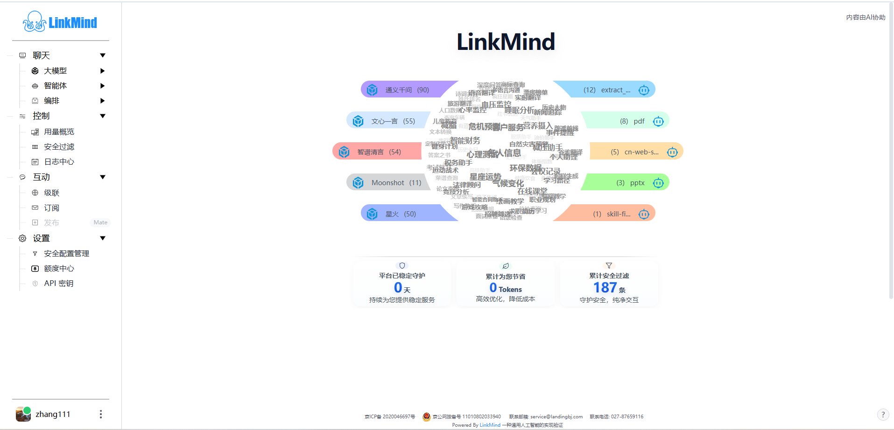

# Using the Web UI

English | [中文](index_zh.md)

Use the web console to try models and agents, upload knowledge, inspect usage, and manage runtime settings. Start the service using the [Installation Guide](../install_en.md), then open `http://localhost:8080`. For a remote deployment, use the address provided by your administrator.

## Complete your first conversation

1. Open the user entry at the bottom left and register or sign in. Enter the requested account details and captcha; click the captcha image to refresh it.
2. Open **Settings → API Keys** and follow [Models and API keys](models_en.md) to add a working configuration. For Landing, check the balance in **Settings → Credits** first.
3. Expand **Chat → LLM → Smart Q&A** and choose an available model in the selector.
4. Enter “Introduce LinkMind in one paragraph,” then click Send or press Enter.
5. Wait for the answer to finish, then check **Control → Usage Overview** for a corresponding record. Verify the answer and the record separately; see [Usage and logs](monitoring_en.md).

If a page opens but its model list is empty, check [model configuration](models_en.md) before repeatedly submitting the same message.

## Find a feature

| Task | Console entry | Guide |
| --- | --- | --- |
| Add keys or switch models | Settings → API Keys; the chat model selector | [Models and API keys](models_en.md) |
| Work with text, speech, images, or video | Chat → LLM | [Chat and multimodal features](chat_en.md) |
| Select an agent or import earlier conversations | Chat → Agents | [Agents](agents_en.md) |
| Upload knowledge, generate instructions, or inspect sources | Chat → Orchestration | [Knowledge and documents](knowledge_en.md) |
| Inspect usage, calls, and filtering | Control | [Usage and logs](monitoring_en.md) |
| Join or manage channels and connect an upstream server | Interactions | [Interactions and cascading](interaction_en.md) |
| Edit filtering rules, top up, or understand login and language | Settings; the user entry | [Settings and credits](settings_en.md) |
| Resolve login, request, upload, and other problems | Find the matching symptom | [Troubleshooting](troubleshooting_en.md) |

Screenshots show the Chinese interface and example data. Model names, accounts, balances, and statistics depend on your deployment.

## Understand menu states

- **Agent Server**: create and manage channels under Interactions → Publish. The Cascade settings entry is disabled.
- **Agent Mate**: configure an upstream interaction server and subscribe to channels. Publish is disabled and carries a Mate badge; use the corresponding Server console to create channels.
- Subscribe, Publish, Security Config Management, Credits, and API Keys require a signed-in UI session. An administrator can also require login for other menus.
- Available models and features depend on deployment configuration. A name or description does not establish that its backend is configured, reachable, or funded.

See [Settings and credits](settings_en.md) for login and menu behavior.

## Continue reading

This guide set is the home for page-level instructions. Use the [Installation Guide](../install_en.md) for startup commands, [Configuration Guide](../config_en.md) for configuration fields, [API Reference](../API_en.md) for HTTP parameters, and [Tutorial](../tutor_en.md) for external agent client integration and verification.

Version scope: these guides describe the Web UI at `main` commit `b696a7c7730a2899eb60b73376bb6a42af62da00`. Other branches and later versions may expose different menus. The document organization follows the [DeepSeek Harness Web UI guide](https://github.com/deepseek-ai/deepseek-harness/blob/master/docs/user/guide/index.zh.md); the instructions and capability boundaries describe LinkMind.

<!-- Maintenance: main@b696a7c; chat.jsp; js/nav.js promptNavs/loadNavBar/refreshInteractionPublishNavState; js/login.js. -->
