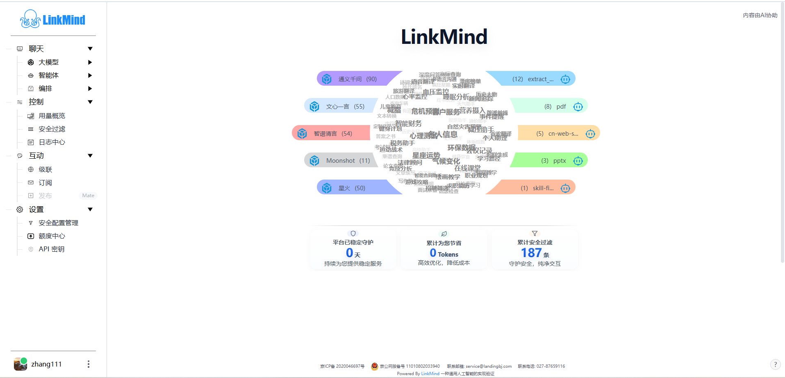

# 使用 Web UI

[English](index_en.md) | 中文

Web 控制台用于体验模型与智能体、上传资料、查看用量和管理运行设置。请先按[安装指南](../install_zh.md)启动服务，再打开 `http://localhost:8080`；远程部署使用管理员提供的地址。

## 完成第一次对话

1. 点击页面左下角的用户入口，注册或登录。按提示填写账号、密码和验证码；点击验证码图片可以刷新。
2. 进入 **设置 → API 密钥**，按[模型与 API 密钥](models_zh.md)添加可用配置。使用 Landing 时先到 **设置 → 额度中心**检查余额。
3. 展开 **聊天 → 大模型 → 智能问答**，在模型选择器中选择可用模型。
4. 输入“请用一段话介绍 LinkMind”，点击发送按钮或按 Enter。
5. 等待回答结束，再到 **控制 → 用量概览**查看本次调用对应的记录。模型回答和记录更新分别检查，参见[用量与日志](monitoring_zh.md)。

菜单能打开但模型列表为空时，先检查[模型配置](models_zh.md)，不要反复提交同一条消息。

## 找到需要的功能

| 你要做什么 | 页面入口 | 操作说明 |
| --- | --- | --- |
| 添加密钥、切换模型 | 设置 → API 密钥；聊天页模型选择器 | [模型与 API 密钥](models_zh.md) |
| 聊天、语音、图片或视频处理 | 聊天 → 大模型 | [聊天与多模态](chat_zh.md) |
| 使用智能体、导入历史对话 | 聊天 → 智能体 | [智能体](agents_zh.md) |
| 上传知识、生成指令、核对出处 | 聊天 → 编排 | [知识与文档](knowledge_zh.md) |
| 查看用量、调用与过滤记录 | 控制 | [用量与日志](monitoring_zh.md) |
| 加入频道、管理频道、连接上级 | 互动 | [互动与级联](interaction_zh.md) |
| 修改过滤规则、充值、了解登录和语言 | 设置；用户入口 | [设置与额度](settings_zh.md) |
| 处理无法登录、调用或上传等问题 | 按问题定位 | [常见问题](troubleshooting_zh.md) |

截图展示中文界面和示例数据；模型名称、账号、余额及统计值以实际部署为准。

## 理解菜单状态

- **Agent Server**：可在“互动 → 发布”创建和管理频道；“级联”设置入口置灰。
- **Agent Mate**：可设置互动级联服务器并订阅频道；“发布”入口置灰并带有 Mate 标识。创建频道请进入相应 Server 控制台。
- 订阅、发布、安全配置管理、额度中心和 API 密钥要求页面登录态；管理员也可以让其他菜单要求登录。
- 模型及能力入口取决于部署配置。名称或介绍出现，不代表相应后端已配置、联网或具备额度。

登录与菜单可见性说明见[设置与额度](settings_zh.md)。

## 继续阅读

本组文档集中维护页面操作。安装命令见[安装指南](../install_zh.md)，配置字段见[配置指南](../config_zh.md)，HTTP 参数见[API 参考](../API_zh.md)，外部 Agent 客户端的接入与验证见[教学演示](../tutor_zh.md)。

适用版本：本组文档按 `main` 提交 `b696a7c7730a2899eb60b73376bb6a42af62da00` 的 Web 控制台编写；其他分支或后续版本的菜单可能不同。文档组织参考 [DeepSeek Harness Web UI 指南](https://github.com/deepseek-ai/deepseek-harness/blob/master/docs/user/guide/index.zh.md)，操作与功能范围以 LinkMind 为准。

<!-- Maintenance: main@b696a7c; chat.jsp; js/nav.js promptNavs/loadNavBar/refreshInteractionPublishNavState; js/login.js. -->
