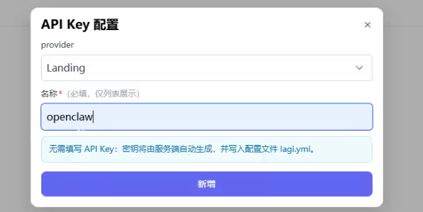
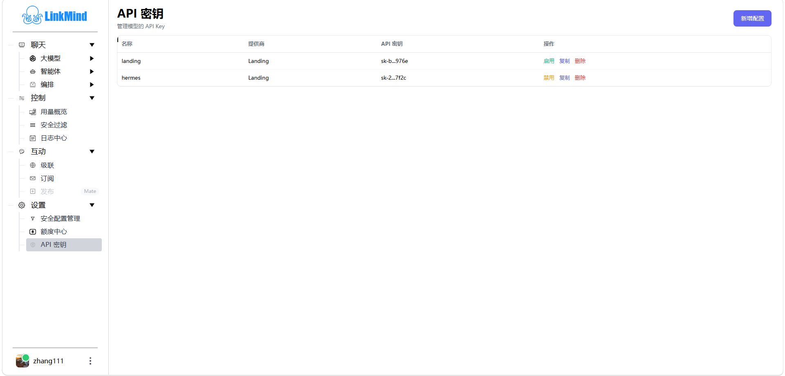

# Models and API keys

[中文](models_zh.md) | [Web UI guide](index_en.md)

Configure a working provider and credential before selecting a model for your task. **Settings → API Keys** manages credentials; the selector on the chat page controls the model sent with the current chat request. Check both.

## Add a model key

Sign in, open **Settings → API Keys**, and click **Add configuration**. Select a provider and enter a recognizable name, such as `team-chat`.

| Provider type | Required information | Check before use |
| --- | --- | --- |
| Landing | A name; the page does not require a manually entered API key, as the server creates one for the current account | The account service is reachable and Credits shows an available balance |
| Other built-in provider | A name and a real API key from that provider | The required model is enabled at the provider and has a corresponding deployment configuration |
| OpenAICompatible | A name, API key, and `model`; optionally `api_address` | The model ID matches the upstream service; follow the adapter's address requirements. The form example uses a full `/v1/chat/completions` URL |

Click **Add**, then check the name and provider in the list after the dialog closes. A successful addition confirms that configuration was saved; verify actual model access with a small request.

## Enable, copy, and delete

1. Locate the configuration. **Enable** is the action for an inactive entry; **Disable** is shown for an enabled entry.
2. Perform the action and check the refreshed row.
3. To supply a key to a configured client, click **Copy**. The list shortens the displayed key; the copy action retrieves the actual credential.
4. Check the name and provider before deleting. Afterwards, inspect the list and verify applications that used the configuration.

If the page indicates that it manages only cloud Landing keys and local keys are disabled, the deployment restricts local key editing and hides enable/disable actions. Ask the administrator to change local provider configuration.

A red key indicates that this process has recorded it as invalid. It is not the result of a fresh connectivity test. Its link opens Credits; use the upstream error to distinguish insufficient credit, permissions, and credential problems.

## Choose a chat model

1. Open **Chat → LLM** and choose Smart Q&A or another feature.
2. Choose a model from the selector at the top. Disabled options cannot be selected. A feature can show selectors for different model types.
3. Submit a small request appropriate to the feature. Ordinary chat sends the currently selected chat model with the request.
4. Recheck the selector after reopening the feature or refreshing the page.

If the configured console default chat model appears in the candidate list, the UI selects it first. Otherwise it uses the preference or default supplied by the server. This console default does not fill model parameters for all external API clients. Administrators use `functions.chat.console_default_model` to set this default and `general.local_api_key_editable` to control local key editing.

## Model preference scope

The current page has model selectors but no connected **Save preference** or **Clear preference** buttons. Selecting a model does not automatically call the preference-saving API. Treat it as the current selection, not a persisted account setting.

Preference save/clear capabilities are available to custom clients. Existing frontend helper functions associate preferences with a browser identifier; this is not cross-device account synchronization. Ask the administrator to maintain the console default if you need a fixed starting model.

## Verify the configuration

Depending on the provider, key management updates local configuration or remote Landing keys. Enabled backends and routing still determine whether a model participates in chat. The Landing route checks for external clients remain in the [Tutorial](../tutor_en.md#34-configure-credits-api-keys-and-routing).

See [model configuration](../config_en.md#models) for fields and key pools, the [API Reference](../API_en.md) for management interfaces, and [Troubleshooting](troubleshooting_en.md) for failed requests.

<!-- Maintenance: main@b696a7c; js/apikeys.js addApiKey/renderApiKeysRows; js/nav.js loadModelSelect/savePerference/clearPreference; chat.jsp model-prefences; PreferenceServlet.java; ApiKeyService.java. -->
