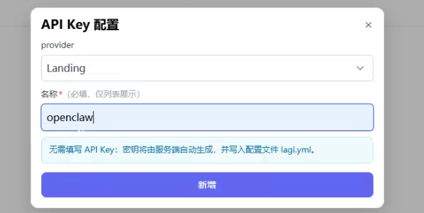
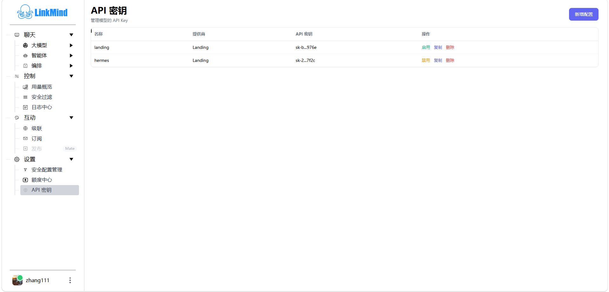

# 模型与 API 密钥

[English](models_en.md) | [Web UI 指南](index_zh.md)

先准备可用的提供方与密钥，再选择当前任务的模型。**设置 → API 密钥**管理凭据；聊天页的选择器决定当前聊天请求使用的模型，两者需要分别检查。

## 添加模型密钥

登录后进入 **设置 → API 密钥**，点击 **新增配置**，选择 provider 并填写名称。名称用于识别配置，例如 `team-chat`。

| 提供方类型 | 要填写的内容 | 使用前确认 |
| --- | --- | --- |
| Landing | 名称；页面不要求手工填写 API Key，服务端按当前账号创建 | 账号服务可访问，额度中心有可用余额 |
| 其他内置提供方 | 名称和该提供方的真实 API Key | 提供方已开通所需模型；部署中有对应模型配置 |
| OpenAICompatible | 名称、API Key、`model`；可填写 `api_address` | 模型 ID 与上游一致；地址按该适配器要求填写，表单示例为完整的 `/v1/chat/completions` 地址 |

点击 **新增**，弹窗关闭后在列表中核对名称与提供方。新增成功表示配置已保存，还需要用一条简单对话验证模型调用。

## 启用、复制和删除

1. 找到目标配置。行内显示 **启用**表示可以启用它；显示 **禁用**表示当前已启用。
2. 点击相应操作后重新查看列表，确认状态变化。
3. 需要把 Key 交给已配置好的客户端时，点击 **复制**。列表展示经过缩略的 Key，复制操作取得实际凭据。
4. 删除前确认名称和提供方；删除后检查列表，并验证使用该配置的应用。

如果出现“仅管理云端 Landing 密钥（本地密钥已关闭）”，当前部署限制了本地 Key 编辑，列表也不会提供启停按钮。需要调整本地提供方时联系管理员。

红色 Key 表示本进程曾记录其无效状态；它不是页面刚刚完成的联网检测结果。点击红色链接会进入额度中心，仍需结合上游错误判断是额度、权限还是凭据问题。

## 选择聊天模型

1. 进入 **聊天 → 大模型**，选择“智能问答”或需要的能力。
2. 从页面上方选择器选择模型；灰色选项不可选。不同能力可能出现不同类型的模型选择器。
3. 发出一条与该能力匹配的小样本请求。普通聊天会把当前选择的模型随请求发送。
4. 返回该能力页或刷新后，再检查选择器，避免沿用之前选择仍然有效的假设。

为控制台设置的默认聊天模型如果在候选列表中，会优先被选中；否则使用服务端返回的偏好或默认项。这个默认值不会替所有外部 API 调用填写模型参数。管理员通过 `functions.chat.console_default_model` 设置控制台默认模型，通过 `general.local_api_key_editable` 控制是否允许本地密钥编辑。

## 模型偏好的范围

当前页面提供模型选择器，但没有接出独立的“保存偏好／清除偏好”按钮，选择模型也不会自动调用偏好保存接口。不要把当前选择当作已持久化的账号设置。

偏好保存与清除能力供定制客户端使用，现有前端辅助函数按浏览器标识关联偏好；它不等同于跨设备账号同步。需要固定默认模型时，由管理员维护控制台默认配置。

## 确认配置生效

Key 管理会根据提供方更新本地配置或远端 Landing Key。模型是否参与聊天，还取决于启用的后端与路由。客户端接入 Landing 的配置检查保留在[教学演示](../tutor_zh.md#34-配置额度api-key-与路由)中。

模型字段和 Key 池见[配置指南](../config_zh.md#模型配置)，管理接口见[API 参考](../API_zh.md#api-key-管理接口)，调用失败见[常见问题](troubleshooting_zh.md)。

<!-- Maintenance: main@b696a7c; js/apikeys.js addApiKey/renderApiKeysRows; js/nav.js loadModelSelect/savePerference/clearPreference; chat.jsp model-prefences; PreferenceServlet.java; ApiKeyService.java. -->
