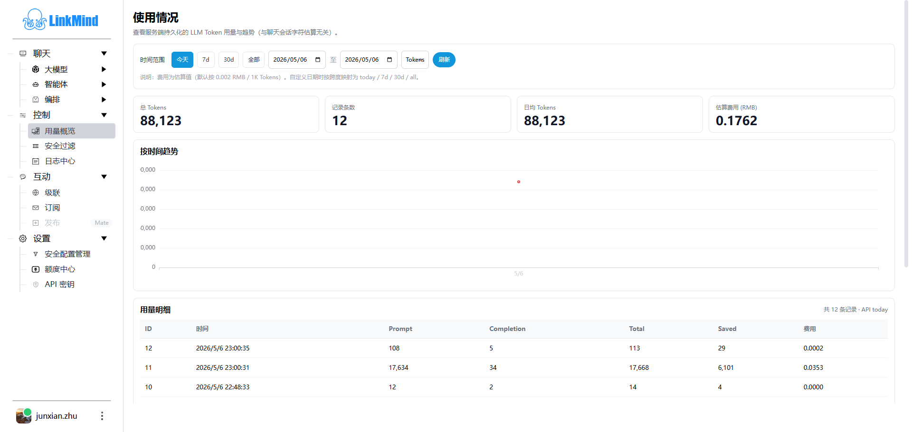
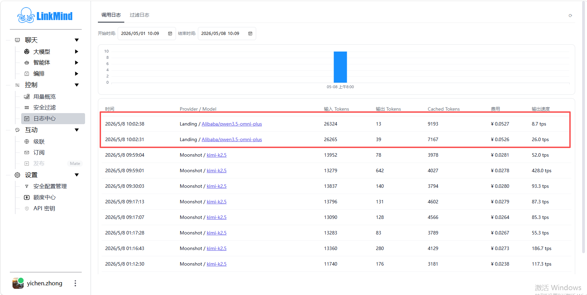

# Usage and logs

[中文](monitoring_zh.md) | [Web UI guide](index_en.md)

**Control** contains Usage Overview, Security Filter, and Log Center. Usage records describe calls stored by the current service. Credits shows the signed-in account's remote balance; they are not the same bill.

## Inspect Usage Overview

1. Open **Control → Usage Overview**.
2. Choose **Today, 7d, 30d, or All**, then refresh.
3. Inspect the summary cards and details. Use the previous/next controls for the 20-record pages.
4. Switch the trend selector between **Tokens** and **Cost**. Complete a small request and refresh to compare records.

| Metric | Interpretation |
| --- | --- |
| Total Tokens | Recorded total usage for the selected server range |
| Record count | Usage records, not distinct conversations or users |
| Daily average Tokens | The average calculated by the server for the selected range |
| Prompt / Completion / Total | Recorded input, output, and total token counts |
| Saved | Recorded savings; do not treat this directly as a provider billing discount |
| Estimated cost | Currently `Total / 1000 × 0.002` RMB, not model-specific billing |

Custom dates are mapped by their span to today, 7d, 30d, or all. **They are not an exact arbitrary-date billing query.** Check the API range shown next to the details. Server and browser date timezones may also differ.

The trend aggregates at most 8,000 detail records, while summary cards use a separate aggregate query. With large datasets they may differ. The page does not establish that all usage is isolated to the signed-in account.

## Inspect Log Center

Open **Control → Log Center**, select **Generation Logs** or **Filter Logs**, set start/end times, and refresh.

Generation Logs shows time, Provider / Model, input/output tokens, Cached Tokens, cost, and output speed. Locate the recent request by time and model. If it is missing, check the filter range and the service address used by the client.

Cost uses the same fixed estimate. When the backend does not provide output speed, the page displays output tokens divided by 1.5; do not use that fallback for actual performance comparisons. Missing Cached Tokens may also fall back to Saved.

The generation chart reads only the first batch of up to 200 records. The list pages through a server range, then applies browser-side time filtering, so charts, page counts, and visible rows may differ. Use server data for complete statistics or exact intervals.

Filter Logs shows filter names, actions, content, and timestamps. An empty list may display the legacy “no running tasks” message. The tab actually reads filter records; it is not an asynchronous-task manager.

## Inspect security filtering

1. Open **Control → Security Filter**, whose page heading describes fence monitoring.
2. Inspect total, today, and last-hour counts, plus the last-24-hour trend.
3. Check each record's time, filter, action, and matched content; the list displays 20 records per page.
4. Refresh manually or enable automatic refresh. It starts off and, when enabled, updates every 5 seconds.

The list reads at most the latest 1,000 records, and its chart is built from that set. Summary counts use a different query, so visible rows need not equal the historical total.

Although the cards use blocking-related labels, the data also includes actions such as mask and erase. Read the action column before concluding that an entire request was blocked. Edit rules using [Settings and credits](settings_en.md#manage-security-filters).

## Verify a call

Record the time and usage before a simple request, then refresh and compare the model answer, logs, and usage. For Landing, also check [Credits](settings_en.md#check-credits-and-top-up) for balance or transaction changes. Character estimates, the UI's fixed-price estimate, and screenshot values do not replace actual billing results.

External client verification remains in the [Tutorial](../tutor_en.md). See [Troubleshooting](troubleshooting_en.md) for missing records and chart differences.

<!-- Maintenance: main@b696a7c; js/tokenUsage.js; js/logs.js; js/fence.js; TokenStatisticsApiServlet.java; TokenStatisticsDao.java; FenceServlet.java. -->
