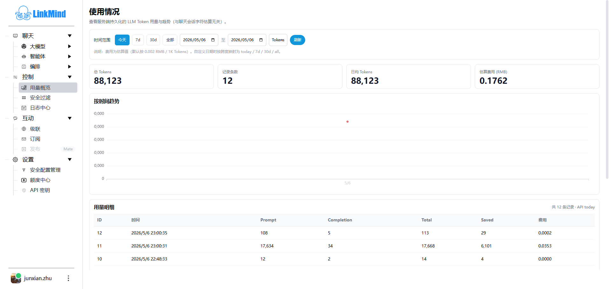
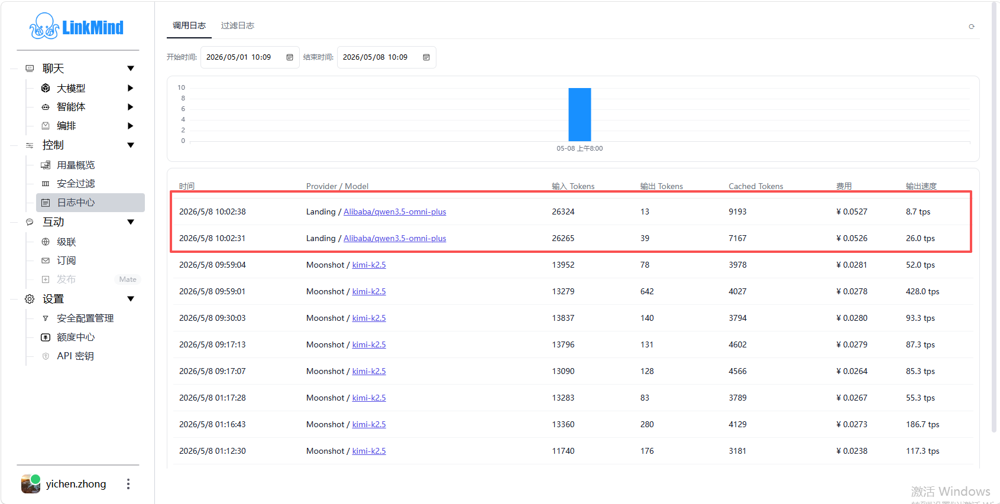

# 用量与日志

[English](monitoring_en.md) | [Web UI 指南](index_zh.md)

**控制**菜单包含用量概览、安全过滤和日志中心。用量记录反映当前服务保存的调用数据；额度中心显示的是登录账号的远端余额，两者不能直接当作同一张账单。

## 查看用量概览

1. 打开 **控制 → 用量概览**。
2. 选择 **今天、7d、30d、全部**，点击 **刷新**。
3. 查看统计卡片和用量明细，必要时用上一页、下一页翻页；明细每页 20 条。
4. 在 **Tokens／费用**选择器中切换趋势指标。完成一次小样本调用后，再刷新对比记录变化。

| 指标 | 如何理解 |
| --- | --- |
| 总 Tokens | 所选统计范围内记录的总用量 |
| 记录条数 | 用量记录数，不等同于独立会话数或用户数 |
| 日均 Tokens | 服务端按所选范围计算的日均值 |
| Prompt／Completion／Total | 记录中的输入、输出和总 Token 数 |
| Saved | 记录中的节省量，不应直接当成供应商账单优惠 |
| 估算费用 | 当前按 `Total / 1000 × 0.002` 元计算，不按实际模型价格计费 |

自定义日期目前按日期跨度映射为 today、7d、30d 或 all，**不是任意起止日期的精确账单查询**。以页面明细旁标出的 API 范围理解统计结果。服务端与浏览器的日期时区也可能不同。

趋势图最多汇总 8,000 条明细，统计卡片由独立汇总查询提供；大量数据下两者不一定一一对应。当前页面不能据此推定已按登录账号隔离所有用量记录。

## 查看日志中心

打开 **控制 → 日志中心**，选择 **调用日志**或 **过滤日志**，调整开始、结束时间后刷新。

调用日志列出时间、Provider／Model、输入和输出 Token、Cached Tokens、费用及输出速度。按时间与模型定位刚才的请求；没有记录时先检查筛选范围和实际接入的服务地址。

费用仍为固定单价估算。缺少后端输出速度时，页面会以输出 Token 数除以 1.5 生成显示值，不能用于真实性能对比。Cached Tokens 缺失时也可能使用 Saved 值作为后备。

调用趋势图只读取首批最多 200 条记录；列表按服务端范围分页，再应用页面时间过滤，因此图表、页数和当前可见行可能不同。需要完整统计或精确时间范围时，应通过服务端数据核对。

过滤日志展示过滤器、操作、内容与时间。空列表时可能出现“暂无进行中的任务”的遗留提示，这个标签页实际读取的是过滤记录，不是异步任务管理器。

## 查看安全过滤记录

1. 打开 **控制 → 安全过滤**，页面标题为 **电子围栏监控**。
2. 查看总量、今日、近一小时统计以及近 24 小时趋势。
3. 在监控日志中检查时间、过滤器、操作类型和匹配内容；每页 20 条。
4. 点击 **刷新**，或开启 **自动刷新**。自动刷新默认关闭，开启后每 5 秒更新。

列表最多读取最近 1,000 条记录，趋势图基于这批数据绘制。总统计与列表使用不同查询，不能要求列表行数等于历史总量。

页面使用“拦截次数”作为统计标题，底层也记录 mask、erase 等处理；应结合具体操作理解，不能把所有记录都当作整条请求被阻断。规则编辑见[设置与额度](settings_zh.md#管理安全过滤规则)。

## 验证一次调用

记录调用前时间和用量，完成一条简单对话后刷新，检查模型回答、调用日志和用量记录。如果使用 Landing，再到[额度中心](settings_zh.md#查看额度与充值)核对余额或交易变化。不要用字符数估算、页面单价估算或某个截图数值替代真实计费结果。

外部 Agent 客户端验证保留在[教学演示](../tutor_zh.md#36-对话验证与用量闭环)，记录缺失和图表差异见[常见问题](troubleshooting_zh.md)。

<!-- Maintenance: main@b696a7c; js/tokenUsage.js; js/logs.js; js/fence.js; TokenStatisticsApiServlet.java; TokenStatisticsDao.java; FenceServlet.java. -->
