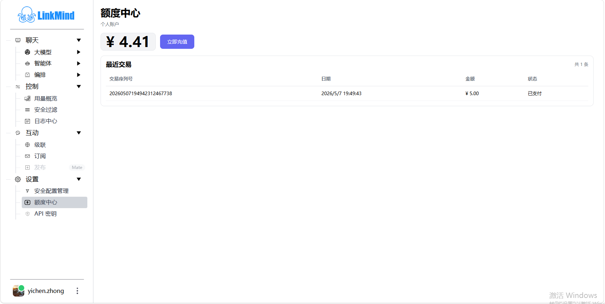

# Settings and credits

[中文](settings_zh.md) | [Web UI guide](index_en.md)

This page covers filtering rules, Credits, login, and interface language. Key operations are maintained in [Models and API keys](models_en.md).

## Manage security filters

Sign in and open **Settings → Security Config Management**. Use search and the type filter to locate existing rules. Prefer editing an existing rule over adding duplicate configurations of the same type.

1. Add a filter or edit an existing entry.
2. Choose a supported filter type.
3. For sensitive-word filters, enter a level and rules in each group; add or remove groups as needed. Other types use a rule list. Commas, Chinese commas, enumeration commas, semicolons, and newlines can separate rules; regular expressions are supported.
4. Save, check the success message, and review the refreshed list.
5. Send a request containing a harmless test marker and inspect **Control → Security Filter**.

| Type | Purpose |
| --- | --- |
| Input sensitive words `sensitive_input` | Inspect user input |
| Output sensitive words `sensitive` | Inspect model output |
| Priority `priority` | Participate in keyword-priority decisions |
| Stopping `stopping` | Participate in topic-ending or new-topic decisions |
| Continue `continue` | Participate in follow-up and context handling |

Sensitive-word group levels mean **1 block, 2 mask, 3 erase the matching text**. The UI labels level 1 as deletion; interpret it as blocking, distinct from the partial erasure at level 3. A harmless marker such as `demo_secret` at level 2 provides a simple mask test.

Save, edit, and delete update the database and immediately refresh runtime rules for subsequent requests to the service. Deletion has a confirmation dialog but no UI undo. Existing database rules take priority over YAML; YAML seeds the rules only when the database is empty. Editing YAML does not overwrite existing online rules.

Input blocking directly returns a filtering notice. Text already streamed to the browser cannot be retracted by a later match. See the [Configuration Guide](../config_en.md#filters) for rule definitions and [Security Guide](../security_en.md) for deployment boundaries.

## Check credits and top up

1. Open **Settings → Credits** and check the account, balance, and recent transactions.
2. To top up, click **Top Up Now**, enter an amount, review the total, and submit the payment request.
3. Pay using the returned WeChat QR code. On mobile, a returned payment link may also be available.
4. The page polls the payment result and refreshes the balance and transactions on success. Confirm the paid status and amount.

A QR code indicates an order was created. Confirm payment and balance updates separately. If you have paid but the page has not updated, reopen Credits and ask the administrator to check the transaction number and time instead of repeatedly creating equivalent orders.

Credits depends on the connected account and billing service. It does not show every external provider's balance, and the usage page's estimated cost is not a payment reconciliation figure.

## Sign in, restore a session, and sign out

Open the user entry to sign in. Registration requires a username, password, confirmation, and captcha. Click the captcha image to refresh it, and enter the new code after a failed attempt.

The default implementation depends on an external account service. When a login cookie exists, the page tries to restore the session, but that still requires the account service. Each cookie setting lasts 7 days and is refreshed after successful restoration; it does not provide offline login.

Choose **Sign out** from the user menu when finished. The page clears this browser's login information and reloads. Closing a tab does not sign out, and signing out here does not establish that every other device session was revoked.

Subscribe, Publish, Security Config Management, Credits, and API Keys always require UI login. The deployment setting `general.menu_login_required` determines whether other menus do. These prompts do not establish uniform administrator authorization on all backend APIs; see the [Security Guide](../security_en.md).

## Interface language

The interface prefers the browser's locally stored `app_lang`, then the browser language. Simplified Chinese and English are supported; other languages fall back to Simplified Chinese. The current page has no separate language-switch button.

Interface language affects menus and notices. Specify the desired language in your question to control the model's answer.

See [Troubleshooting](troubleshooting_en.md) for login, payment, and rule-saving problems.

<!-- Maintenance: main@b696a7c; js/filterConfig.js; FilterConfigService.java; SensitiveWordUtil.java; js/credits.js; js/login.js; UserServlet.java; UserService.java; js/i18n.js. -->
