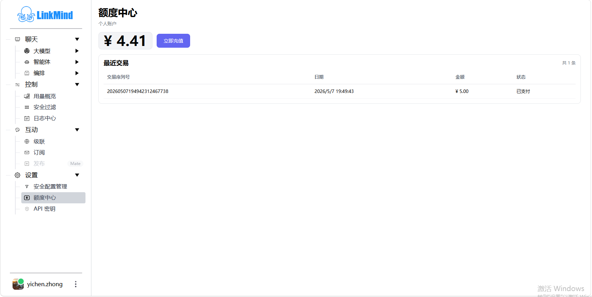

# 设置与额度

[English](settings_en.md) | [Web UI 指南](index_zh.md)

本页说明安全规则、额度中心，以及登录和语言行为。密钥的详细操作统一见[模型与 API 密钥](models_zh.md)。

## 管理安全过滤规则

登录后打开 **设置 → 安全配置管理**。使用搜索框和类型筛选定位现有规则；修改已有规则时优先使用 **编辑**，避免重复新增同类配置。

1. 点击 **新增过滤器**或目标配置的 **编辑**。
2. 选择系统支持的类型。
3. 敏感词类型在分组中填写级别和规则，可按需添加或删除分组；其他类型填写规则列表。支持逗号、中文逗号、顿号、分号或换行分隔，规则也支持正则表达式。
4. 点击 **保存**，确认成功提示并重新检查列表。
5. 使用不含真实敏感信息的测试词发送一次请求，在 **控制 → 安全过滤**核对效果。

| 类型 | 用途 |
| --- | --- |
| 输入敏感词 `sensitive_input` | 检查用户输入 |
| 输出敏感词 `sensitive` | 检查模型输出 |
| 优先级 `priority` | 参与关键词优先级判断 |
| 停止词 `stopping` | 参与话题结束或新话题判断 |
| 继续词 `continue` | 参与继续追问与上下文处理 |

敏感词分组的级别含义：**1 阻断、2 掩码、3 擦除匹配文本**。界面将级别 1 标成“删除”，应按阻断理解，不要与级别 3 的局部擦除混淆。可先使用测试词 `demo_secret`、级别 2，核对掩码效果。

保存、编辑和删除会更新数据库并立即刷新运行规则，影响当前服务后续请求。删除需要在确认框中确认；记录删除后没有页面撤销入口。已有数据库配置优先于 YAML，YAML 只在规则库为空时用于初始化；修改 YAML 不会覆盖已有在线规则。

输入阻断会直接返回过滤提示。流式输出已经送达浏览器的文字不能被后续匹配撤回。配置解释见[配置指南](../config_zh.md#过滤器)，部署边界见[安全说明](../security_zh.md)。

## 查看额度与充值

1. 进入 **设置 → 额度中心**，检查登录账号、余额与 **最近交易**。
2. 需要充值时点击 **立即充值**，填写金额，核对应付总额，再提交充值请求。
3. 使用返回的微信收款码完成支付；移动端在服务返回支付链接时可以通过该链接继续。
4. 页面会查询支付结果，确认支付成功后刷新余额与交易列表。检查交易状态为 **已支付**，并核对金额。

出现二维码只表示订单已创建；支付成功、账户余额更新需要分别确认。已经付款但页面未更新时，重新进入额度中心查看，并把交易号和时间提供给管理员核对，避免反复创建同额订单。

额度依赖部署连接的账号与计费服务。这里的余额不能代表所有自带 Provider Key 的余额；用量页的估算成本也不能直接用于充值对账。

## 登录、恢复与退出

点击用户入口登录；注册页需要用户名、密码、确认密码和验证码。点击验证码图片可刷新，失败后按新验证码重新填写。

当前默认实现依赖外部账号服务。已有 Cookie 时，页面尝试恢复登录，但恢复仍需要账号服务响应。登录 Cookie 每次设置的有效期为 7 天，恢复成功后会刷新，不代表无网络时也能离线登录。

退出时打开用户菜单，点击 **退出登录**。页面清除本浏览器的登录信息并重新加载；不要把关闭标签页当作退出，也不要把此操作理解成撤销所有设备的会话。

订阅、发布、安全配置管理、额度中心和 API 密钥始终要求页面登录态；其他菜单是否提示登录由部署设置 `general.menu_login_required` 决定。菜单提示不等同于所有后端接口已有统一的管理员权限控制，部署访问要求见[安全说明](../security_zh.md#访问控制与密钥)。

## 界面语言

界面优先使用浏览器本地保存的 `app_lang`，否则参考浏览器语言，支持简体中文与英文；其他语言回退简体中文。当前页面没有独立的语言切换按钮。

界面语言控制菜单和提示文字，不会替模型设定回答语言。需要英文或中文回答时，在问题中直接说明。

遇到登录、支付或规则保存问题时，参见[常见问题](troubleshooting_zh.md)。

<!-- Maintenance: main@b696a7c; js/filterConfig.js; FilterConfigService.java; SensitiveWordUtil.java; js/credits.js; js/login.js; UserServlet.java; UserService.java; js/i18n.js. -->
